# 纯净魔法从零部署

Mac 电脑从零部署 DMIT 与 Karing：服务器、电脑端和移动端配置教程

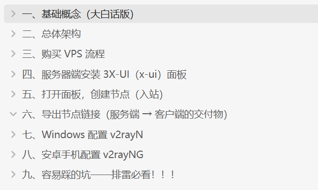

## 一、基础概念（大白话版）

### （一）先搞懂上网是怎么回事

你打开浏览器输入 `youtube.com`，为什么就能看到视频？

你的电脑  ──发送请求──>  youtube服务器  ──返回数据──>  你的电脑

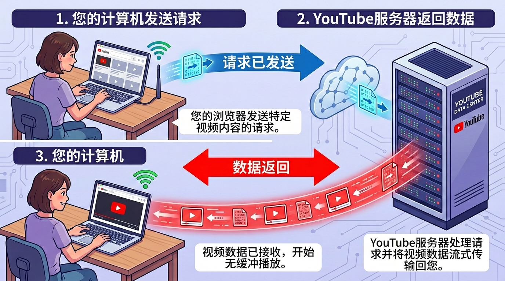

简单说：你的电脑是个"寄信人"， youtube 是个"收信人"，你们之间一来一回，就上网了。

### （二）IP 是什么

IP = 身份证号。每台联网的电脑都有一个独一无二的身份证号（例：`203.0.113.10`），用来标识"我是谁"。

网站也有身份证号。你访问 `youtube.com` 时，浏览器会先查"youtube的身份证号是多少"，然后才能发请求。

### （三）IPv4 / IPv6 是什么

| 类型 | 身份证号长这样 | 现状 |
| --- | --- | --- |
| IPv4 | `203.0.113.10` | 大多数网站都用它 |
| IPv6 | `2001:0db8:...` | 新版，号码更多，但有的网络不支持 |

不用纠结：教程全程用 IPv4，用不到 IPv6。

### （四）VPS 是什么（重点！）

VPS = 在云端租一台永远开机的电脑

你本地电脑关机，VPS 还在跑

VPS 可以在任何地方登录（公司、网吧、手机都行）

这台电脑归你全权控制，想装什么软件都行

通俗理解：相当于在云端养了一台 24 小时待命的"服务器"，专门帮你处理网络请求。

### （五）静态 IP 是什么

静态 IP = 固定不变的身份证号

动态 IP = 每次上网随机分配的身份证号

为什么要静态 IP？

你需要从公司/家里登录 VPS 管理它

如果 IP 天天变，你还怎么登录？

很多网站会检测 IP 稳定性，静态 IP 更不容易被封

### （六）机场是什么

|  | 机场 | 自建 VPS |
| --- | --- | --- |
| 谁提供的 | 商家搭建，你花钱买 | 自己搭建 |
| 节点数量 | 一堆国家可选 | 只有 1 个（你买的 VPS 所在地） |
| IP 状态 | 很多人共用，IP 容易"变脏" | 专属 IP，只有你一个人用 |
| 速度 | 高峰期可能卡 | 取决于你买的 VPS 线路 |
| 价格 | 每月 10-100 元 | VPS 每月约 10-100 元 |
| 稳定性 | 商家跑路就凉凉 | 只要 VPS 不跑路就没事 |

通俗理解：

机场 = 坐公交，人多挤、司机（商家）可能心情不好（不稳定）

自建 VPS = 自己开车，想怎么开怎么开（很稳定）

### （七）本文到底搭建的是什么东西（是不是 VPN）

官方叫法：VLESS + REALITY 协议（一种加密通信方式）

通俗叫法：自己搭的"科学上网通道"

是不是 VPN：

传统 VPN（如公司用的）确实是这个原理

但技术上不完全一样（协议不同）

效果一样：开着软件 → 走 VPS 通道 → 访问海外网站

效果一样：关掉软件 → 走本地网络 → 访问国内网站

### （八）机房 IP / 住宅 IP

| 类型 | 怎么来的 | 特点 | 适合谁 |
| --- | --- | --- | --- |
| 机房 IP | 云厂商数据中心分配 | 速度快、带宽大、价格便宜 | 大多数人（教程用的） |
| 住宅 IP | 家庭宽带分配 | 看起来像"真人"，不容易被封 | 需要高隐匿名性的人 |

>教程用机房 IP，普通人足够用，性价比最高。

## 二、总体架构

Windows 浏览器/应用

│（系统代理/PAC）

▼

v2rayN（本地 Xray Core）

│（加密通道：VLESS + REALITY 等）

▼

海外 VPS（Xray 服务端 + 3X-UI 面板）

▼

海外网站/服务（GitHub / YouTube / X / 服务器后台等）

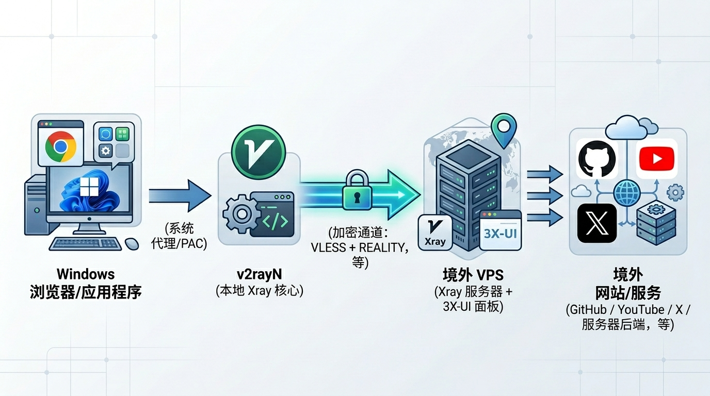

## 三、购买 VPS 流程

我比较了一堆VPS，最后选择了DMIT：https://www.dmit.io/aff.php?aff=18784

DMIT的优越之处在哪？以下是gemini给我推荐的理由：

1. 🚀顶级直连线路 (CN2 GIA / CMIN2)

这是 DMIT 最值钱的地方，也是你能“秒开 4K”的根本原因。

普通的服务器线路（公共高速）： 就像免费的国道，平时还能跑，一到晚上 8 点到 11 点的“晚高峰”（跨海光缆极其拥堵），所有人都在上网，这条路就会严重堵车。你的油管视频就会一直转圈圈，降到 480P 都卡。

DMIT Premium 线路（VIP 专属通道）： DMIT 花重金向中国电信/联通/移动购买了最高等级的企业级跨境专线（电信叫 CN2 GIA，移动叫 CMIN2，联通叫 AS9929）。这相当于你拥有了全天候不限速的 VIP 应急车道。不管晚高峰别人卡成什么样，你的网速依然坚挺如初，延迟极低且绝不丢包。

2. 🛡️ 极高的 IP 纯净度（告别验证码折磨）

很多便宜的 VPS 厂商，他们的 IP 段早就被黑客、发垃圾邮件的人搞烂了。如果你用那种 IP 上网，用 Google 搜索时会频繁跳出“寻找红绿灯、斑马线”的恶心验证码，访问 ChatGPT 更是直接被拒绝。

DMIT 提供的是优质的美国“原生 IP”。因为定价较高，自动过滤掉了很多乱搞的恶意用户，所以它的 IP 池非常干净。Google 信任你，各大 AI 平台信任你，日常使用体验极其丝滑。

3. ⚡ 强悍的硬件与超大带宽

很多便宜的 VPS 给的带宽只有可怜的 50Mbps 或 100Mbps。

DMIT 洛杉矶 Premium 套餐的带宽通常是 1Gbps 到 10Gbps 起步（相当于 1000兆 到 10000兆 宽带）！这意味着只要你本地的宽带跑得动，DMIT 的服务器就能毫无瓶颈地把数据喂给你，瞬间榨干你家路由器的极限。

4. 🏢 极高的稳定性

便宜的服务器经常会“突然失联”（俗称宕机），或者动不动就因为同一台母机上的邻居乱占 CPU 而导致你的机器卡死，你得经常去后台重启。

DMIT 的机器以坚如磐石著称。你买完配置好之后，只要按时续费，它几乎能在那里默默运行一整年都不需要你登录一次后台。这种“配完就忘，永远在线”的省心体验，是无价的。

💡 总结

💡 摘要

选择DMIT 9.99$/月（洛杉矶优化线路）。也就比机场贵了一倍，但是能享受到稳定快速的网络，我觉得还是蛮值的。但是DMIT经常缺货，所以这里还推荐两个vps，价格和质量成正比，大伙可自行选择：

搬瓦工：https://bandwagonhost.com/order/ecommerce/Los%20Angeles/USCA_2
voyracloud：https://www.voyracloud.com/?ref_code=KZJXH37H

下面以 DMIT 为例，依次完成套餐选择、系统选择、下单和 SSH 登录。

### （一）选套餐

| 项目 | 建议 |
| --- | --- |
| 机房位置 | 优先美西（洛杉矶）对中文用户常见延迟更低 |
| 线路类型 | 标注对大陆优化/高级路由的优先 |
| 带宽 | 1Gbps 足够 |
| 月流量 | 1TB 对单人开发+上传随便够用了 |
| IPv4 | 必须有（很多厂商额外 IPv4 要加钱） |

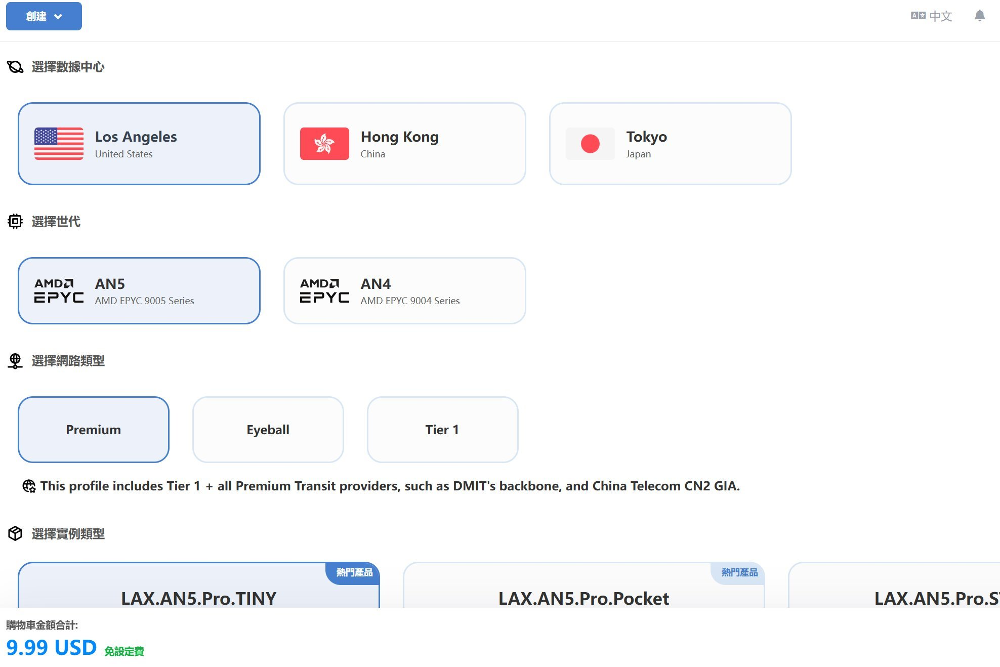

#### DMIT 缺货时，怎样对照备选套餐

本教程购买的是可以自己登录、安装 Linux 软件并部署节点的 VPS。购买前核对独立公网 IPv4、系统选项和服务器管理权限。机场订阅、现成代理节点或单独出售的 HTTP / SOCKS5 代理，不属于这里的 VPS 备选。

**截图基准：**DMIT 洛杉矶 → AN5 → Premium → LAX.AN5.Pro.TINY，9.99 美元/月；1 vCPU、2 GB 内存、20 GB SSD、1 个 IPv4、1000 GB 流量（截图标注双向计量）、1 Gbps 带宽。

下面是 2026 年 10 月 12 日查看官网选购页的对照。用于找套餐入口，购买时让 AI 重新核对当前价格、库存、付款周期和续费价格。

| 商家与选择路径 | 页面配置与价格 | 与 DMIT 的主要差别 |
| --- | --- | --- |
| [搬瓦工：E-Commerce VPS → Los Angeles → USCA_9 → 2 GB 档](https://bandwagonhost.com/order/ecommerce/Los%20Angeles/USCA_9) | 3 vCPU / 2 GB / 40 GB SSD；2 TB/月，2.5 Gbps。89.99 美元/季，或 299.99 美元/年。 | 内存相同，其他标称资源更多；页面标注 CN2 GIA、CMIN2 等优化线路，价格更高。 |
| [VoyraCloud：Cloud VPS → Standard → Los Angeles](https://www.voyracloud.com/pricing) | 2 vCPU / 2 GB / 40 GB；1 TB，200 Mbps。月付 9 美元。配置页可选 Debian 12.7。 | 内存、流量额度和预算接近；带宽较低，所查页面未给出与 DMIT Premium 对等的大陆优化线路说明。 |
| [VoyraCloud：Residential IP VPS → Standard → Los Angeles](https://www.voyracloud.com/pricing) | 2 vCPU / 4 GB / 60 GB；2 TB，200 Mbps。月付 15 美元。 | 商家标注为住宅 IP VPS，是另一类产品；内存更多，不能当作同等线路、同等带宽。 |

搬瓦工另有 1 GB 内存、20 GB SSD、1 TB/月的入门档，49.99 美元/季或 169.99 美元/年。可作为较低配置候选，但不要把它说成与截图的 2 GB 配置相同。VoyraCloud Cloud Standard 页面显示的 7.2 美元/月是年付优惠的月均价，当时配置页总额为 86.4 美元，并标注新用户优惠。

**给 AI：**先确认缺货的是哪个套餐，再比较同商家的合适套餐或上表备选。分别比较服务器资源、线路、带宽和实际付款金额；不存在完全对应的套餐，就明确告诉用户差在哪里。CN2 GIA 等是网络线路名称，不是自建节点的必备条件；如果改选普通线路，也要说明与截图路线的差别。不要只因价格接近或都有“VPS”字样就认定同等配置。

**选好商家后，先比较两档费用，再决定是否预留云端运行**

后续文档可能会更新在 VPS 上运行 Claude Code 的方案，把程序和项目放在服务器上，让运行环境和网络出口保持稳定。这对 VPS 的性能有要求，尤其是内存，费用可能会高一些。

截至 2026 年 10 月 12 日，[Claude Code 官方系统要求](https://code.claude.com/docs/en/setup#system-requirements)是 4 GB 及以上内存、x64 或 ARM64 处理器，支持 Debian 10+、Ubuntu 20.04+ 等系统。1 GB、2 GB VPS 低于这项内存要求。Claude Code 在自己电脑上运行、VPS 只负责网络时，不需要因此升级 VPS。

**给 AI：**用户选好商家后、购买套餐前，先查当前官方运行要求，再在这家商家里找满足要求的最低价合适套餐或内存升级项。保留已选地区和线路条件，分别列出“文档推荐套餐”和“预留云端运行的套餐”的配置、实际付款金额、付款周期与差价，查完再问用户是否需要。选 DMIT 就查 DMIT，选搬瓦工就查搬瓦工，选 VoyraCloud 就查 VoyraCloud。

“文档推荐套餐”以本教程 DMIT 截图配置为对照，不是网站最便宜的套餐。用户不需要预留，或暂时不确定，就继续文档推荐套餐，不自动降到 1 GB，也不反复劝升级。若要同时跑浏览器、Docker、项目构建或多个会话，再按实际任务估算额外资源。

### （二）选系统

推荐：Debian 12

原则：脚本兼容性强、系统干净

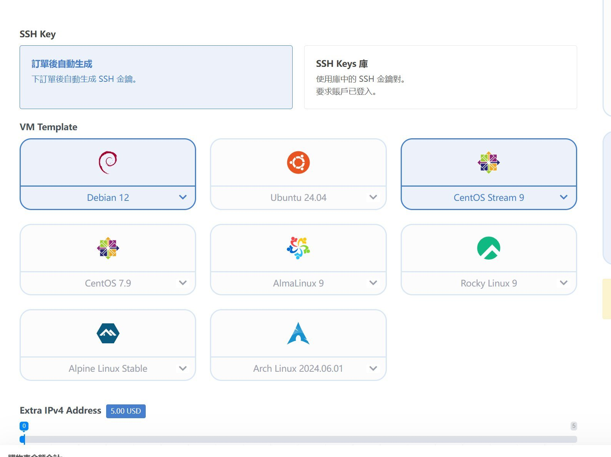

### （三）Hostname 报错（可能会遇见，没遇见就跳过）

报错：`Invalid Linux Hostname` / `The hostname for your server is invalid.`

报错 ：'Linux 主机名无效'/'你的服务器主机名无效。'

原因：hostname 只能用字母数字和 `-`，不要空格/中文/特殊符号。

可用示例：

`vps.yourname.com`

`node-01.example.net`

### （四）下单

选择第一个基础套餐就够用了。

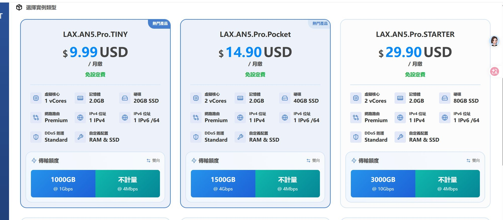

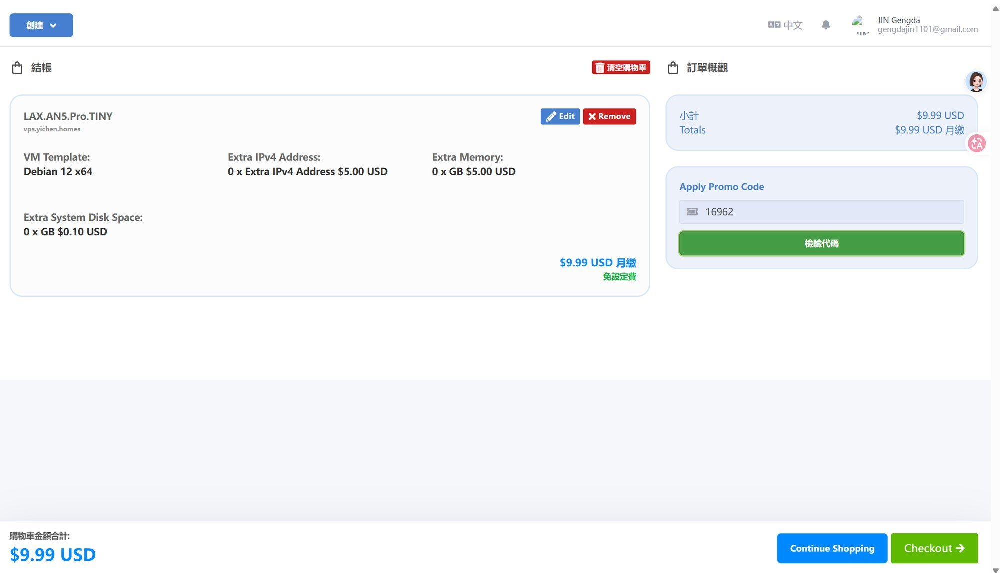

### （五）拿到 VPS IPv4 和 SSH 登录凭证

下单成功后，你需要在控制台拿到这两个东西：

1. 拿到 VPS 的 IPv4 地址

登录DMIT 控制台→ 进入 Services / 产品列表 → 你的 VPS → 详情页

在详情页找到字段：Primary IPv4 / IPv4 Address

记录这个 IPv4（这是你后续所有动作的"服务器地址"）

2. 拿到 SSH 登录凭证：根据控制台实际提供的方式，使用 Root 密码或 SSH 私钥。

分支 1：厂商给的是 Root 密码

在开通邮件或控制台找到：Root Password（或让你 Reset Root Password）

分支 2：厂商给的是 SSH 私钥 .pem

步骤 1：下载私钥

控制台里点击 获取 SSH 金钥 / Download SSH Key

下载 `.pem` 文件

Mac 用户可以先把下载的 .pem 私钥保存在“下载”文件夹，记下实际文件名和路径。下面以 ~/Downloads/id_rsa.pem 为例；文件名不同，请替换成自己的路径。

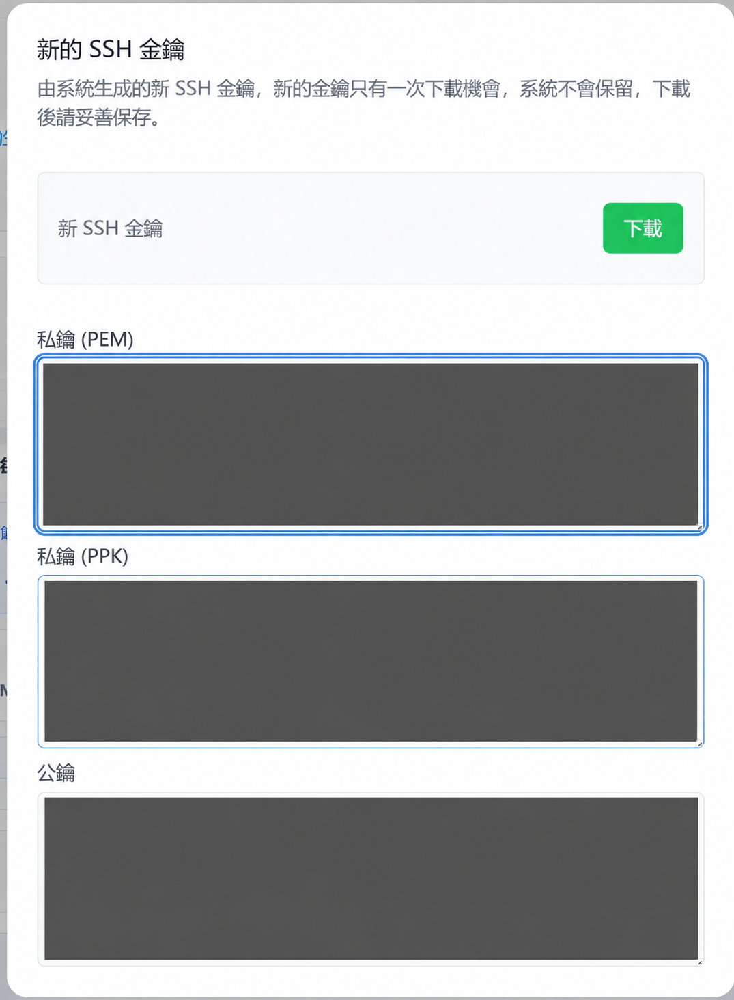

### （六）Mac：在终端连接 DMIT

打开 Mac 的“终端”。以下命令中的“你的服务器IP”替换成 DMIT 控制台显示的 IPv4 地址。

如果控制台提供的是 Root 密码，执行：

```bash
ssh root@你的服务器IP
```

首次连接时确认服务器地址和提示的主机指纹；确认无误后输入 yes。随后输入 Root 密码，输入时终端不显示字符属于正常现象。

如果控制台提供的是 .pem 私钥，先限制私钥文件的访问权限，再用私钥登录：

```bash
chmod 600 ~/Downloads/id_rsa.pem
ssh -i ~/Downloads/id_rsa.pem root@你的服务器IP
```

请使用私钥的实际保存路径。出现 UNPROTECTED PRIVATE KEY FILE 或 bad permissions 时，先确认 chmod 600 处理的正是登录命令所用的那份私钥。

看到 Debian 欢迎信息，且提示符变成类似 root@vps:~#，就说明已登录服务器。Mac 用户可直接继续第四章。

### （七）Windows：连接与私钥权限处理（Mac 用户跳过）

使用 Root 密码时：

打开Windows PowerShell 执行：

```bash
ssh root@<你的IPv4>
```

首次连接会提示指纹确认：输入 `yes`

输入 Root 密码（输入时不回显，正常现象）

使用 SSH 私钥时：

放到固定位置（例：`D:\Users\你的用户名\Desktop\id_rsa.pem`），不要弄丢

步骤 2：用私钥登录 VPS

打开PowerShell （windows终端，不懂的话直接给丢给codex让他做）执行：

```bash
ssh -i D:\Users\你的用户名\Desktop\id_rsa.pem root@<你的IPv4>
```

首次连接同样会提示指纹确认：输入 `yes`

步骤 3：处理 Windows 经典报错 - UNPROTECTED PRIVATE KEY FILE

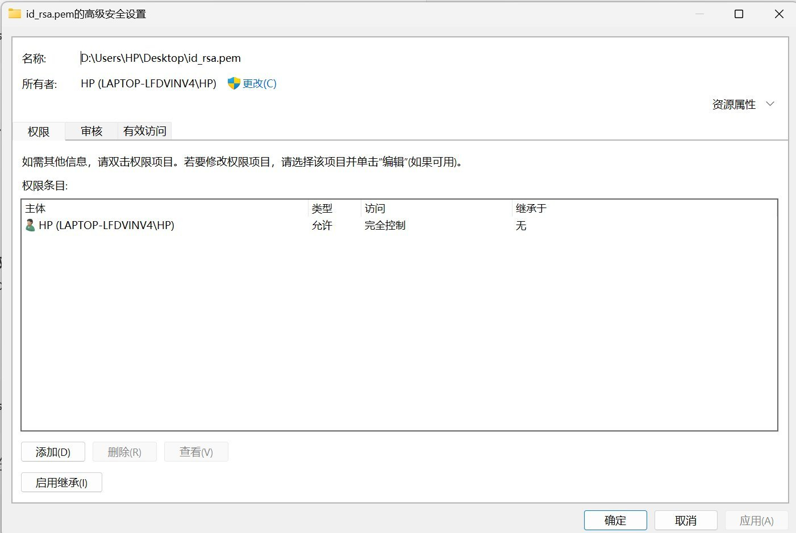

修复流程：

右键 `id_rsa.pem` → 属性

安全 → 高级

点击 禁用继承 → 选择 删除所有已继承的权限

点击 添加 → 选择主体 → 选你当前 Windows 用户

勾选 完全控制 → 确定保存

修复完成后，重新执行登录命令：

```bash
ssh -i D:\Users\你的用户名\Desktop\id_rsa.pem root@<你的IPv4>
```

登录成功标志：看到 Debian 欢迎信息，提示符变为：

root@vps:~#

3. 容易踩的坑

| 现象 | 原因 | 解决 |
| --- | --- | --- |
| `usage: ssh ... destination` | 命令只写了 `-i key.pem`，没写 `root@` | 补全命令 |
| `Are you sure you want to continue connecting?` | 首次写入 known_hosts | 输入 `yes` 即可 |
| `UNPROTECTED PRIVATE KEY FILE` / `bad permissions` | .pem 文件权限太松 | 按上面步骤修复权限 |
| `Permission denied (publickey)` | 私钥被忽略（通常就是上一个权限问题未修好） | 先修复权限再重试 |

## 四、服务器部署与面板配置

### （一）更新系统环境

成功登录后，先执行以下命令，让系统保持最新，并安装必备的下载工具：

```bash
apt update && apt upgrade -y
```

```bash
apt install curl wget -y
```

### （二）安装 3x-ui 可视化面板

我们要安装一个叫 3x-ui 的控制面板，它能让你在网页上用鼠标点点点就能建好节点，不用敲复杂的代码。

1. 执行安装脚本

在终端中复制并运行以下一键脚本：

```bash
bash <(curl -Ls https://raw.githubusercontent.com/mhsanaei/3x-ui/master/install.sh)
```

2. 初始交互设置

脚本运行中途会停下来问你几个问题：

是否自定义账号密码和端口？ 输入 y 并回车。

设置用户名：输入你想要的登录名（比如 admin），回车。

设置密码：输入你想要的密码，回车。

设置面板端口：输入一个你喜欢的数字（极其重要，请看下方踩坑指南）。

💣 【新手踩坑记录 1：随便填了一个超大端口号】症状：提示安装完成，但面板根本没启动。

真相：计算机的端口号有效范围是 1 到 65535。如果你随手填了一个 98765，面板程序会直接崩溃报错。

避坑指南：建议设置在 10000 到 65000 之间，且避开常见的 80、443 等端口。比如设置成 8899。

💣 【新手踩坑记录 2：把数字填到了 y/n 的问题里】症状：系统问你 Are you sure... [y/n] 时，你输入了刚刚想好的端口号 8899，结果直接退出了。

真相：只要看到中括号里是 [y/n]，系统就只认英文字母 y (是) 或 n (否)。

补救措施：如果这一步弄砸了，直接在终端输入 x-ui 回车调出主菜单，选择 9. Change Port 重新设置端口，然后选择 11. Start 启动面板。

### （三）安装器中的 SSL 提示与登录信息

安装器版本不同，交互提示和菜单编号可能不同，以实际菜单文字为准。如果提示申请 SSL 证书，DMIT 教程中的选择方式如下：

选择 Let's Encrypt for IP Address

选择  让我们加密 IP 地址

IPv6：留空跳过（enter）

ACME HTTP-01 端口：默认 80（enter）

按 HTTP-01 方式申请时，需要确保服务器的 80 端口可从外网访问。安装结束后保存下面五项信息，后续优先使用安装器输出的完整 Access URL：

Username（用户名）

Password（密码）

Port（端口）

WebBasePath（Web 基础路径）

Access URL（最终登录地址）

### （四）打通网络与防火墙（最容易卡关的地方）

如果安装器输出的 Access URL 打不开，先检查服务器防火墙是否放行了面板端口（下面以 8899 为例）。后面创建节点时，节点端口也需要按实际配置检查放行。

在终端输入 x-ui 回车调出菜单，选择 22. Firewall Management（防火墙管理）。

💣 【新手踩坑记录 3：找不到 ufw 命令】症状：在防火墙菜单里选择放行端口，系统却报错 /usr/bin/x-ui: line 829: ufw: command not found。

真相：Debian 纯净版系统默认没有安装 ufw 防火墙管理软件。

避坑指南：在防火墙菜单下，先输入 1 (Install Firewall) 并回车，系统会自动帮你安装好。安装完后，再输入 3 (Open Ports)，然后输入你的端口号（如 8899），看到 Rule added 就说明放行成功了。

💣 【新手踩坑记录 4：浏览器打不开，以为被 GFW 墙了】症状：防火墙放行了，但浏览器依然转圈打不开。

真相排查：不要盲目猜疑！打开测试网站 👉 https://ping.pe，输入 IP:端口 测试。如果下面表格里全球（包括 China）都是绿色的 successful，说明服务器网络完美畅通！

如果 ping.pe 显示端口可达，但本机浏览器仍打不开，继续检查本机代理设置、实际访问的协议和完整路径。优先使用安装器输出的 Access URL：输出为 https:// 时保留 HTTPS，不要套用 HTTP 示例。

### （五）登录面板（寻找隐形的门）

在浏览器打开安装器输出的完整 Access URL。下面说明遗漏安全后缀路径时出现 404 的情况。

💣 【新手踩坑记录 5：绝望的 404 Not Found】症状：满怀期待地在浏览器输入 http://107.150.xxx.xxx:8899，结果网页秒开，但上面赫然写着 404 page not found。

真相：恭喜你，这其实是天大的好消息！这说明网络完全通了，只是 3x-ui 为了防止黑客扫描，默认开启了“安全后缀路径”**。它把自己藏在了一个随机路径后面。

避坑指南：回到终端，输入 x-ui 调出主菜单。

选择 7. Reset Web Base Path，输入 y 确认重置。

屏幕上会显示出你的新路径，比如：Web base path has been reset to: 0VwkFPwU3Ywdw0xaqI。

把新的 Web Base Path 放到面板地址末尾，并保留实际使用的协议和端口。仅在面板确实使用 HTTP 时，示例才是 http://你的IP:8899/0VwkFPwU3Ywdw0xaqI/；使用 HTTPS 时按安装器输出的 HTTPS 地址填写。

使用安装时设置的面板账号和密码登录。

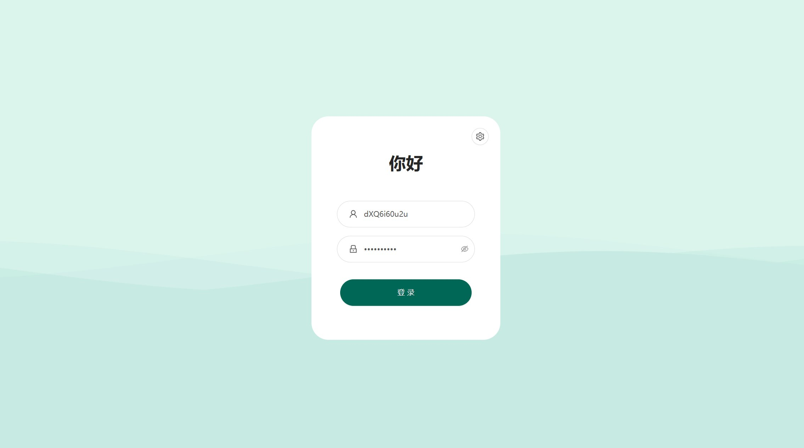

## 五、创建 VLESS + Reality 节点

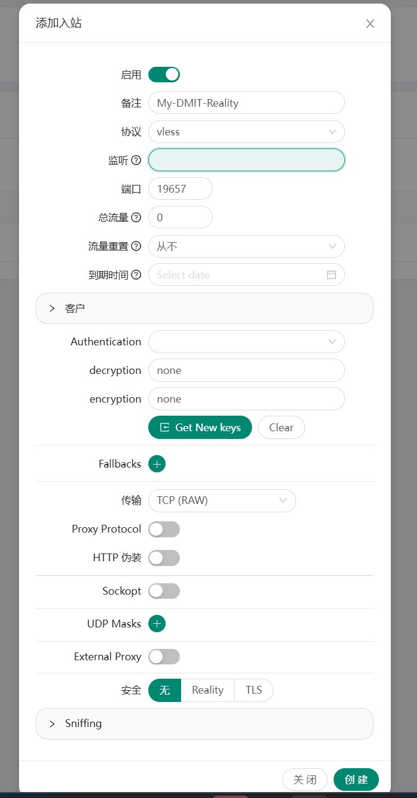

进入面板后台，这就是最后一步了。按以下步骤精准配置：

在左侧菜单点击 “入站列表 (Inbounds)”。

点击 “添加入站” 按钮。

核心参数设置：备注：随便写，比如“洛杉矶主力节点”。

协议 (Protocol)：选择 vless。

端口 (Port)：随便填一个不冲突的四位数或五位数（比如 8555，千万别填你的面板登录端口）。

传输层 (Network)：选择 tcp。

安全 (Security)：勾选启用 Reality （这是目前防封锁最强的技术）。

流控 (Flow)：如果在选项里能看到，选择 xtls-rprx-vision（如果没有或者找不到，可以留空不管）。

目标网站 (Dest) / SNI：填入一个支持 TLS 1.3 的国外大厂域名，比如填入 www.oracle.com:443 或 www.microsoft.com:443，SNI 框填 www.oracle.com。


💣 【新手踩坑记录 6：忘记生成加密密钥】症状：照着填完后无法保存，或者连上没网。

真相：Reality 协议需要一对独一无二的“公钥和私钥”来进行加密伪装，默认框里是空的。

避坑指南：在设置页面里，务必点击一下那个绿色的 Get New Cert 按钮！点完后，“公钥”和“私钥”框里会自动填入长长的一串乱码字符。

确认无误后，滑动到页面最下方，点击蓝色的 “添加” 按钮保存。

回到“入站列表”，找到你刚建好的这一行，点击最右侧的 “操作” -> 选择 “复制链接”。

🎉 恭喜！ 此时你的剪贴板里已经复制好了一段以 vless:// 开头的超长代码。这就是通往自由世界的终极钥匙！你只需要把它导入到任意代理客户端（如 Karing、Clash 等）中，就可以开始畅游网络了。

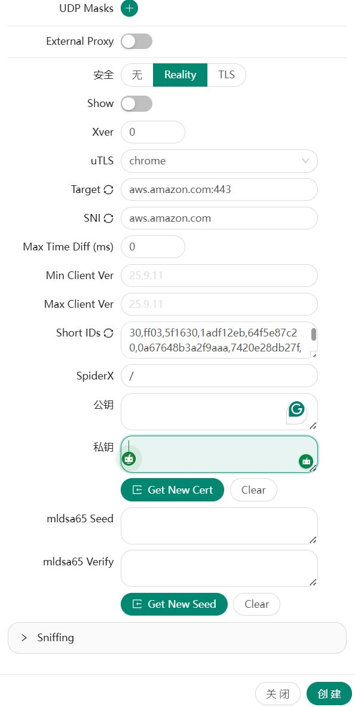

## 六、导出节点链接（服务端 → 客户端的交付物）

在入站列表里找到刚创建的入站：操作 → 复制链接

得到一个以 vless:// 开头的长链接。

这串链接包含：服务器 IP、端口、UUID、公钥、SNI、指纹等。

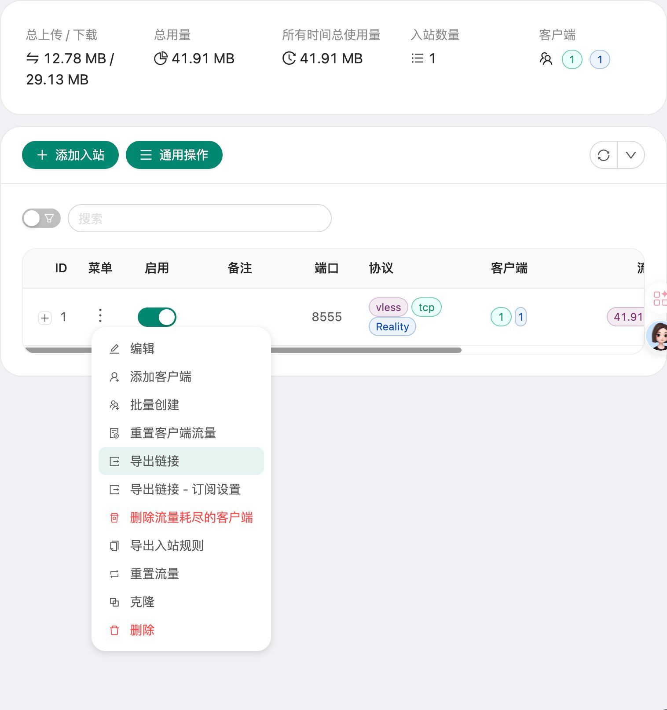

## 七、Windows 配置 v2rayN或者Mac配置Karing

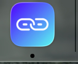

为啥Mac我不用clash verge？

因为clash verge这玩意儿不支持导入vless链接，要先创建yaml文件，才能导入，很麻烦，karing一键导入比较简单

下面仅仅展示win版本的v2rayN如何下载，karing是同理的办法，如果不会，可以问下任何Ai，然后按照下面的思路下载下来即可。但是karing的导入方法会单独介绍。

### （一）下载版本选择

在github里面下载：

https://github.com/2dust/v2rayN/releases

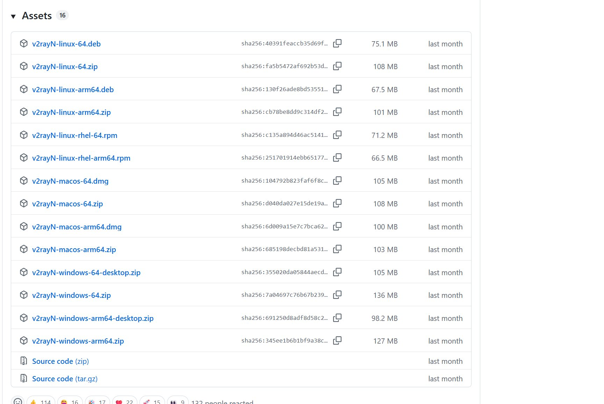

你会看到的四类资产：

文件名 适用情况

windows-64.zip 普通 Intel/AMD 电脑（推荐）

windows-64-desktop.zip 可能依赖本机 .NET 环境

windows-arm64.zip ARM 设备

windows-arm64-desktop.zip ARM 设备 + 桌面版

选择规则：普通 Intel/AMD 电脑选 windows-64；desktop 版本可能依赖本机 .NET 环境，为减少变量，优先用更"开箱即用"的打包版本——所以选择windows-64.zip

### （二）解压与目录放置

解压到固定目录（例：D:\Apps\v2rayN\）

不要长期放 Downloads（容易被清理误删）

### （三）必做：强制管理员运行

否则"系统代理"可能表面切换了，实际没接管。

做法：右键 v2rayN.exe → 属性 → 兼容性 → 勾选 以管理员身份运行此程序

### （四）导入节点

导入方式（稳定）：菜单 → 从剪贴板导入批量 URL

导入成功标志：列表出现那条节点（地址=VPS IP，端口=你设置的入站端口）。

### （五）开启系统代理（让全机走通道）

底部状态栏设置：

设置项 选择 意义     系统代理 自动配置系统代理 让全机流量走通道   路由 绕过大陆（Whitelist） 国内站点直连，海外站点走 VPS

国内站点直连（省流量、速度更快）

海外站点走 VPS

### （六）连通性验证（用你实操里最可靠的信号）

方法：点击一下右下角的“当前延迟”。

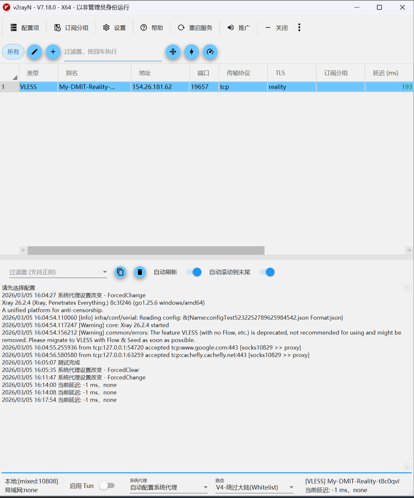

v2rayN 测试延迟：出现 非 -1 的 ms 数字（例：161ms）

下面为错误-1ms：

日志出现：accepted tcp:www.google.com:443 [socks -> proxy]

国内分流出现：[socks -> direct]


### （七）底部状态栏全解

v2rayN 软件最下方的那一排状态栏，是决定你电脑怎么上网的核心区域。从左到右分为四个模块：

模块一：本地端口信息区

本地: [mixed:10808]

局域网: none

本地：10808 是 v2rayN 在你电脑上开的"内部收发室"。你电脑里的浏览器、软件想翻墙，都会把数据先送到这个门牌号里。

局域网：如果是 none，说明只有你当前这台电脑能翻墙。如果开启允许局域网连接，同一 Wi-Fi 下的手机、iPad 就能跟着一起翻墙。

模块二：启用 Tun（底层强接管模式）

这是一个物理开关，默认是灰色的（关闭状态）。

什么时候不需要开？ 日常刷网页、看 YouTube、用电报 (Telegram)，保持关闭最省系统资源。

什么时候必须开？玩外服 PC 游戏时：游戏客户端通常不听"系统代理"，开启 Tun 能强制游戏流量走专线

用微软商店 (UWP 应用) 时：Windows 商店有时打不开，开启 Tun 可以强制接管

遇到死活翻不了的奇葩软件时：打开 Tun 就能强行带它翻墙

模块三：系统代理（日常总开关）

这是你每天最常点击的下拉菜单，相当于水管的总闸门。

选项 作用 什么时候用     自动配置系统代理（红色） 开启翻墙 日常必备，选它！   清除系统代理（黑色） 关闭翻墙恢复正常网络 想关闭翻墙时   不改变系统代理（黑色） 软件运行但不接管网络 高手用，普通用户永远别选

模块四：路由（智能交警）

这是决定你"国内网速卡不卡"、"国外网速快不快"的核心大脑。

模式 作用 什么时候用

V4-绕过大陆 (Whitelist) 智能分流：国内 IP 直连，国外 IP 走 VPS 365天保持选它就对了！

V4-全局 (Global) 全部流量都走 VPS 临时访问冷门国外网站，用完立刻切回

黑名单 (Blacklist) 靠人工维护的名单 千万别选，已经过时了

通俗理解：

绕过大陆模式 = 顺丰包邮（国内走本地，国外走专线）

全局模式 = 寄到美国再转国内（所有东西都强制走专线，慢死）

终极配置

不管怎么折腾，平时让底部栏保持这个状态，就是最完美的"战斗形态"：

设置项 状态     启用 Tun 关闭（灰色）   系统代理 自动配置系统代理（红色）   路由 V4-绕过大陆(Whitelist)

设置好这三个，你就可以把 v2rayN 最小化到右下角托盘，永远不用再管它了！

特殊情况：使用Antigravity，把tun模式和全局打开！！！

### （八）Mac配置Karing

先在github把karing下载下来，可能开始需要你一些授权，给一下就好了

点击“添加配置”


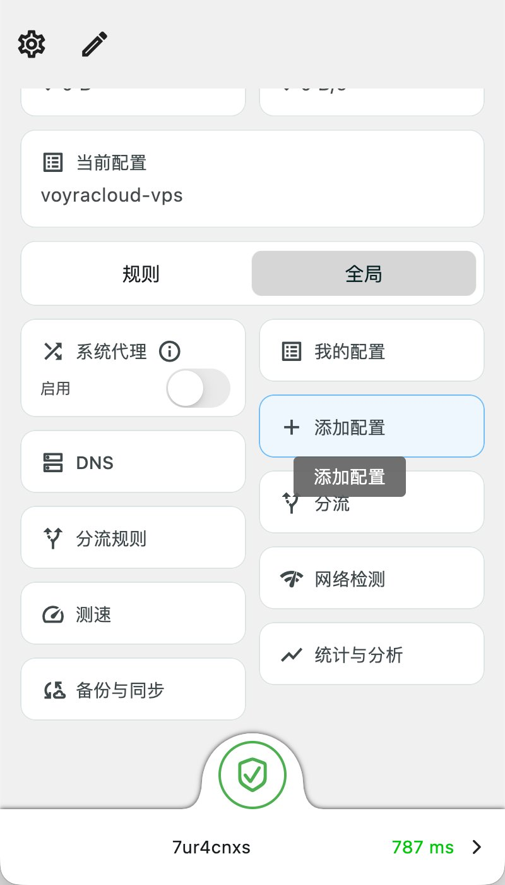

然后从剪贴板导入刚才复制的vless链接，即可啦。

我其实还有一个疑问：为什么我没有打开“系统代理”按钮，就能科学上网了？

然后搜了下Ai：原来是karing开启了tun模式，然后再按照一定的规则分配流量，非常适合小白哈哈哈。

1. 真正的“总开关”是那个大绿盾牌

看你截图的最下方，有一个巨大的绿色盾牌图标。只要这个盾牌是绿色的，就代表 Karing 的核心代理引擎已经在底层强行接管了你 Mac 的网络。

2. “系统代理” vs “TUN 模式”的区别

系统代理（你关闭的那个开关）： 这是一种“君子协议”。打开它，其实只是在 Mac 的系统设置里填入了一个代理地址。它等于是告诉各个软件：“请大家自觉把流量交给我”。但是，很多软件（比如终端命令行、部分游戏、甚至一些顽固的国内软件）是不遵守这个协议的，它们会绕过系统代理直接连网。

TUN 模式 / VPN 模式（Karing 正在悄悄用的）： 这是一种“底层强力接管”。当底部的绿盾牌亮起时，Karing 会在你的 Mac 上虚拟出一张网卡。你的 Mac 发出的所有流量（不管软件听不听话），都会被强行吸入这张虚拟网卡，然后再由 Karing 决定是直连还是走你的洛杉矶节点。

**三、线路断了就让 Claude 断网，绝不自动直连。**

这块一定注意，你平时走代理用 Claude，某天节点断了，代理客户端会切到直连，Claude 那边看到的却是你的 IP 从美国瞬移回了国内。

正确的做法是，给 Claude 的流量单独指定线路，这条线路失败时直接拒绝连接，不许自动换节点、更不许直连。检查一下你的分流规则，claude.ai 和 [api.anthropic.com](https://api.anthropic.com/) 这些域名有没有可能落到 DIRECT 上，兜底规则是不是直连。

## 八、安卓手机配置 v2rayNG导入vless链接

在电脑端成功搭建好 VLESS+REALITY 节点后，将节点同步到手机上是最简单的。只需扫个码，手机就能使用配置好的。

### （一）下载客户端

在电脑浏览器中访问 v2rayNG 的官方 GitHub 发布页：https://github.com/2dust/v2rayNG/releases

找到最新版本，强烈建议下载：v2rayNG_x.x.x_arm64-v8a.apk这是完美适配目前 99% 安卓手机的 64 位版本，体积小、运行快

如果手机非常老旧无法安装，请改下载 universal.apk 全能版

将下载好的 .apk 文件通过微信"文件传输助手"或其他方式发送到手机

在手机上点击安装，如果系统提示"未知来源风险"，选择"允许"或"继续安装"

### （二）一键导入节点（扫码法）

最快捷的方法是直接扫描电脑屏幕上的二维码。

电脑端准备二维码：

登录 3X-UI 面板后台

点击左侧的"入站列表"

找到建好的 VLESS 节点，点击最右侧的 操作 → 选择 二维码

手机端扫码导入：

打开手机刚安装好的 v2rayNG 软件

点击屏幕右上角的 + 号

选择 扫描二维码 (Import configuration from QRCode)

授予软件相机权限后，用手机镜头对准电脑屏幕的二维码

瞬间，节点就会出现在手机屏幕的列表中

### （三）正确启动连接

不要急着点连接，正确的"激活"姿势是关键。

选中节点：用手指轻轻点击刚导入的节点名称中部区域

连接服务器：点击屏幕右下角灰色的按钮第一次连接时，安卓系统必定会弹出全屏提示框，询问是否允许"创建 VPN 连接"

必须点击确定或允许！

连接成功标志：右下角按钮变成绿色或带有对勾

手机最顶部的状态栏出现了一把小钥匙（VPN 图标）

### （四）测试连通性

点击右上角的 三个点 (⋮) → 选择 测试全部配置真连接（或 Tcping）

如果节点下方出现了一排绿色的数字（例如 160ms），说明通道已彻底打通

可以直接打开 YouTube App 测试了

### （五）终极优化设置（解决卡顿）

如果发现看 YouTube 一直转圈圈，或者国内 App（微信、淘宝）变慢了，不是服务器慢，而是 v2rayNG 的默认设置需要调整。

### 第一步：设置正确的路由模式（必须做）

点击 v2rayNG 左上角的 三条横线（菜单）→ 进入 设置 (Settings)

找到 预定义规则 或 路由设置，必须选择：

绕过局域网及大陆地址 (Bypass LAN and mainland China)

效果：国内 App 走原本的 5G/Wi-Fi，不消耗流量且速度最快；只有国外 App 才会走专线。

### 第二步：确认运行模式为 VPN

在设置里，确保工作模式是 VPN 而不是 Proxy Only。

VPN 模式才能全局智能接管需要翻墙的 App

Proxy Only 模式下，YouTube 等大部分 App 根本不认识代理

### 第三步：开启"分应用代理"（终极杀招）

如果觉得还不够干脆，或者某些国内银行 App 依然报错：

在"设置"里找到 分应用代理 (Per-app Proxy)

开启它，进入应用列表

只勾选需要翻墙的软件（如 Chrome、YouTube、Twitter、Telegram 等）

保存返回

效果：只有打勾的软件才会经过专线，没打勾的软件完全不知道 VPN 的存在，手机网速和没开翻墙软件时一模一样！

### 第四步：防系统杀后台

安卓系统为了省电，经常在后台偷偷断掉 VPN。

进入手机系统 设置 → 应用管理 → 找到 v2rayNG → 在电池优化/省电策略中设为 无限制（不优化）。

完成以上设置后，手机将拥有和电脑一样稳定、随时满速看 4K 的极致体验！

## 九、容易踩的坑——排雷必看！！！

### （一）两个代理抢控制权

Windows 系统代理只有一个控制位

机场软件可能会在退出时"顺手清掉系统代理"，导致 v2rayN 没接管

处理：彻底退出机场软件后，在 v2rayN 里重新设置 自动配置系统代理，必要时点"重启服务"。

### （二）-1ms / none 的常见原因

原因 说明     服务端端口没通 防火墙/安全组/iptables   REALITY 握手失败 时间偏差   客户端没管理员权限 系统代理没接管   公钥私钥未生成 我真实踩的坑

### （三）在 Windows PowerShell 里敲 iptables

错误原因：iptables 是 Linux 命令，只能在 SSH 登录后的 VPS 里敲。

你踩到的表现：PowerShell 报 && 分隔符无效、iptables 不认识。

正确做法：先 ssh root@IP 进入 root@vps:~# 再执行。

### （四）Let's Encrypt 证书申请失败

常见原因：80 端口不通/被占用。

处理要点：确保 VPS 外网能访问 80；安装时选默认 80。

### （五）"关掉 v2rayN 就没网"

正常现象。隧道客户端就是本机入口；关掉等于断开通道。

正确习惯：不退出，放托盘后台运行；退出时明确选择"退出"还是"最小化"。

