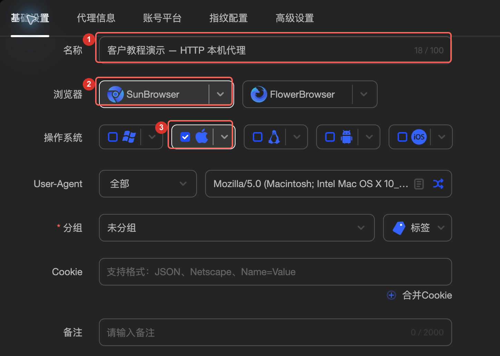
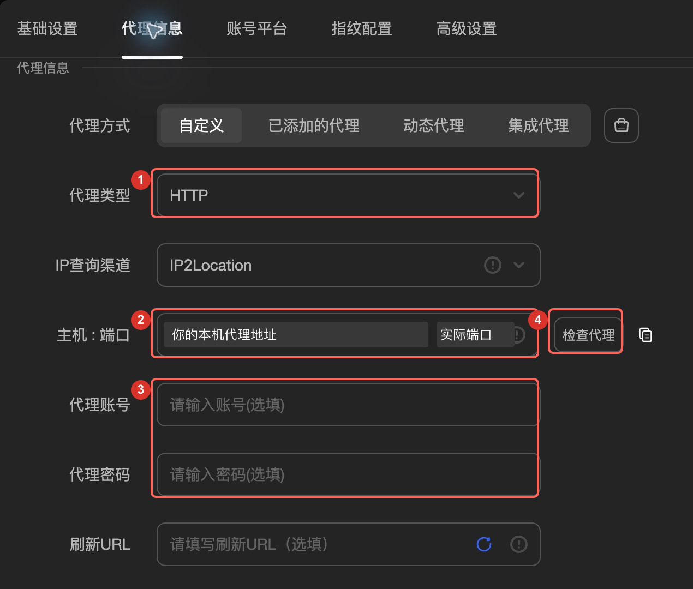
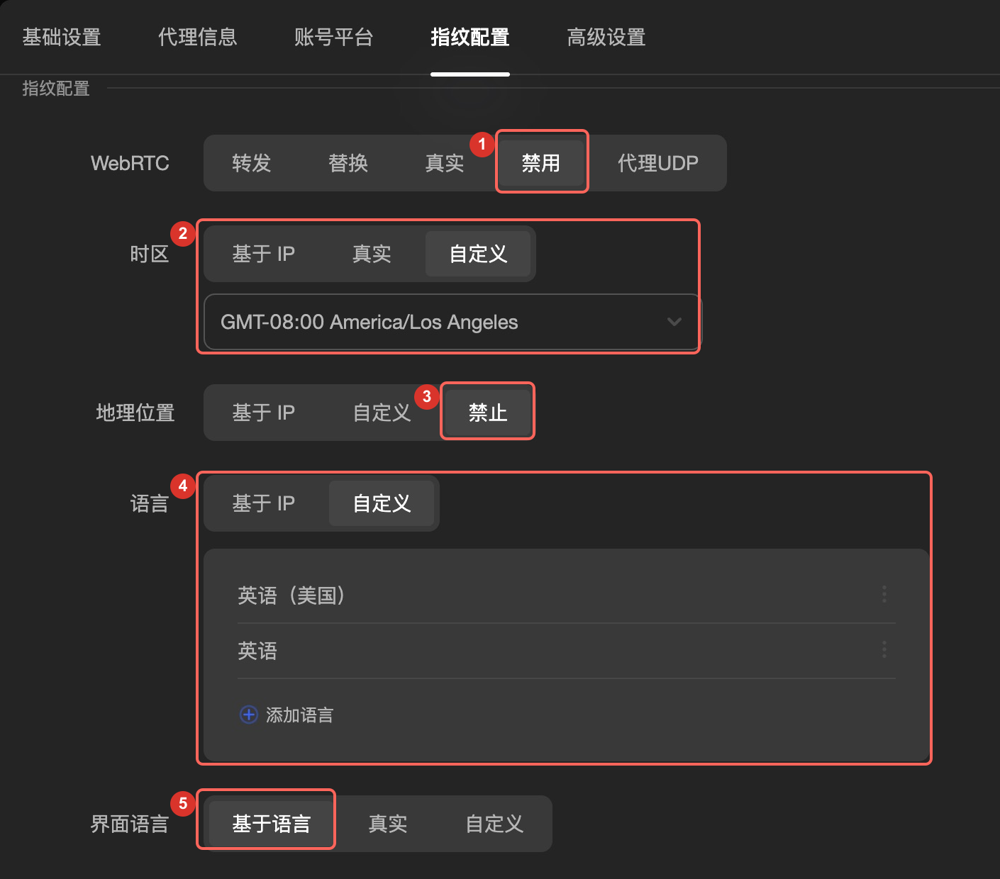
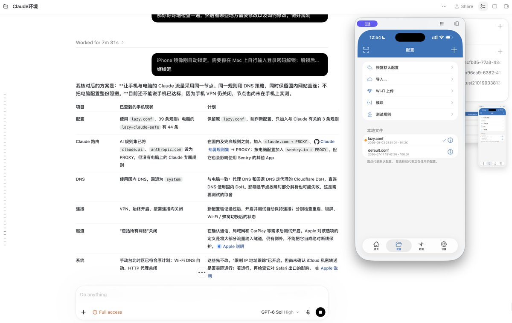

# 指纹浏览器与 iPhone 网络配置

按[统一控制层](17-workflow-controller.md)阶段推进：`browser` 完成电脑 AdsPower，完成后进入 `phone_proxy` 配置手机。进入每个阶段时一次展示该阶段适用的全部原图，配中文说明与当前起点。

## 1. 电脑端：AdsPower 配合本机代理

### Claude 桌面版、Claude Code 和 AdsPower 分别做什么

**这套流程完成后，您可以用 Claude 桌面版，也可以用 Claude Code。**先分清这三个工具：

- **Claude 桌面版**：下载安装到电脑上的 Claude 软件，打开就能直接对话。
- **Claude Code（CLI）**：在电脑“终端”里使用的 Claude 编程工具，用来帮您写代码、改项目。
- **AdsPower 指纹浏览器**：现在要配置的独立浏览器环境，用来处理电脑网页里的 Claude 登录、相关邮件链接，以及桌面版或 Claude Code 弹出的浏览器授权链接。授权完成后回到 Claude 软件或终端继续使用。

**关于 Claude 桌面版，给您同步两边真实情况：**
- 有人担心，Claude 桌面版可能要求更多电脑权限、读取更多设备信息，从而增加账号被封的风险。
- 我们已经交付的用户中，也有不少人反馈：一直在用 Claude 桌面版，目前使用正常。

按您的使用习惯和接受程度自由选择即可；首次登录与订阅按后面的手机流程完成。

**连接顺序：AdsPower → 本机 HTTP 代理入口 → Mac Karing（或 Windows v2rayN）→ VPS → 网站。**本机代理类型优先选 **HTTP**（混合端口同样选 HTTP）；确认 HTTP 不可用时再改用实测可用的 SOCKS5 备选并记录原因。

### 1.1 确认本机 HTTP 代理入口

确认电脑客户端已按[网络教程](01-network.md)完成新旧 VPN 交接（系统代理关闭、TUN 开启、全局代理指向目标 VPS 节点，且 Codex 能正常回复）。Mac Karing 如遇握手异常，先按[网络教程第十节](01-network.md#十karing-reality-握手失败)修通。

只读检查本机代理配置与监听端口，确认实际可用的本机 HTTP 监听地址与端口（如 `127.0.0.1:3067`）及是否需要认证，并用该入口发起 HTTPS 请求核对出口与目标 VPS 一致，记录地址和端口供下一步填写。

### 1.2 新建 AdsPower 环境并填写 HTTP

**AdsPower 免费版完全够用，直接按免费版界面点击左上角「新建环境」手动填写**（无需开通付费版，也无需打开 `API & MCP`）。新建一个专门的环境，保留原有日常环境。

① 名称填「Claude 登录授权」；② 浏览器选 SunBrowser；③ Mac 选 macOS，Windows 选 Windows，浏览器内核选当前支持的稳定版本。

切换到「代理信息」，代理方式选「自定义」：

| 位置 | 填写内容 |
| --- | --- |
| ① 代理类型 | 选 **HTTP**（混合端口同样选 HTTP）。 |
| ② 主机与端口 | 填第 1.1 节核对到的本机代理地址与实际端口（如 `127.0.0.1` 与实际端口）。 |
| ③ 代理账号、密码 | 本机入口无认证则留空；有入口认证则填该入口凭据。 |
| 刷新 URL | 留空。 |
| ④ 检查代理 | 点击后确认连接成功、返回出口地区与目标 VPS 一致。 |

### 1.3 时区、语言与浏览器设置

切换到「指纹配置」，按以下清单一次配齐：

1. **WebRTC**：选「禁用」。
2. **时区**：先按节点所在城市配置（如洛杉矶 `America/Los_Angeles`），使用城市时区自动处理夏令时；手机阶段按第 2.3 节确认“跟随节点／台北”后，电脑、手机和 AdsPower 统一采用所选时区。
3. **地理位置**：选「禁止」。
4. **语言**：浏览器语言可选「英语（美国）」与「英语」或保留中文，界面语言选熟悉的中文即可；日常直接用简体中文和 Claude 交流（想改英文界面时电脑和手机一起改，并提前了解系统菜单会变英文）。
5. **硬件参数**：Canvas、WebGL 图像、AudioContext、媒体设备、ClientRects、SpeechVoices 噪音全部选「关闭」；**WebGL 元数据、WebGPU、CPU 和内存全部选「真实」**。

**点击「确定」保存前，一次性核对完整清单**：代理已选 HTTP 并检查通过，WebRTC 禁用、地理位置禁止、时区正确、噪音全关、WebGL 元数据／WebGPU／CPU／内存全部为「真实」。确认齐全后再点「确定」，然后在环境列表点击「打开」。

### 1.4 配好后先检查，再进入手机

在新打开的 AdsPower 窗口内完成以下检查（**电脑网络配置阶段已完成 1 次断线测试，AdsPower 浏览器阶段不再做断线测试**）：

| 检查项 | 完成标准 |
| --- | --- |
| 实际出口 | 在新环境打开 [Ping0](https://ping0.cc/) 确认出口与目标 VPS 一致，隐藏完整 IP 后保存脱敏截图到 `.local/`，记录时间、设备、环境、节点、地区、ASN、IP 类型、风控值、原生 IP 和共享人数。 |
| IPv4 / IPv6 | 分别核对两种地址族，确认无绕行出口；无 IPv6 出口直接记为“不可用”。 |
| DNS / WebRTC | 确认 DNS 查询符合客户端规则，WebRTC 已禁用且无其他公网出口暴露。 |
| 时区 / 语言 | 检测页读到的时区与已保存配置一致。 |

**三站参考评分（分别记录数值与检测时间，达标即进入下一步；轻微偏离如 79／35 照常推进，大幅偏离先复查，见[确定性执行层](14-scripted-execution.md#三站结果与建议)）：**

| 网站 | 本教程建议参考值 |
| --- | --- |
| [NetCoffee](https://ip.net.coffee/claude/) | 约 80 分或更高，越高越好 |
| [Ping0](https://ping0.cc/) | 风险值低于 30（优先低于 25），越低越好 |
| [Scamalytics](https://scamalytics.com/ip) | 查询当前代理出口 IP，风险值低于 10，越低越好 |

交给 Codex 的检查参考话术：

> 请检查我刚新建的 AdsPower 环境：核对本机 HTTP 入口经目标节点访问网页，检查出口 IPv4／IPv6、DNS、WebRTC、时区与语言，记录 NetCoffee、Ping0、Scamalytics 三站结果并保存 Ping0 脱敏截图（浏览器阶段无需再做断线测试）。遇到验证码让我本人完成。

### 1.5 浏览器验收完成后，直接进入手机

电脑 AdsPower 验收完成后，直接进入第 2 节配置手机网络，按控制层依次完成：手机网络配置 → 电脑与手机时区和定位设置 → 手机网络验收 → 美区 Apple ID 准备与等待安排 → 保持节点开启下载官方 Claude App → 手机 Google 登录 → Apple 内购 Pro → 核对订单与权益，结束交付。

日后在电脑使用 Claude Code 时，把默认浏览器弹出的完整授权链接复制到已配置的 AdsPower 环境完成授权，再回到终端继续使用。安卓用户在手机网络验收后走[安卓官网 Google Pay 分支](11-android-web-pay.md)。

## 2. 手机端：Codex 配合 iPhone 镜像配置网络

**电脑网络和 AdsPower 验收后，直接接续手机代理、时区与定位、手机网络验收，再完成手机登录和订阅。**进入手机阶段时主动向客户讲清三件事：
1. 手机只用于**首次登录和 Apple 礼品卡内购订阅**（避开国内银行卡网页付款受限的问题，后续如需退款也走 Apple 入口）；
2. 订阅完成后，**平时全部回到电脑的 Claude 桌面端或 Claude Code 使用**；
3. 手机节点连上后，**下一步立刻把电脑、手机和 AdsPower 的时区统一成一致**，不会出现时间对不上的情况。

客户询问“主要用电脑，手机一定要配吗”或担心时区不一致时，直接用以上三点正面解答并继续推进手机配置。

### 2.1 按电脑平台选择手机带做方式

- **Windows＋iPhone**：使用本章图解逐步带做，每轮先标明操作设备（「现在只操作 iPhone」或「现在在 Windows 电脑上操作」），合并给 1～3 个相连动作及预期页面结果。电脑负责展示节点二维码与核对出口，手机负责小火箭、Safari 与 App Store 操作。
- **Mac＋iPhone**：优先尝试 **Codex Computer Use + iPhone 镜像**（核对同一 Apple 账户与双重认证、Wi-Fi／蓝牙开启、设备靠近与锁屏状态，按实际报错修复权限）。**若 Mac 桌面控制（Computer Use）启动异常在核对权限或重启一次后仍报错崩溃，或设备／地区不支持镜像，立即说明原因并直接切为简洁的手动合并步骤（每轮 2～3 个连续动作），快速推进。**

密码、验证码、Face ID、系统授权和付款由用户本人完成；节点凭据通过本机二维码导入，保存在本机 `.local/`。

### 2.2 导入节点并设置小火箭全局路由

**iPhone／iPad 统一默认使用 Shadowrocket（小火箭）**，与整套扫码、全局路由、DNS 和微信分流图解完全对应。把电脑端部署的同一条 VPS 服务器节点通过本机二维码导入小火箭并核对参数（使用服务器节点本身，区别于电脑 AdsPower 的本机 `127.0.0.1` 入口）。已有小火箭直接复用；尚未安装时衔接美区 Apple ID 流程准备小火箭（仅在客户主动指定使用已装的其他客户端时核对等效设置）。

选中导入的目标节点，**将「全局路由」设为「代理」**，开启连接并确认系统 VPN 已连接。

| 全局路由模式 | 说明 |
| --- | --- |
| 代理 | 将 VPN 接管且未排除的流量全部送到选定节点（本教程登录与订阅期间默认选用）。 |
| 配置 | 按配置文件规则分流（用于需要微信直连等单应用分流场景）。 |
| 直连 / 场景 | 直连走本地网络；场景按网络条件自动切换策略。 |

开启「代理」并连接后，按第 2.3 节完成时区与定位设置，再按第 3.1 节验收手机出口、三站评分、IPv6／DNS 与排除路由（**手机阶段不做断线测试**）。

#### 2.2.1 小火箭全局超时：先试 Chrome 140

检测页和其他网页正常、仅微信图片异常时直接看第 2.2.3 节；刚改过端口或切换配置导致失联时先看第 2.2.2 节恢复。其余小火箭全局超时、节点连不上或网页打不开时，直接先给客户首个尝试步骤：

> 有用户反馈过“小火箭 TCP 测试有延迟，但 CONNECT 一直超时，商店也下载不了”。我们先试一个调整：打开小火箭当前节点的设置，找到 **TLS 指纹**，先记下原来的值，再改成 **Chrome 140**，保存后重新连接，全局路由仍选「代理」。然后重测 CONNECT、手机网页和刚才失败的操作，告诉我有没有恢复；找不到该选项把当前设置页截图发我（遮住节点地址和密钥）。

执行要点：先记原值、只改 TLS 指纹一项并保存重连；同一节点与网络下用 CONNECT 和新 HTTPS 出口请求复测，有效即保留并继续手机验收，无改善则恢复原值，再依次核对节点参数（地址、端口、UUID、Flow、SNI、公钥、Short ID）、小火箭日志、服务端状态与 DNS。

#### 2.2.2 断线测试后恢复端口，手机仍无法联网

适用场景：客户此前自行改过节点端口、做过断线测试或切换配置文件，操作后网页仍打不开。先给客户两个恢复动作：

> 1. 打开小火箭首页当前选中的那条节点，点右侧 ⓘ 进入编辑页，核对端口已恢复为原服务端口（如 443），点保存退出后重新进入回读确认。
> 2. 记下当前路由模式与配置文件名（保留已有 DNS 和微信规则），临时把全局路由切到 **「代理」**，选中刚核对的节点，关闭再开启 VPN，用 Safari 打开 [IPv4 检测页](https://api.ipify.org/) 发起新请求，告诉我显示的 IP 或具体报错。

按结果继续：
- **「代理」恢复、「配置」失败**：核对配置文件里的策略、节点选择与 DNS 规则，保留微信直连规则修正异常条目后复测。
- **「代理」仍失败**：逐项对照节点参数与本机原始导入资料，查看小火箭连接日志与 VPS 服务端监听状态。
- 仅 IPv6 专用页失败而 IPv4 正常，符合 VPS 无公网 IPv6 出口的表现，继续检查 IPv4 与原生 IPv6 状态即可。恢复正常 HTTPS 与目标出口后继续手机验收。

#### 2.2.3 节点可用，只有微信图片打不开

处理方案：保持或先恢复正常联网状态，再使用小火箭 **「配置」** 模式，让微信走直连（`DIRECT`）、Claude 相关流量继续走目标节点。

先对客户说明：
> 我们先确认正常上网的设置没问题，再单独处理微信图片：小火箭切到「配置」模式，让微信走直连，Claude 相关访问继续走原来的节点，配好后两边都测一下。

执行步骤：
1. 若此前越调越坏导致整体断网，先按本机记录与第 2.2.4 节恢复最后一次可用的节点与配置，验证 HTTPS 与目标出口正常后再处理微信。
2. 保持服务端、节点端口、UUID、Flow、SNI、REALITY 参数与 TLS 指纹原样不变，按第 2.2.4 节留好备份。
3. 查看当前加载的配置文件，确认微信规则命中 `DIRECT`、Claude 相关域名命中原目标节点，保存加载并核对实际请求命中。
4. 同时复测微信发图／加载与原网络出口（及 Claude 请求路由），两边都正常即保留，无改善则恢复原配置。

#### 2.2.4 Windows＋iPhone：保存配置与按目标恢复

节点导入资料与配置文件分开保存：
- **电脑端**：保留本次部署生成的原始节点二维码／导入文件（用于恢复节点参数）。
- **iPhone 端**：先截图保存小火箭首页与待改设置页原值；在「配置」列表点击当前文件名（如 `default.conf`），有导出／分享／副本入口则保存到「文件 → 在我的 iPhone」带日期文件名；若菜单仅有「编辑纯文本」，打开后全选复制到本机笔记／文本保存并重开核对首尾齐全。点「＋」出现网址框时点取消返回列表。
- **按明确目标恢复**：逐项回读当前节点、端口、路由模式、配置文件名与 DNS 原值，只修正差异项并重开回读，再重连复测 [IPv4 检测页](https://api.ipify.org/) 与微信图片。

#### 2.2.5 DNS 添加：输入、加入列表、保存、回读

仅在实际出现 DNS 解析异常时使用（本案例配置分流主 DNS 采用 `https://dns.google/dns-query#proxy`）：
1. **找字段**：小火箭底部「配置」→ 当前选中文件右侧 ⓘ →「通用」→ 截图记录「DNS 覆写、直连 DNS、备用 DNS」原值。
2. **添加并回读**：在「DNS 覆写」输入框粘贴 `https://dns.google/dns-query#proxy` → 点左侧绿色 **「＋」**，看到网址变成独立一行且左侧为红色 **「－」** 后，删除同组原来的 `system`（保留另外两项原值）→ 点右上角 **「✓」** 保存 → 退出再重新进入「通用」回读确认条目完整保留。
3. **重连复测**：回小火箭首页关闭再开启连接，用 Safari 刷新 [DNS 检测页](https://ip.net.coffee/claude/) 并复测微信图片；异常则按原值恢复。

### 2.3 电脑和手机时区、定位设置

**手机节点连接后，立即执行本节，再做第 3.1 节手机网络验收。**先询问一次时区选择（已有选择直接复用）：
> **时区推荐跟节点所在城市一致（如洛杉矶）；如果您想保留东八区作息，也可以选台北。电脑、手机和 AdsPower 会统一按您的选择设置，您选哪一种？**

确认后，在对话直接展示对应设备的设置路径并逐项复查：

#### Windows 上怎么改
按[Windows 专章第 7 节](10-windows.md#7-配置-adspower-与电脑自检)在「设置 → 时间和语言 → 日期和时间」关闭自动设置时区、手动选定所选时区并保留自动校时；在「设置 → 隐私和安全性 → 位置」（Win10 为「隐私 → 位置」）关闭设备定位服务。

#### Mac 上怎么改
1. 打开 **系统设置 → 通用 → 日期与时间**，关闭「自动设置时区」，保留自动设置日期与时间，在「设置……」中搜索选择已选城市（节点城市或台北）。
2. 打开 **系统设置 → 隐私与安全性 → 定位服务 → 系统服务 → 详细信息**，关闭「设定时区」并返回（Mac 定位服务总开关保持原状）。
3. 确认 AdsPower 地理位置为「禁止」、Claude 网页位置权限为禁止。
4. 返回 **通用 → 日期与时间** 复查已选城市。

#### iPhone／iPad 上怎么改
1. 打开 **设置 → 通用 → 日期与时间**，关闭「自动设置」，点「时区」搜索选择已选城市（节点城市或台北）。
2. 打开 **设置 → 隐私与安全性 → 定位服务 → 系统服务**，关闭「设定时区」。
3. 返回 **隐私与安全性 → 定位服务**，关闭顶部「定位服务」总开关（原本已关闭则保持关闭）。
4. 返回 **设置 → 通用 → 日期与时间** 复查已选城市。

#### 设置完成后接哪一步
并排核对电脑系统、手机系统与 AdsPower 实际时区一致（VPS 服务器 UTC 时间保持原状），分别记录电脑／手机／AdsPower 的时区与定位结果，随即进入手机网络验收并衔接[登录前自检](06-before-login.md#登录前衔接脚本)。

## 3. 手机网络与交付检查

### 3.1 手机端完成标准

1. **记录基础状态**：记录手机带做方式（镜像或手动）、小火箭节点参数、全局路由模式（「代理」或已核对规则的「配置」）与系统 VPN 连接状态。
2. **手机浏览器独立验收**：保持节点连接，在手机自己的浏览器依次打开 [Ping0](https://ping0.cc/)、[NetCoffee](https://ip.net.coffee/claude/) 和 [Scamalytics](https://scamalytics.com/ip)，记录网络类型（Wi-Fi／蜂窝网络）、时间、实际出口（与电脑 AdsPower／目标 VPS 一致）、三站实测分数、IPv4／IPv6、DNS 与排除路由。切换 Wi-Fi／蜂窝网络使用前补检另一网络。
3. **App 请求路径**：后续下载 Anthropic 官方 Claude App 后，结合小火箭连接日志核对 App 请求命中目标节点。
4. **不做断线测试**：**电脑网络配置阶段已完成 1 次断线测试，手机阶段不再做断线测试**，也无需改动节点端口；日常使用 Claude 前保持手机 VPN 已开启即可。

### 3.2 交付前统一核对

- **电脑**：电脑网络（系统代理关闭 + TUN + 全局 + 1 次断线测试）已通过；AdsPower 免费版环境、本机 HTTP 入口、实际出口、IPv6／DNS／WebRTC、时区语言与三站评分均已通过。
- **手机**：小火箭导入同一节点并开启全局「代理」和 VPN；实际出口、三站评分、IPv6／DNS、排除路由、电脑与手机时区及定位开关分别确认通过。

各项核对通过后，直接进入 Apple 支付准备、下载官方 App、手机 Google 登录与 Pro 订阅。
