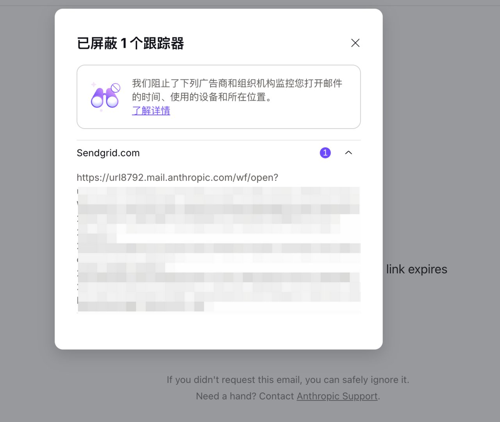
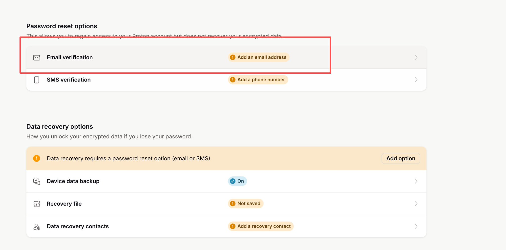

# 指纹浏览器与 iPhone 网络配置

## 1. 电脑端：AdsPower 配合 Karing

前一篇已经把 DMIT 的 VLESS + Reality 节点导入 Karing。这一篇继续使用这条线路，在 AdsPower Global 里新建独立浏览器环境，把浏览器连接到这台 Mac 上的 Karing。

**连接顺序：AdsPower → 本机 HTTP 代理入口 → Karing → DMIT VPS → 网站。**

VLESS + Reality 是 Karing 连接服务器时使用的节点协议；HTTP 是 AdsPower 连接本机 Karing 时使用的代理类型。

### 1.1 先确认本机 HTTP 代理入口

先打开 Karing，确认上一章导入的 DMIT 节点能够连接。查看 Karing 当前的 HTTP 或混合代理监听地址、端口；如果自己找不到，把下面这段交给 Codex 检查。

请先只读检查这台 Mac 的 Karing 配置、系统代理和本机监听端口，找出确实支持 HTTP 的本机代理入口。分别核对监听地址、端口、是否需要认证，并通过该入口发起 HTTPS 请求，确认出口是我的目标 VPS。不要猜端口，不要把 VLESS 服务端端口或 SSH 端口当成本机 HTTP 端口。如果当前没有可用入口，先说明需要的改动并保留配置备份，再协助配置。不要覆盖我已有的浏览器环境，也不要公开输出节点密钥、账号密码或完整公网 IP。

请记录检查得到的**本机代理地址和实际端口**，供下一节填写。截图中的地址、端口已遮挡为说明文字，不能直接复制使用。本机入口指当前这台电脑上的代理服务；网页最终看到的是请求经过代理规则后使用的公网出口，所以还要核对目标网站的实际出口。

### 1.2 新建 AdsPower 环境并填写 HTTP

打开 AdsPower Global，点击左上角「新建环境」。新建一个专门的环境，保留原来日常使用的环境。

① 名称可以填「Claude 日常使用」；② 浏览器选择 SunBrowser；③ Mac 用户选择 macOS。让 Codex 按你自己的电脑配置，浏览器内核选 AdsPower 当前支持的稳定版本，硬件参数尽量与本机一致。

切换到「代理信息」，代理方式选「自定义」，按下面的字段填写。

| 位置 | 填写内容 |
| --- | --- |
| ① 代理类型 | HTTP |
| ② 主机与端口 | 主机填你自己检查得到的本机代理地址；端口填实际可用的 HTTP / 混合代理端口。图中已遮挡具体数值，不是可直接填写的参数。 |
| ③ 代理账号、密码 | 本例的本机入口没有认证，因此留空。如果你自己开启了入口认证，则填写该入口的凭据。不要填 DMIT 登录密码、SSH root 密码或 VLESS UUID。 |
| 刷新 URL | 本例留空。 |
| ④ 检查代理 | 点击后应显示连接成功，并检查返回的出口地区。失败时先检查 Karing 是否运行、端口是否正确、节点是否可用；不要靠切换 SOCKS5 碰运气。 |

### 1.3 时区、语言与浏览器设置

切换到「指纹配置」。下面是本例的实际设置，各项数字与图中对应。

1. WebRTC 选「禁用」。这样可减少通过实时音视频接口暴露其他网络地址的机会，但部分音视频功能会受影响。
2. 时区选择与实际出口地区相符的城市。本例为洛杉矶；其他地区按实际情况选择。应使用城市时区，让夏令时自动处理，不要固定照抄 GMT 偏移量。
3. 地理位置选「禁止」，避免网站取得精确定位。
4. 语言选「自定义」，本例依次为「英语（美国）」和「英语」。
5. 界面语言选「基于语言」。

继续向下检查硬件相关设置。本例将 Canvas、WebGL 图像、AudioContext、媒体设备、ClientRects、SpeechVoices 的噪音关闭，WebGL 元数据、WebGPU、CPU 和内存使用真实值。其余选项按实际设备与软件能力核对，不需要一键随机所有参数，也不要每次启动都生成新指纹。这些选项并不意味着浏览器所有特征都与本机完全一致。

点击「确定」保存，然后在环境列表中点击新环境的「打开」。之后登录邮箱、打开验证链接和登录 Claude，都在这个环境里完成。

### 1.4 配好后先检查，再注册

「代理检查成功」只说明入口能连接。打开新环境后，还要在这个窗口里检查实际网络路径；不能拿其他浏览器的检测结果代替。

| 检查项 | 完成标准 |
| --- | --- |
| 实际出口 | 在新环境打开 ipinfo.io 或 IP 检测页面，刷新后确认出口属于预期线路。若使用分流，继续检查 Claude 相关域名的路由规则与连接日志；单个检测网站不能代表全部网站。 |
| IPv4 / IPv6 | 分别检查两种地址族；不能出现绕过预期代理的公网出口。IPv6 不可用应记录为不可用，不要写成已经验证通过。 |
| DNS / WebRTC | 检查 DNS 查询路径是否符合客户端规则，以及 WebRTC 是否暴露预期代理之外的公网地址。DNS 服务商与 VPS 不同本身不等于泄露，需要结合配置判断。 |
| 时区 / 语言 | 检测页读到的时区、语言与本例设置一致；换地区后重新核对。 |
| 故障时是否直连 | 在没有登录或付款操作时，分别测试「节点不可达但 Karing 仍运行」和「Karing 退出」。使用无登录检测页发起新的请求，预期应失败，不能改走其他公网出口；测试后恢复配置。只选择 HTTP 并不自动保证两种故障都能阻断。 |

可以把下面这段连同本文交给 Codex：

请检查我刚新建的 AdsPower 环境，不要修改现有环境。确认它使用本机实际可用的 HTTP 入口，经 Karing 的目标节点访问网页。在该环境内检查出口 IPv4 / IPv6、DNS、WebRTC、时区、语言及目标域名的分流规则。把每项结果写成「通过 / 未通过 / 未验证」，并给出依据。断线测试会影响联网，先确认当前没有进行登录或付款，再分别测试节点不可达和 Karing 退出，记录是否出现直连并恢复配置。只输出脱敏结果；遇到验证码、密码或身份验证，让我本人完成。

### 1.5 邮箱准备与验证

窗口配好了，接下来准备一个海外邮箱。**个人建议谷歌邮箱登录，权重高。**

如果正常配置好了指纹浏览器直接在指纹浏览器里面登录就好，如果不想买谷歌邮箱，那就弄一个隐私邮箱，这边推荐proton。

原因很简单：Anthropic 在邮件里放了跟踪器，而 Proton 会自动把它拦掉。

你看下面这张图，是我在 Proton 里打开一封 Anthropic 的邮件，顶上直接提示「已屏蔽 1 个跟踪器」，来源是 Sendgrid.com，展开的链接开头就是 mail.anthropic.com。

这类跟踪器会在你打开邮件时加载，顺带就能拿到你当时的 IP

Proton 它拦的就是对方监控「您打开邮件的时间、使用的设备和所在位置」。

Proton 的跟踪保护可减少邮件跟踪内容的加载；AdsPower 的代理设置用于控制这个浏览器环境的网络路径。两者作用不同，配好后仍需要按上一节检查，不能据此保证账号不会触发风控。

注册 Proton 选最左边的 Free 就够，一分钱不用花。

Proton 注册后，如果你收不到验证邮件的话，需要先绑定安全邮箱，这是因为Proton 防止滥用才做的拦截。

打开https://account.proton.me/u/1/mail/recovery，找到Email verification绑定邮箱，这样就能收到了。

别用来路不明的野鸡邮箱，我觉得那会拉低你的账号权重。

不管用哪个，这个邮箱只在这个AdsPower 浏览器窗口里登录、收信，这样打开邮件时露出去的也只是代理的 IP。

还有些验证链接会发到别处，比如 Proton 发到你恢复邮箱里的验证信，这封信是在你的日常邮箱里收的。

别在日常浏览器里直接点，像图里这样，在「Verify email」上点右键，选红框里的「复制链接地址」，再粘到AdsPower 浏览器里打开。

### 1.6 Claude 注册

邮箱准备好后，先完成[注册／登录前自检](06-before-login.md)，再注册或登录 Claude。AI 会展示检查清单，你可以选择“让 AI 帮我检查”，或提供检测截图让 AI 核对。

注册分为网页端和手机端两种，先演示网页端。

目前claude可能暂停新用户订阅，谷歌的账号权重相对重一些，有条件的还是建议谷歌登录。谷歌登录一步一步按他说的来就行。这边我做一个Proton邮箱的演示。

在AdsPower 浏览器这个窗口里打开 claude.ai，上面 Google、Apple 那两个按钮都不用管，直接在箭头指的输入框里填你的邮箱，点「Continue with email」，就是下面左边这张图。

然后回 Proton 收 Claude 发来的邮件，里面就一个黑色的 Sign in 按钮，链接 10 分钟就过期，收到了尽快点。

点完回到 Claude，就是右边这张，勾上同意条款的复选框，点「Create account」。

接下来它会问你几件事，都按一个普通新用户的反应来。

先是让你选套餐。

你的目标是 Max 20x，但正常人不会注册完第一分钟就掏 200 美元，大部分人都是先免费用用看，所以点最左边箭头指的「Use Claude for free」。

之后它会推荐你下载桌面客户端，点最下面那个很小的「Skip」跳过；问你职业，也跳过。

称呼随便写个像英文名的，我这里随手填了个重置哥大名 tibo。

角色选择也跳过，就进到首页了。

进来之后，像个新用户一样随便聊几轮。

中文英文都行，海外用简体中文的华人和留学生多的是，不用刻意全用英文。

这一步最容易翻车的，是在日常浏览器里点开 Claude 的邮件链接。

前面环境配得再好，一点开就把真实 IP 交出去了。

注册这一步做得干不干净，直接决定后面付款时会不会弹 KYC。

要是付款时真弹了 KYC 身份验证，说明注册时的环境不够干净，原因无非这几种：

IP 不行，之前被人滥用过；

指纹浏览器哪里没配好，比如时区跟 IP 对不上、WebRTC 没关；

邮箱被风控了；

也可能刚好那会儿 Claude 把风控系数拉高了，不是你哪一步做错了。

碰到这种情况，我的建议是直接重新注册一个新号：新开一个指纹浏览器窗口、换个新邮箱，按前面的流程排查后再走一遍。

**Claude Code 的网页授权和终端联网要分别检查。**如果授权链接打开在默认浏览器里，可以复制本次授权地址，到已配置的 AdsPower 环境完成登录，并按终端提示完成回调。授权链接不要分享给别人。在 AdsPower 登录成功，并不表示 Claude Code 后续的请求会经过 AdsPower；终端进程的代理和实际请求路径请按文末第 3 节单独验收。

## 2. 手机端：Codex 配合 iPhone 镜像配置网络

手机端使用支持 VLESS + Reality 的客户端（例如相应版本的 Shadowrocket），将上一章同一条服务器节点导入手机，再核对节点参数和分流规则。可以让 Codex 在具备手机操作能力时辅助配置；密码、验证码和系统授权由自己完成。**不要把电脑 AdsPower 的本机代理地址和端口照抄到手机：**本机回环地址在手机上指向手机自己。这里要复用的是服务器节点，不是电脑的本地 HTTP 入口。

然后建议使用claude的电脑时区和魔法地区保持一致，手机端在订阅的时候把时区改成魔法对应区域的时区，改完杀掉claude后台再把时区改回来正常用就好，手机端只负责订阅付费，尽量只在电脑上使用claude。

Mac 上怎么改

1. **系统设置 → 通用 → 日期与时间**
2. 关掉「自动设置时区」
3. 点「设置……」，手动搜 Los Angeles或「洛杉矶」
4. **重要：再去「隐私与安全性 → 定位服务 → 系统服务」，关掉「设定时区」**——否则 Apple 会根据你的 Wi-Fi 定位又把时区改回上海

#### iPhone 上怎么改

1. **设置 → 通用 → 日期与时间**
2. 关掉「自动设置」
3. 时区选「洛杉矶」
4. **同样重要：设置 → 隐私与安全性 → 定位服务 → 系统服务，关掉「设定时区」**

两端保持一致是最省心的做法。

## 3. 手机和 Claude Code：分别检查网络

### 3.1 手机端完成标准

手机客户端显示连接后，先在手机浏览器里打开 IP 检测页，核对公网出口、IPv4 / IPv6 和 DNS，再检查 Claude App 的相关连接是否命中目标节点。手机浏览器的结果不能单独证明 App 使用了同一条线路，应结合客户端连接日志和分流规则判断。

如果平时会从 Wi-Fi 切到蜂窝网络，两种网络都要检查；需要验证断线行为时，用未登录的测试页面操作，并在测试后恢复连接。未测过的网络或 App 路径标记为「未验证」。电脑端已通过，不等于手机端已通过。

### 3.2 Claude Code 完成标准

先区分「网页授权成功」和「终端请求走代理」。核对启动 Claude Code 的那个终端实际继承了哪些代理环境变量、NO_PROXY 规则，或者是否由 Karing 的 TUN 模式接管。不要只在另一个终端运行一次 curl，就认定 Claude Code 也已走相同路径。

从实际使用的终端启动 Claude Code，完成一次普通请求，并结合 Karing 的连接日志核对该进程请求的目标域名、命中规则和节点。记录验证时间及结果；不要把授权链接、令牌或聊天内容贴到交付截图里。

### 3.3 交付前统一核对

- 电脑：AdsPower 环境名称、本机入口、出口、DNS / WebRTC、语言时区及断线测试有记录。
- 手机：节点已导入；实际使用的 Wi-Fi / 蜂窝网络及 Claude App 路径分别有结果。
- Claude Code：网页授权完成；实际终端进程的网络请求已单独核对。
- 每项只填写「通过 / 未通过 / 未验证」。能打开网页、第三方分数较高，都不能替代上述检查，也不能作为不封号或免身份验证的承诺。

交给 Codex 的检查提示词：

请按本文完成标准分别核对 AdsPower 浏览器、手机和 Claude Code。先读取配置，再检查各端实际请求路径；不要因为浏览器检查通过就把其他端也标为通过。输出检查项目、结果、证据和未完成原因，隐藏所有密钥和个人信息。不要改动我已有的浏览器环境，不进行注册、付款或提交身份材料。需要断线测试时先确认不会中断当前工作，完成后恢复连接。

