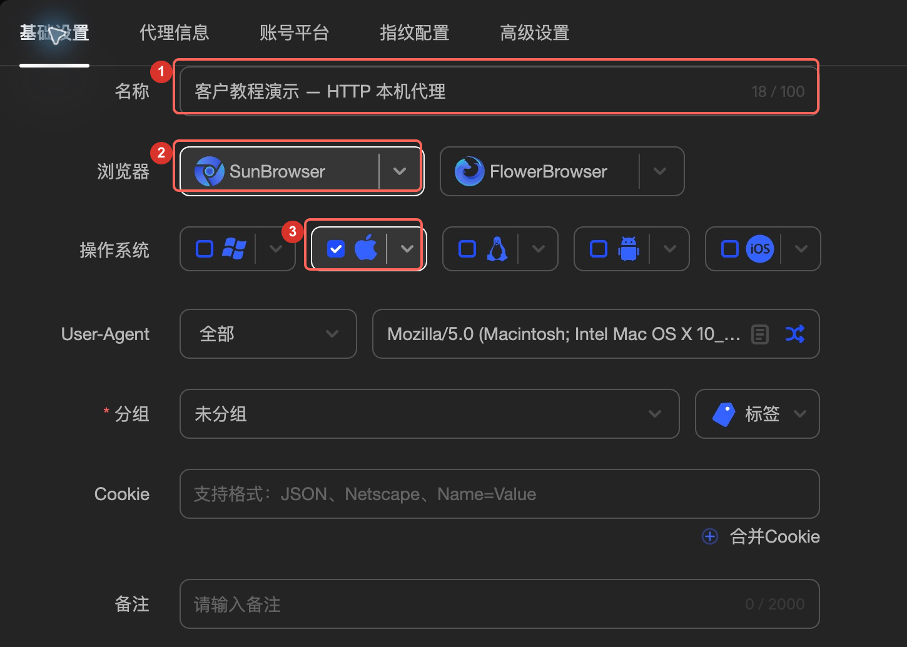
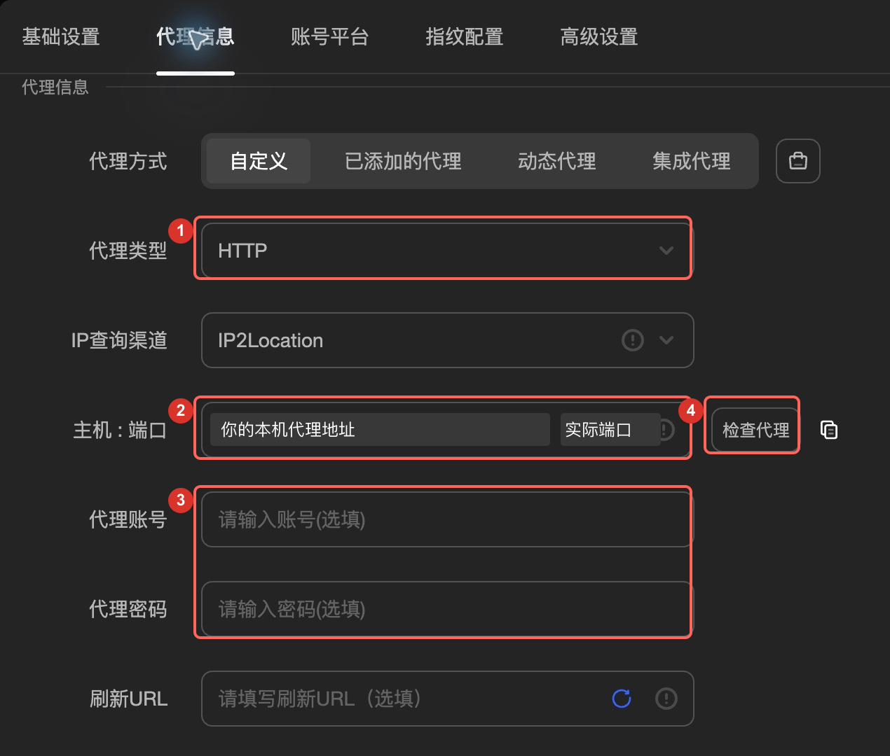
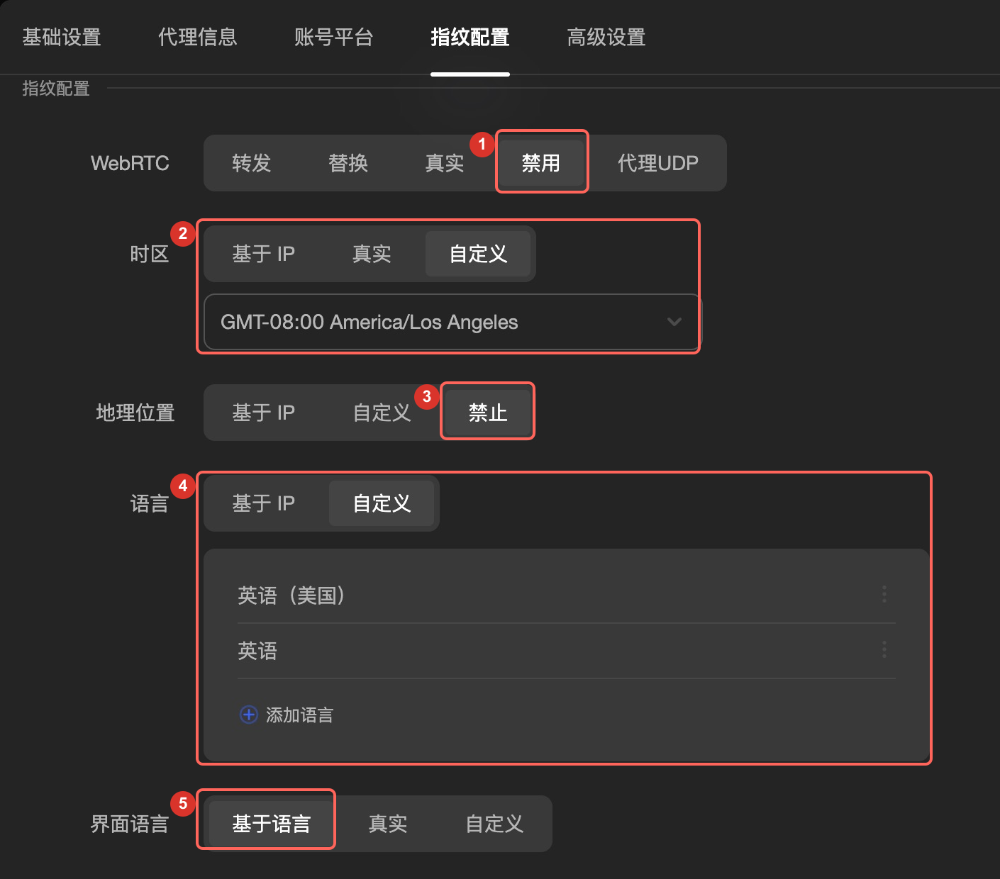
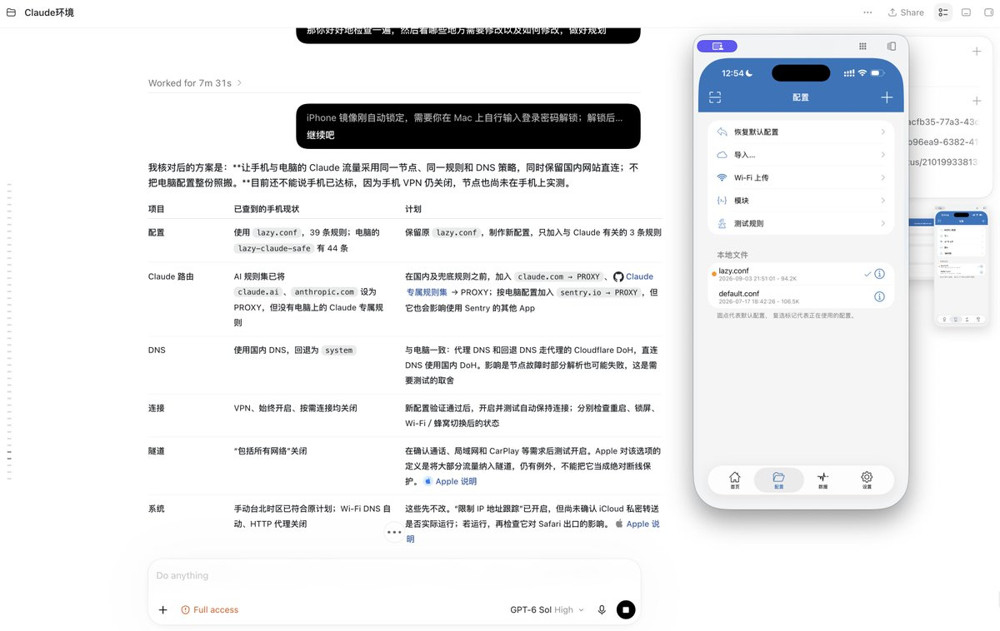

# 指纹浏览器与 iPhone 网络配置

## 1. 电脑端：AdsPower 配合 Karing

前一篇已经把 DMIT 的 VLESS + Reality 节点导入 Karing。这一篇继续使用这条线路，在 AdsPower Global 里新建独立浏览器环境，把浏览器连接到这台 Mac 上的 Karing。

**连接顺序：AdsPower → 本机 HTTP 代理入口 → Karing → DMIT VPS → 网站。**

VLESS + Reality 是 Karing 连接服务器时使用的节点协议；HTTP 是 AdsPower 连接本机 Karing 时使用的代理类型。

### 1.1 先确认本机 HTTP 代理入口

进入本章前应已按[网络教程](01-network.md)完成新旧 VPN 交接并确认 Codex 能继续回复；尚未完成时先回到该流程，不直接关闭仍在供 Codex 联网的旧代理。

先打开 Karing，逐项确认系统代理关闭、TUN／Tunnel 开启、路由为全局代理，并确认上一章导入的目标 VPS 节点能够连接。本机 HTTP 入口继续保留，关闭系统代理不等于关闭这个入口。查看 Karing 当前的 HTTP 或混合代理监听地址、端口；如果自己找不到，把下面这段交给 Codex 检查。

请先只读检查这台 Mac 的 Karing 配置、系统代理和本机监听端口，找出确实支持 HTTP 的本机代理入口。分别核对监听地址、端口、是否需要认证，并通过该入口发起 HTTPS 请求，确认出口是我的目标 VPS。不要猜端口，不要把 VLESS 服务端端口或 SSH 端口当成本机 HTTP 端口。如果当前没有可用入口，先说明需要的改动并保留配置备份，再协助配置。不要覆盖我已有的浏览器环境，也不要公开输出节点密钥、账号密码或完整公网 IP。

请记录检查得到的**本机代理地址和实际端口**，供下一节填写。截图中的地址、端口已遮挡为说明文字，不能直接复制使用。本机入口指当前这台电脑上的代理服务；网页最终看到的是请求经过代理规则后使用的公网出口，所以还要核对目标网站的实际出口。

### 1.2 新建 AdsPower 环境并填写 HTTP

打开 AdsPower Global，点击左上角「新建环境」。新建一个专门的环境，保留原来日常使用的环境。

① 名称可以填「Claude 日常使用」；② 浏览器选择 SunBrowser；③ Mac 用户选择 macOS。让 Codex 按你自己的电脑配置，浏览器内核选 AdsPower 当前支持的稳定版本，硬件参数尽量与本机一致。

切换到「代理信息」，代理方式选「自定义」，按下面的字段填写。

| 位置 | 填写内容 |
| --- | --- |
| ① 代理类型 | HTTP |
| ② 主机与端口 | 主机填你自己检查得到的本机代理地址；端口填实际可用的 HTTP / 混合代理端口。图中已遮挡具体数值，不是可直接填写的参数。 |
| ③ 代理账号、密码 | 本例的本机入口没有认证，因此留空。如果你自己开启了入口认证，则填写该入口的凭据。不要填 DMIT 登录密码、SSH root 密码或 VLESS UUID。 |
| 刷新 URL | 本例留空。 |
| ④ 检查代理 | 点击后应显示连接成功，并检查返回的出口地区。失败时先检查 Karing 是否运行、端口是否正确、节点是否可用；不要靠切换 SOCKS5 碰运气。 |

### 1.3 时区、语言与浏览器设置

切换到「指纹配置」。下面是本例的实际设置，各项数字与图中对应。

1. WebRTC 选「禁用」。这样可减少通过实时音视频接口暴露其他网络地址的机会，但部分音视频功能会受影响。
2. 时区选择与实际出口地区相符的城市。本例为洛杉矶；其他地区按实际情况选择。应使用城市时区，让夏令时自动处理，不要固定照抄 GMT 偏移量。
3. 地理位置选「禁止」，避免网站取得精确定位。
4. 浏览器语言本例选「自定义」的「英语（美国）」和「英语」；可以按用户需要保留中文，不把英文作为通过条件。语言与时区分开设置。
5. 界面语言可选「基于语言」或用户熟悉的中文，以当前软件支持为准。

**正常用简体中文和 Claude 交流就可以。**系统语言方面，按作者的配置建议，能适应英文界面的话，可以把电脑和手机一起改成英文；要改就两台一起改。提前告诉用户：改完后系统菜单和部分提示会变成英文，日常使用可能没那么方便。觉得不方便可以保留中文，英文不作为通过条件。时区仍按实际 VPS 出口所在地区设置，与使用什么语言分开判断。

继续向下检查硬件相关设置。本例将 Canvas、WebGL 图像、AudioContext、媒体设备、ClientRects、SpeechVoices 的噪音关闭，WebGL 元数据、WebGPU、CPU 和内存使用真实值。其余选项按实际设备与软件能力核对，不需要一键随机所有参数，也不要每次启动都生成新指纹。这些选项并不意味着浏览器所有特征都与本机完全一致。

点击「确定」保存，然后在环境列表中点击新环境的「打开」。后续电脑上打开 Claude、处理相关邮件和授权链接，都在这个环境里完成；首次登录按下文先配置手机，再在手机 Claude App 用 Google 登录。

### 1.4 配好后先检查，再进入手机

「代理检查成功」只说明入口能连接。打开新环境后，还要在这个窗口里检查实际网络路径；不能拿其他浏览器的检测结果代替。

| 检查项 | 完成标准 |
| --- | --- |
| 实际出口 | 在新环境打开 [Ping0](https://ping0.cc/) 或 ipinfo.io，刷新后确认出口属于预期线路，并按下面的方式留存节点检测凭证。若使用分流，继续检查 Claude 相关域名的路由规则与连接日志；单个检测网站不能代表全部网站。 |
| IPv4 / IPv6 | 分别检查两种地址族；不能出现绕过预期代理的公网出口。IPv6 不可用应记录为不可用，不要写成已经验证通过。 |
| DNS / WebRTC | 检查 DNS 查询路径是否符合客户端规则，以及 WebRTC 是否暴露预期代理之外的公网地址。DNS 服务商与 VPS 不同本身不等于泄露，需要结合配置判断。 |
| 时区 / 语言 | 检测页读到的时区、语言与当前保存的配置一致；换地区后重新核对。 |
| 故障时是否直连 | 先按网络章节确认 Codex 的联网依赖；会中断 AI 时提前给用户具体恢复步骤并确认会恢复，无恢复办法记“未验证”。在没有登录或付款操作时，分别测试「节点不可达但 Karing 仍运行」和「Karing 退出」。使用无登录检测页发起新的请求，预期应失败，不能改走其他公网出口；测试后恢复配置。只选择 HTTP 并不自动保证两种故障都能阻断。 |

**三个检测网站分别记录：**

| 网站 | 本教程建议参考值 |
| --- | --- |
| [NetCoffee](https://ip.net.coffee/claude/) | 分数约 80 或更高，越高越好 |
| [Ping0](https://ping0.cc/) | 风险值低于 30 可接受参考，优先低于 25，越低越好 |
| [Scamalytics](https://scamalytics.com/ip) | 查询当前代理出口 IP，风险值最好低于 10，越低越好 |

电脑和手机分别检查，记录设备、时间和当前线路。三站数值分别保留，不直接平均；未取得结果写“未验证”。这些是本教程的选线参考值，配置检查仍须逐项完成。IPinfo 只作出口归属辅助查询，不列入这三个评分网站。

**留存 Ping0 节点检测凭证：**连接待测节点后，在这个 AdsPower 环境打开 https://ping0.cc/，记录检测时间、设备与浏览器环境、节点名称，以及页面显示的出口地区、ASN / 运营商、IP 类型、风控值、原生 IP 和共享人数。截图先隐藏完整 IP，保存到本机 `.local/`，在 `.local/progress.md` 记录结果及截图的相对路径，不提交到教程仓库。

Ping0 的风控值越低表示该站评估的风险越低，不套用 Claude 检测的“80 分以上”。这些标签和人数是第三方页面的评估，不单独证明住宅属性、独享节点或账号安全。遇到人机验证时由用户在页面完成；页面打不开或某项没有结果，记录“未验证”，不能引用示例截图的数值。

可以把下面这段连同本文交给 Codex：

请检查我刚新建的 AdsPower 环境，不要修改现有环境。确认它使用本机实际可用的 HTTP 入口，经 Karing 的目标节点访问网页。在该环境内检查出口 IPv4 / IPv6、DNS、WebRTC、时区、语言及目标域名的分流规则。把每项结果写成「通过 / 未通过 / 未验证」，并给出依据。断线测试会影响联网，先确认当前没有进行登录或付款；如会中断 Codex，按网络章节提前说明如何关闭新连接并恢复旧 VPN，确认我知道如何恢复后再测，再分别测试节点不可达和 Karing 退出，记录是否出现直连并恢复配置。只输出脱敏结果；遇到验证码、密码或身份验证，让我本人完成。

同时在该环境打开 Ping0，按本节要求记录节点检测结果和脱敏截图，作为本次检测凭证。各项以实际页面为准，未取得的结果标为“未验证”。

### 1.5 浏览器配置完成后，直接进入手机

电脑检查通过后，直接进入第 2 节配置 iPhone 网络，不主动带用户在电脑网页注册 Claude，也不默认注册 Proton 邮箱。Google 账号按[账号准备与两步验证](08-google-account.md)在前面确认；首次 Claude 登录默认在手机官方 App 中使用 Google 完成。只有用户明确要求电脑注册时才按其要求处理。

此时主动提醒一次：**后续电脑上使用 Claude，只打开刚配置好的 AdsPower 环境，不用日常默认浏览器。**手机主要用于首次登录和 Apple 订阅，日常对话尽量回电脑。

### 1.6 登录前的提醒与交付顺序

手机网络检查完成、首次登录前再简短提醒：

> 手机主要用于这次登录和订阅，后续尽量在电脑的指纹浏览器里用 Claude。Claude 邮件可能包含跟踪像素，不要在日常浏览器随手打开相关邮件或登录链接；需要处理时放在已配置的浏览器环境里。

邮件跟踪内容可能在加载时产生网络请求，不是向电脑安装程序。不要把“开过邮件”直接认定为封号原因。

接下来按顺序做：手机网络与时区验收 → 美区 Apple 账户和礼品卡检查 → 新号等待安排 → 手机 Google 登录 Claude → 可选先在电脑免费使用约两天 → 手机 Apple 内购 Pro → 回电脑核对权益与正常对话。操作细节见[带做指南](05-ai-walkthrough.md)和[Apple 章节](03-apple.md)。Google 登录需要两步验证时，读取[字段说明与操作步骤](08-google-account.md)。

日后用户自行使用 Claude Code 时，提醒其把默认浏览器弹出的完整授权链接复制到已配置的指纹浏览器，再完成网页授权。Claude Code 的安装和使用教学不属于本次交付；保留文末的网络排查资料，仅在用户明确需要时读取。

## 2. 手机端：Codex 配合 iPhone 镜像配置网络

**准备在 iPhone 使用 Claude，或通过 App Store 订阅时，必须先单独配置并验收手机网络。**只用电脑时可以暂缓，但首次手机注册、登录或订阅前必须回到本节，不能用电脑的通过结果代替手机。

### 2.1 优先打通 iPhone 镜像，由 Codex 带做

iPhone 镜像是新手导入节点和配置网络的关键辅助方式。默认优先用 **Codex Computer Use + iPhone 镜像**读取手机界面、导入节点、选择路由并核对结果；不要只发一份教程就让用户自己配。镜像没有开启或连接失败时，先帮助用户把它配置好，逐项排查并重试，不直接退回手动配置。

1. 按当前 Apple 官方说明核对 Mac、iPhone 的硬件与系统要求、所在地区可用性；Windows 不直接套用 Mac 的原生 iPhone 镜像步骤。
2. 核对两台设备是否使用同一个 Apple 账户并启用双重认证，Wi-Fi 与蓝牙是否开启，设备是否靠近，iPhone 是否处于镜像要求的锁定状态；按当前界面的提示处理其他连接冲突。
3. 检查 Mac 上 iPhone 镜像的首次设置、连接授权，以及 Codex Computer Use 是否能读取和操作这个窗口。能够看到镜像不等于工具可以点击；用实际页面读取和一次普通导航确认操作能力。
4. 根据实际报错修复权限、连接或兼容问题，必要时重新连接、重开应用后重试。会中断当前网络或操作的步骤先说明影响，记录尝试和结果，不盲目反复重置设备。

密码、验证码、Face ID、系统授权和购买客户端的付款由用户完成；需要用户在实体手机上处理时，带他完成必要动作，再恢复镜像连接继续配置。节点通过用户本机的导出链接或现有二维码导入，不要求把完整 VLESS 链接、密钥发到聊天，也不把参数写入公开文档或进度文件。界面操作依据真实页面，不编造导入按钮或路径。

**只有确认设备／地区不支持，或有具体记录的排查仍无法让镜像与 Computer Use 可用时，才说明阻碍和已尝试的办法，改用其他可用的手机操作工具；仍不可用时才逐步指导用户手动操作。**用户明确要求手动操作时按其选择。镜像不可用不等于可以跳过手机网络配置和验收。

### 2.2 导入节点并设置小火箭全局路由

手机端使用支持 VLESS + Reality 的客户端（例如相应版本的 Shadowrocket），将上一章同一条服务器节点导入手机，再核对节点参数。**不要把电脑 AdsPower 的本机代理地址和端口照抄到手机：**本机回环地址在手机上指向手机自己。这里要复用的是服务器节点，不是电脑的本地 HTTP 入口。客户端尚未安装时先按当前官方购买／下载流程准备，不默认用户已经有小火箭。

使用 Shadowrocket（小火箭）时，选中导入的目标节点，**将「全局路由」设为「代理」，开启连接并确认系统 VPN 已连接**。这是本教程手机登录和订阅期间的默认配置，最接近电脑的「TUN 接管 + 全局代理」。先记录原配置；日常使用需要恢复其他模式时按用户选择，下一次使用 Claude 前重新检查。

| 全局路由模式 | 区别与本教程要求 |
| --- | --- |
| 配置 | 按配置中的规则分流，部分流量可能直连；不能直接当成全部流量走节点。 |
| 代理 | 将 VPN 接管且没有被排除的流量送到选定代理节点；本教程手机使用 Claude 期间选择此项。 |
| 直连 | 接管后的流量直接连接目标，不符合本教程此阶段的要求。 |
| 场景 | 按设置的网络场景自动切换策略；结果取决于场景配置，不能凭名称判断为全局代理。 |

TUN／VPN 是接管流量的机制，以上模式决定接管后的去向；电脑仅开启 TUN 也不代表所有流量走代理。**「代理」不等于已证明手机所有流量绝无绕行，也不保证 VPN 关闭后仍阻断网络。**继续按第 3.1 节检查排除路由、DNS、IPv6、实际出口、App 请求路径和断线行为，不凭模式名称或 VPN 图标判通过。其他手机客户端按实际功能核对等效设置，不照搬小火箭按钮名称。

默认选“代理”是为了让新手的路径简单、一致，不代表其他路由模式在技术上都不可用。用户明确保留其他模式时，检查该模式下目标流量是否仍走指定节点、是否有直连或泄露，逐项验收并记录；不能只凭模式名称判通过。

### 2.3 电脑和手机时区

使用 Claude 前，电脑系统、浏览器和准备使用的手机时区按实际节点地区核对。手机首次登录或订阅前都要完成下面的三项设置，不要只看时区城市就继续。手机仅用于订阅时，完成操作并关闭 Claude 后可以按自己需要恢复日常时区；下次登录或订阅前重新核验。

Mac 上怎么改

1. **系统设置 → 通用 → 日期与时间**
2. 关掉「自动设置时区」（部分版本显示为「使用当前位置自动设置时区」）
3. 点「设置……」，手动搜索实际节点所在城市。本例为 Los Angeles／洛杉矶；使用 Phoenix／凤凰城、Boston／波士顿或其他节点时按实际地区选择，不统一套用洛杉矶。
4. **重要：再去「隐私与安全性 → 定位服务 → 系统服务」，关掉「设定时区」**。定位相关的时区设置可能让系统回到所在地时区，例如上海，这个开关也要明确核对。
5. 返回「日期与时间」复查实际时区城市，并记录两个开关的状态。只关闭相关时区功能，不要求关闭整个定位服务或 Mac 的自动校时。

#### iPhone 上怎么改

1. **设置 → 通用 → 日期与时间**
2. 关掉「自动设置」
3. 手动选择实际节点所在城市，本例为「洛杉矶」；其他节点按实际地区选择。
4. **同样重要：设置 → 隐私与安全性 → 定位服务 → 系统服务，关掉「设定时区」**
5. 返回「日期与时间」复查实际时区城市，并记录「自动设置」和「设定时区」两个开关的状态。

完成设置后，把**电脑系统、iPhone 系统和 AdsPower 浏览器实际时区**放在一起核对：同一节点下应使用一致的时区规则，并与 VPS 实际出口地区对应。记录城市／时区标识及当前偏移，不只比较当下时钟数字；不同城市名若属于同一时区规则，可以记录为等效一致。不要照抄 VPS 服务器 Linux 系统里的 UTC 时间设置，也不必为了客户端时区去改服务器时间。

**AI 必须主动提醒客户确认三项是否设置好了：自动设置已关闭、手动城市正确、定位服务里的「设定时区」已关闭。**电脑和手机分别检查，再复查实际城市；某个开关没有看到就记“未验证”，不能仅凭当前时区城市判定通过。暂时不用手机，可留到首次登录或订阅前补检；不能用电脑的结果代替手机。

## 3. 手机和 Claude Code：分别检查网络

### 3.1 手机端完成标准

先逐项记录：镜像与 Computer Use 是否可用（不可用时写排查结果和替代方式）、客户端与目标节点、节点参数核对结果、全局路由模式、客户端连接状态及系统 VPN 状态。小火箭默认核对「代理」；其他模式按第 2.2 节的明确选择与实际路径验收处理。模式未见到或实际路径未验证时先补检，不把未知结果记通过。

手机客户端显示连接后，先在**手机自己的浏览器**打开 [Claude IP 检测](https://ip.net.coffee/claude/)、[Ping0](https://ping0.cc/) 和 [Scamalytics](https://scamalytics.com/ip)，记录设备、时间、网络类型、实际出口地区和各站结果，核对公网出口、IPv4 / IPv6 和 DNS，检查客户端是否存在绕过代理的排除路由。三站量表分别记录，第三方评分不能代替实际路由检查。

官方 Claude App 安装后，先在未登录状态下结合客户端连接日志核对可观察到的 Claude 相关请求、命中规则和节点；首次登录后的实际请求再复核。手机浏览器的结果不能单独证明 App 使用了同一条线路；日志未能覆盖的路径记「未验证」，不能宣称全部 App 流量已确认。

如果平时会从 Wi-Fi 切到蜂窝网络，两种网络都要检查；当前不使用的网络记「不适用（切换前补检）」，不能用 Wi-Fi 结果代替蜂窝结果。需要验证断线行为时，确认没有登录、付款或其他不能中断的工作，用未登录的测试页面分别测试节点不可达（VPN 保持开启）与主动关闭 VPN，并在测试后恢复连接和「代理」模式。节点故障后发生自动直连时先修复；不能确认时记「未验证」。主动关闭 VPN 后可能恢复手机原网络，不能宣称普通小火箭设置提供系统级永久断网保护；必须提醒用户先停止 Claude 使用，恢复 VPN 并复查后才继续。

**手机网络和时区是继续操作前的检查关卡。**适用项未通过或未验证时，先带用户修复或补检；用户明确要求跳过才保留原状态继续，不能默认跳过或写通过。模式、节点、Wi-Fi／蜂窝网络、DNS／排除路由变化，或 VPN 重连后结果有疑问时，重新检查受影响项目。电脑端已通过，不等于手机端已通过。

### 3.2 Claude Code 完成标准

先区分「网页授权成功」和「终端请求走代理」。核对启动 Claude Code 的那个终端实际继承了哪些代理环境变量、NO_PROXY 规则，或者是否由 Karing 的 TUN 模式接管。不要只在另一个终端运行一次 curl，就认定 Claude Code 也已走相同路径。

从实际使用的终端启动 Claude Code，完成一次普通请求，并结合 Karing 的连接日志核对该进程请求的目标域名、命中规则和节点。记录验证时间及结果；不要把授权链接、令牌或聊天内容贴到交付截图里。

### 3.3 交付前统一核对

- 电脑：AdsPower 环境名称、本机入口、出口、DNS / WebRTC、语言时区及断线测试有记录。
- 手机：镜像操作或排查与替代方式有记录；节点已导入，小火箭全局路由为「代理」、VPN 已连接；实际使用的 Wi-Fi / 蜂窝网络、出口、IPv6 / DNS、排除路由、Claude App 路径、断线行为和时区分别有结果。
- Claude Code：网页授权完成；实际终端进程的网络请求已单独核对。
- 每项只填写「通过 / 未通过 / 未验证」。能打开网页、第三方分数较高，都不能替代上述检查，也不能作为不封号或免身份验证的承诺。

交给 Codex 的检查提示词：

请按本文完成标准分别核对 AdsPower 浏览器、手机和 Claude Code。先读取配置，再检查各端实际请求路径；不要因为浏览器检查通过就把其他端也标为通过。输出检查项目、结果、证据和未完成原因，隐藏所有密钥和个人信息。不要改动我已有的浏览器环境，不进行注册、付款或提交身份材料。需要断线测试时先确认是否会中断 Codex 或其他当前工作；会中断 Codex 时按网络章节提前交代手动恢复方法并确认用户会恢复，没有恢复办法则记未验证。完成后恢复连接并确认 Codex 可以继续。

