# Apple 账号、礼品卡与内购｜客户交付版

## 选区：美区还是台区？

单说订阅 AI，我直接推荐美区。AI 类 App 在美区最全，新功能基本都在美区首发，礼品卡的购买渠道也最多，出问题时网上能搜到的解决办法也最多。

台区的优点是界面全繁体中文，看着不费劲，还能下到一些美区没有的应用。如果你本来就有台区需求，用它订阅也没问题，流程完全一样。只是地址格式不同：台湾的邮编是 3 位或 5 位，电话格式也和美国不一样，填的时候别照搬美区的格式。

## 默认路线：先准备美区 Apple 账户

手机网络检查完成后，先说明“这套 iPhone 礼品卡订阅路线使用美区 Apple 账户”，再单独问有没有可用的美区账户；有的话，继续问是自己一直在用的老号、新注册，还是刚买／刚接手的账号，再确认礼品卡／余额。用户已说明的部分不重复问。没有账户时，提供[原有购号网站](https://chuhai91.cc)及 [Apple ID 补充渠道 xintaikeji](https://xintaikeji.eu.org/)，选择美区 Apple 账户；接手后确认自己能控制登录与恢复方式，拿到账号后立即展示下文醒目提醒，带用户只在手机 App Store／“媒体与购买项目”成功登录一次，核对登录的是该账号，再从实际首次登录并开始使用的时间安排约两天等待。购入账号仅在 App Store 使用，不更换 iCloud。自己注册或改区的方式保留如下，用户明确选择时再带做，不把这两种方式作为默认分支。

## 搞一个外区 Apple ID

我试过三种办法，按推荐程度说。

### 首选：自己在 iCloud 官网注册。

零成本，账号从头到尾都是你自己的，这点最重要。

有个细节很多人不知道：在 appleid.apple.com 注册外区号，经常遇到“此时无法创建你的账户”，怎么试都不行。换成 iCloud.com 的入口，成功率高很多。注册前把代理全关掉，用正常网络。我自己几次失败都是因为开着代理，关掉就好了。

步骤很简单：打开 iCloud.com，点“登录”，再点“创建你的 Apple 账户”。

邮箱：准备一个从没绑过 Apple ID 的，163 或 QQ 邮箱都行。

地区：选美国（或台湾）。姓名随意。

出生日期：一定要填成年，否则后面会被各种年龄限制卡住，部分 App 下不了、付不了款。

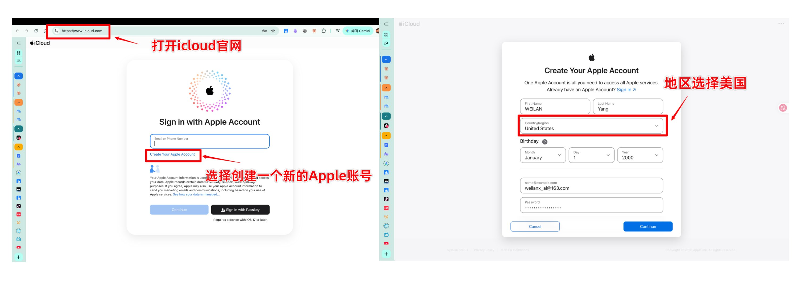

手机号：直接选 +86 填自己的国内号码。一个号码能绑的 Apple ID 数量有限，别拿同一个号反复注册一堆账号。

注册好后我们就是一个 「美国地区」的 Apple ID了🎉

邮箱验证码和短信验证码都过了，号就有了。这些信息自己记好，尤其是密码和注册邮箱，丢了找回会很麻烦。

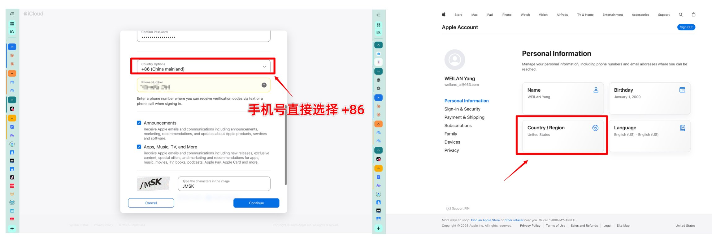

### 其次：把闲置的国区旧号改成美区。

手上有不用的旧号可以这么干。改区的路径是 App Store → 头像 → 点自己的名字 → 国家/地区 → 更改国家或地区。

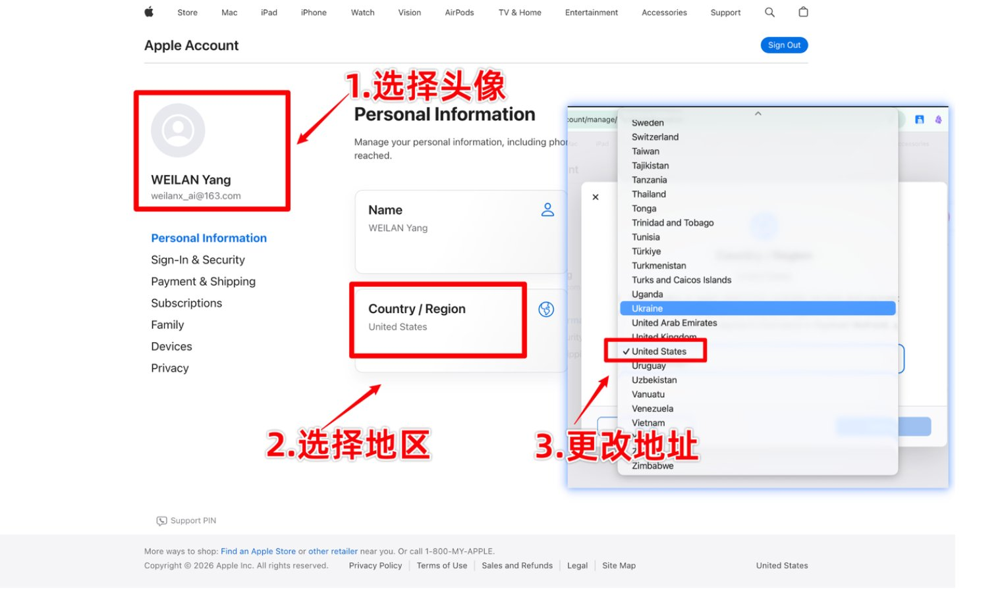

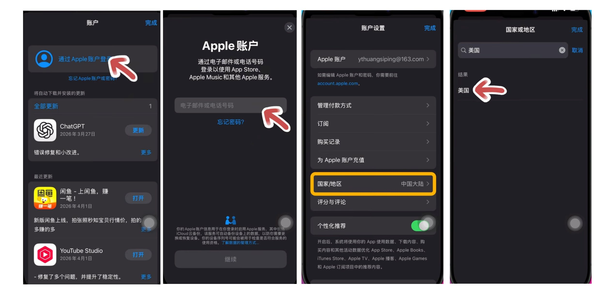

最大的难点是付款方式那一栏经常只有信用卡，没有“无”的选项。

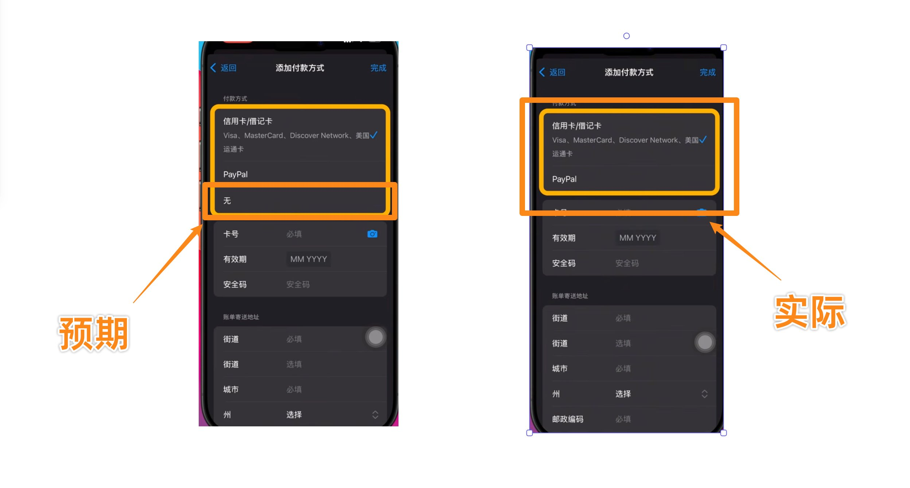

我当时是开了加速器（UU 里有 App Store 的专项加速），刷了几次才出现“无”。

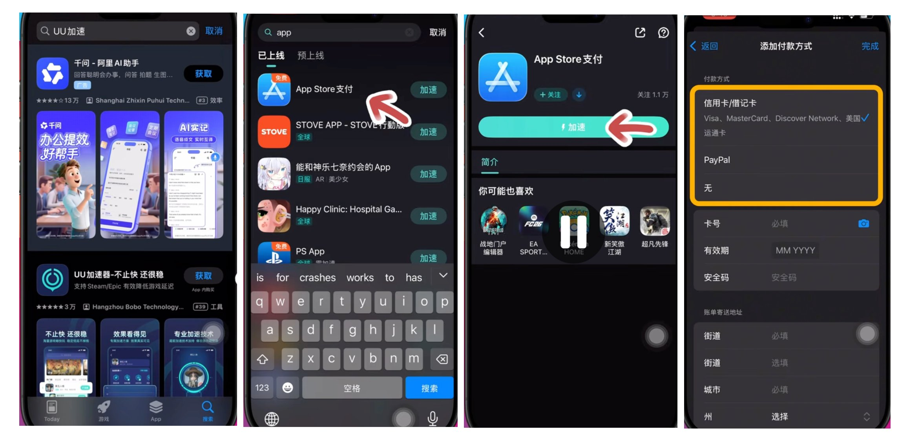

选“无”之后要填一个格式正确的地址，美国电话是 3 位区号加 7 位号码。

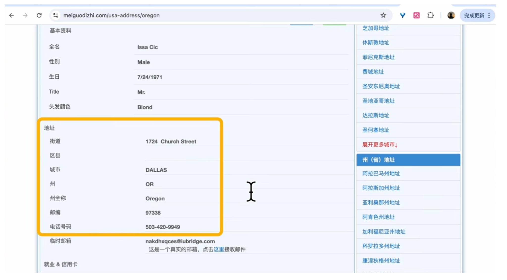

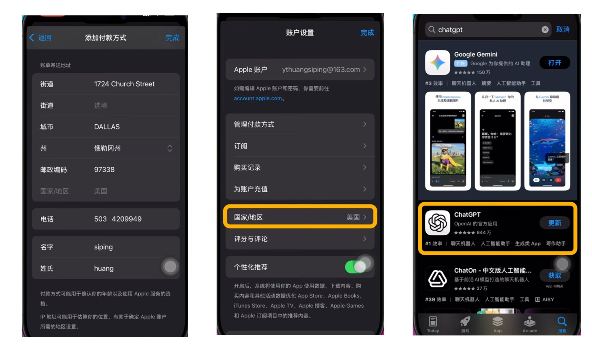

有两点要提前知道：账户里有剩余余额或者还有生效中的订阅时，是改不了区的，得先把余额花完、订阅取消；另外改区之后，账单地址会影响之后的计税

### 不太推荐：直接买成品号。

我早期买过，快是真快，几分钟就能用。但号不是你注册的，密码和密保都经过别人手，哪天被原主找回，你充的余额、订的会员就全没了，也没人能帮你。实在要买，拿到手第一件事是改密码。

## ⚠️ 最重要的一条：外区号绝对不要登 iCloud

这是我见过后果最严重的坑，必须单独拿出来说。

**外区号只能在 App Store 里登录，千万不要登到“设置 → Apple 账户 / iCloud”里。**

系统级的 iCloud 关系到手机的激活锁。你要是在这里登了一个自己控制不了的号（买来的号尤其危险），哪天这个号被锁、被改密码，你的手机可能连激活锁都解不开，数据也跟着搭进去。

正确的登录方式：

打开 App Store，点右上角头像；

拉到最底下，点“退出登录”；

回到顶部，用外区号登录；

如果弹出提示，让你绑定手机或升级双重认证，点 “其他选项” → “不升级”。

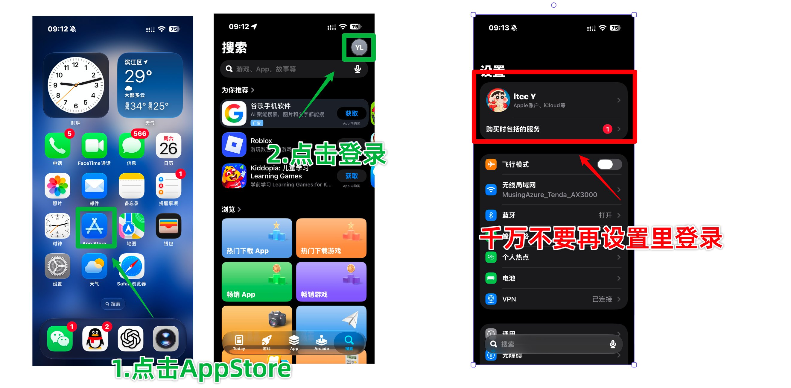

还要说一句，App Store 登外区号，并不影响你手机本身的 iCloud 同步、照片备份这些功能，两边互不干扰。

## 充值和订阅前，先确认 Apple 账户情况

**先完成网络自检，再单独问账户情况。**用户准备通过 App Store 订阅 Claude 时，先完成[登录前自检](06-before-login.md)中当前设备适用的网络和时区项目。通过后，再问下面这一句，不把账户问题混进第一轮网络检查清单；用户已说清楚的部分直接复用。

> 网络检查已经完成。这套 iPhone 礼品卡订阅路线使用美区 Apple 账户，您已经有了吗？

已有账户时接着问：“这个账号是您一直在用的老号、新注册，还是刚买／刚接手的？如果是新号，您是否已经在自己手机的 App Store 登录成功，大概是什么时候？”没有账户时先准备账户，拿到后立即给出下面的提醒，不等进入充值页才说。

根据客户反馈，本教程对新注册、刚接手的成品号采用下面的提醒：

### 🔴 新 Apple ID：先登录 App Store，等待约两天再充值

> **新买或新注册的 Apple ID，强烈建议先等约两天，再充值、订阅！**
>
> **先在您自己的手机 App Store／“媒体与购买项目”成功登录一次，保留该商店账号正常使用约两天。不要登录或替换手机的 iCloud。**
>
> **根据实际交付反馈，刚拿到账号就立即充值、付款，更容易遇到苹果购买限制。一旦受限，可能需要联系苹果人工客服，常见还要等待 72 小时才能重试，很耽误时间；具体时长以本次客服答复为准。**

展示要求：在客户对话中专门起一栏，标题与“先在自己手机 App Store 成功登录一次、等待约两天、暂不充值订阅”均加粗。这几行必须直接出现在给客户的回复中，不能只留在工具输出、进度文件或 PDF 链接里。有红色文字能力的界面使用红色强调；普通聊天用“🔴＋加粗＋独立引用块”，不输出可能失效的 HTML／ANSI 颜色代码。首次确认新号及新号购入／注册完成后立即展示，进入充值或订阅前按进度简短复查；已展示且仍在同一等待期时不每轮刷屏。老号不套用新号警示；新接手的卖家“老号”仍按新接手账号提醒。

这里的“养号”就是先留出正常使用的时间，不需要为了养号专门购买其他东西、反复下载 App 或频繁登录退出。起点按用户本人在手机 App Store 成功登录并开始使用该账户的实际时间确认，不能只拿付款买号时间或卖家称它是“老号”来跳过提醒。没有登录成功先处理登录，不记成等待已开始。约两天是客户反馈形成的建议，不是苹果公布的规则，也不保证等够时间就一定能付款。

AI 按下面的情况接着带做：

- **自己长期正常使用的老号**：没有当前购买限制时，核对账户和余额后继续，不额外要求等约两天。
- **新注册或刚接手的成品号，开始使用未满两天**：先给出上述提醒，确认手机商店登录已成功，记录用户选择的等待时长、实际首次登录使用起点、时区和预计继续日期；暂缓购买礼品卡、充值和订阅。没有明确开始时间时先补问，不编造到期时间。默认建议等待，用户明确选择立即继续时记录其选择，再按实际流程操作。
- **新号已正常使用约两天**：复用已有记录，确认当前没有购买受限，再继续；不因新对话或再次自检重新开始计时。等待完成记为“建议等待已完成”，不记成“风控已解除”。
- **已经充值但还没订阅**：保留现有余额，不追加充值；按账户使用时间给出等待建议，再决定订阅时间。
- **已经提示无法完成购买**：进入[Apple 购买受限人工支持](07-apple-purchase-support.md)，不拿新号的约两天等待代替申诉处理。常见客服安排是等待 72 小时；问清本次起点和时长后记下具体重试时间，期间暂停重复尝试和追加充值。

将账户地区、账户类型、手机商店登录结果、首次登录使用起点、醒目提醒是否已给出、等待安排和下一步写入 `.local/progress.md` 的“Apple 充值／订阅前检查”。只用网页订阅或暂不准备 Apple 内购时，这一项记为不适用或待订阅前完成，不阻断 Claude 的正常注册、登录和免费使用。

## 买礼品卡，给账户充钱

先完成上面的账户检查；仍在建议等待期间时，先不购买礼品卡或充值。已经买到礼品卡但尚未兑换，也按账户检查的等待安排继续，不自动进入充值步骤。

### 官方渠道订阅礼品卡（最稳定可靠）

外区账户靠余额消费，礼品卡就是给余额充值用的。

有双币信用卡的话，去苹果美国官网买。 注意是 apple.com，不是 apple.com.cn。在页面底部 Shop and Learn 里找到 Gift Cards，点 Buy。需要注意的几点：

配送方式一定选 Email。 选成 Mail 会给你寄实体卡，那就尴尬了。

金额选自定义（Other）。 最低 10 美元。订阅一个月 Pro 或 Plus 建议多充一点，原因后面讲。

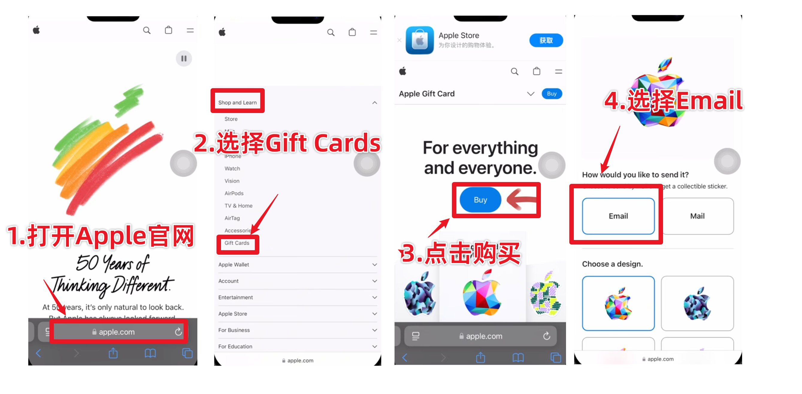

收件邮箱填你自己的，至少核对两遍。 兑换码就发到这里，填错了追回很麻烦。

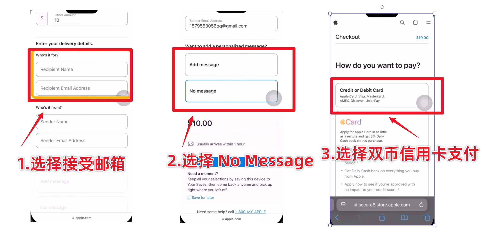

账单地址直接填信用卡的真实地址。 招行、浦发这些银行的双币卡，我和身边朋友都用过，能正常付款。

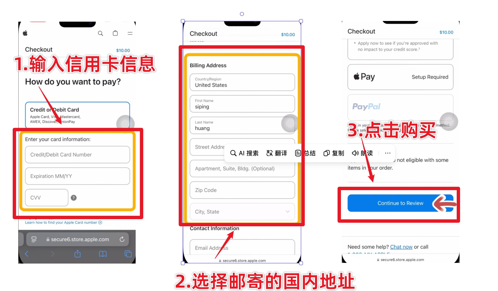

一般几十分钟到一小时内能收到邮件。没收到的话先翻垃圾箱，还没有就去订单页面点重新发送，或者联系苹果客服。

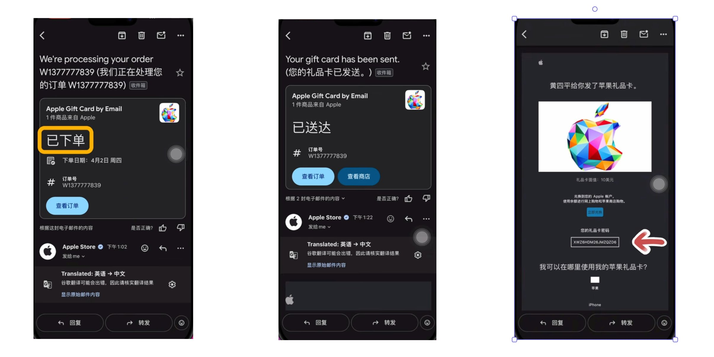

### 2. 支付宝购买礼品卡（最方便）

没有信用卡的话，只能找第三方平台用支付宝买。 我的建议是：挑口碑好、有售后的平台，别贪那几块钱的差价去找来路不明的小店。先完成账户检查和等待安排，准备充值时再购买礼品卡；卡密拿到后按本次充值流程兑换，兑换前别截图发给任何人。

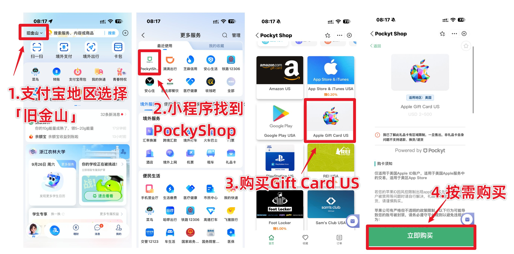

找不到可以复制这一段到备忘录，直接跳转支付宝小程序：[https://render.alipay.com/p/s/i/?scheme=alipays%3A%2F%2Fplatformapi%2Fstartapp%3FappId%3D2021001165662428%26page%3Dpages%252Fredirect%252Fredirect%253FappId%253D2021003191605547%26enbsv%3D0.2.2507280946.43%26chInfo%3Dch_share__chsub_CopyLink%26fxzjshareChinfo%3Dch_share__chsub_CopyLink%26apshareid%3DA6364F5A-E354-477C-A944-0B4A1390FC24%26shareBizType%3DH5App_XCX%26shareTimestamp%3D1772934191191](https://render.alipay.com/p/s/i/?scheme=alipays%3A%2F%2Fplatformapi%2Fstartapp%3FappId%3D2021001165662428%26page%3Dpages%252Fredirect%252Fredirect%253FappId%253D2021003191605547%26enbsv%3D0.2.2507280946.43%26chInfo%3Dch_share__chsub_CopyLink%26fxzjshareChinfo%3Dch_share__chsub_CopyLink%26apshareid%3DA6364F5A-E354-477C-A944-0B4A1390FC24%26shareBizType%3DH5App_XCX%26shareTimestamp%3D1772934191191)

### 礼品卡兑换 ✅

兑换： App Store → 头像 → 先确认登的是外区号 → “兑换电子礼品卡或代码” → 手动输入 16 位代码。兑换完回到头像页，邮箱下面就能看到余额。

这里说一下为什么要多充一点。美国的订阅费是标价加上当地销售税，实际扣款可能比 20 美元多一点。我第一次就栽在这里：只充了整 20 美元，结果付款失败，白白折腾半天。所以余额最好留一点富余，心里有底。

## 在 App 里订阅

**手机首次登录 Claude 或在 App 里订阅前，先完成[手机网络配置](02-browser-iphone.md#2-手机端codex-配合-iphone-镜像配置网络)和[登录前自检](06-before-login.md)，这是继续操作前的必检步骤。**默认优先由 Codex Computer Use 操作 iPhone 镜像导入同一服务器节点；镜像不可用时先尽可能排查修复，不直接让用户自己配。小火箭「全局路由」选「代理」，开启 VPN，再单独验收手机实际出口、IPv6／DNS、排除路由、App 请求路径和断线行为，同时完成手机时区三项与复查。电脑通过、礼品卡已到账或 VPN 图标出现，都不能代替手机检查。适用项未完成时先补齐；只有用户明确要求跳过才保留未通过／未验证状态继续。

网络检查通过后，确认本章“充值和订阅前，先确认 Apple 账户情况”已完成。待等待的账户先按记录继续等待；老号或建议等待已完成的账户，再继续订阅。

如果手机上以前从别的区下载过 Claude，我习惯先删掉，再用外区号从 App Store 重新下载官方版。这样之后更新、订阅管理都挂在同一个账号下面，不会乱。

下载的时候一定要看开发者。 Claude 的开发者是 Anthropic，ChatGPT 的是 OpenAI。App Store 里山寨套壳的应用非常多，名字、图标都做得很像，有的还会诱导你订阅高价会员，我身边就有人中过招。

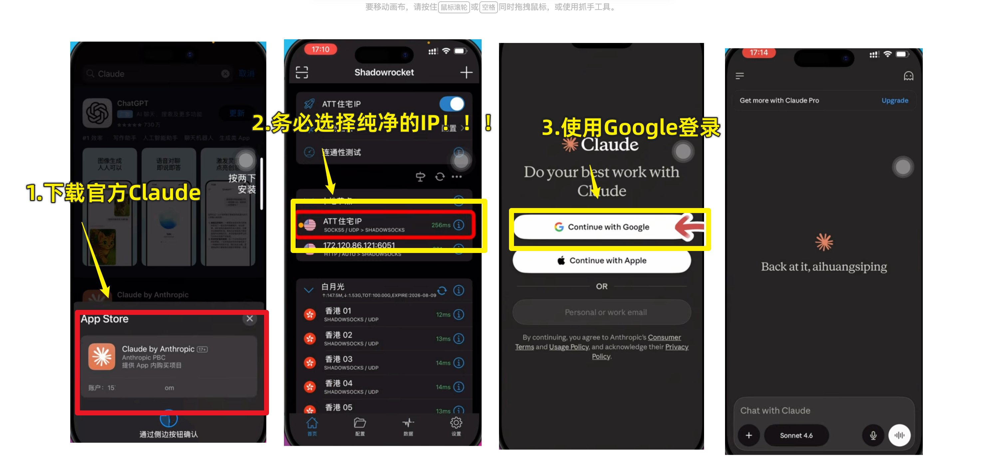

在手机官方 Claude App 使用 Google 登录，必要的账号字段与两步验证见 [Google 账号准备](08-google-account.md)。有条件可以先在电脑 AdsPower 免费使用约两天，再订 Pro；这与 Apple 新号等待可以同时进行，分别记录。

默认先推荐 Pro，标价 20 美元／月，不建议首次直接订 Max；金额与税费按实际页面核对。找到升级入口，选 Pro，会弹出苹果原生的支付窗口。付款前看两眼：扣款账户是不是你的外区号，付款来源是不是账户余额。确认没问题，双击侧边键刷脸，权益基本是秒开。ChatGPT Plus 的流程一模一样。

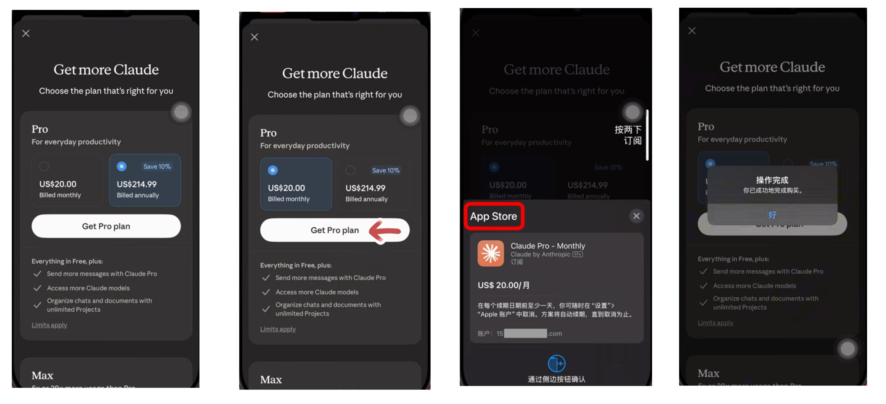

AI 在兑换和订阅这几步主动展示对应图片，按实际手机页面逐步带做。付款后核对订单和当前 Claude 账号权益，再回电脑 AdsPower，用同一个 Google 账号确认 Pro 权益并完成一次正常对话，三项齐全才算交付完成。手机主要用于首次登录和订阅，后续日常使用尽量放在电脑指纹浏览器中。

## 提示“无法完成购买”怎么办

新注册或刚改区的号，第一次付款偶尔会失败，提示 Cannot Complete Purchase。遇到这种情况先别急着弃号，按下面几步排查：

先自查。余额够不够（别忘了税）？登的是不是正确的账号？设置里的“屏幕使用时间”有没有限制 App 内购买？这几项我都中招过。

自查都没问题，进入[Apple 购买受限：Codex 带办人工支持](07-apple-purchase-support.md)。用户希望代办时，由 Codex 操作本机 Chrome，优先走 **Get Support → App Store → Subscriptions & Purchases → Unable to purchase → Continue → Get more help → Live Chat**，按当前页面选择对应入口；备用入口和完整聊天流程见该章。

用英文说清楚情况就行，不用写得很复杂，意思到了就好：

I’m trying to purchase a subscription in the App Store, but I receive "Cannot Complete Purchase." Could you please review the purchase attempt and check whether there is a purchase restriction on my Apple Account?

我在 App Store 订阅时出现“无法完成购买”的错误。请帮我复核这次购买尝试，并查一下账户是否有购买限制。付款来源和余额核实后，再补充对应事实。

Codex 负责起草、读取并回复客服消息，用户负责登录、登录验证码、Support PIN 的生成和输入，以及本人核验。沟通用用户确认的事实，具体分工与可复制提示词见[人工支持章节](07-apple-purchase-support.md)。

客服可能要求一个 4 位数的 Support PIN。保留聊天窗口，另开 [account.apple.com](https://account.apple.com/)，用户登录同一个账户，在页面底部找到 Support PIN → Generate PIN，并亲自将 PIN 输入当前官方客服聊天窗口。随后由 Codex 继续沟通，问清处理结果、等待时长与起点、期间的购买安排和到期跟进方式。常见经验为 72 小时，具体按本次客服确认安排；记录明确的重试日期与时区，付款后再核对权益。

这里也能看出为什么我一直推荐自己注册账号：账号是你本人的，找客服时才说得清楚。用买来的号，连身份都证明不了。

