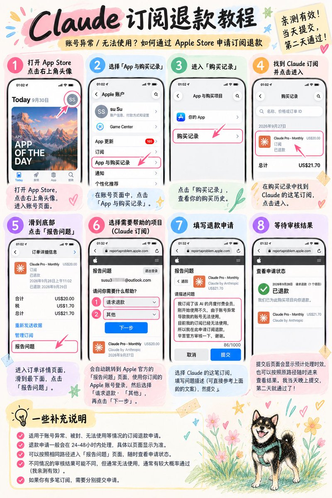
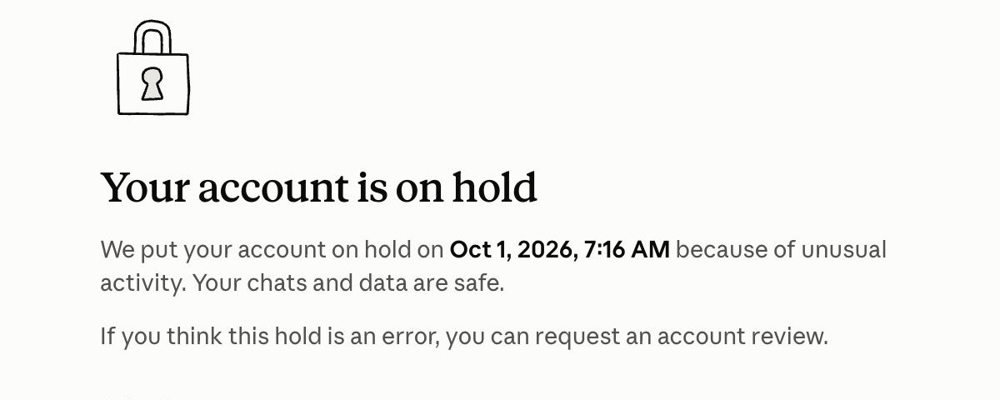

# Claude 退款、封号申诉与旧账号清理

App Store 提示无法购买或购买未完成时，先按[Apple 购买受限人工支持](07-apple-purchase-support.md)请求 Apple 复核。下面的封号申诉处理 Claude 账号；Apple 退款处理已经发生的订阅订单，按实际问题选择对应流程。

## 有封禁经历时先处理旧登录残留

本节在开场第一个问题回答“有”时主动读取，早于 VPS 询问；先确认是电脑、手机还是两者曾登录过被 Claude 封禁的账号，以及用过浏览器、Claude App 还是 Claude Code。

### 电脑：按系统提供内置清理 Skill

Mac 客户直接展示 [Mac 端清理 Skill](15-mac-cleanup.md)，Windows 客户展示 [Windows 端清理 Skill](16-windows-cleanup.md)，并说明：

> 我们先检查旧账号的本地登录残留。项目已内置适合您电脑系统的清理 Skill，会先列出实际范围，备份后再按您确认的范围处理。

对客户使用“Mac 端清理 Skill”“Windows 端清理 Skill”。两端都先只读审计，具体操作与验证范围见对应入口。

先确认实际使用的是 Claude Code、Claude Desktop 还是浏览器。只使用浏览器时，按指定浏览器配置档检查站点登录状态，不清空全部浏览器资料，也不清理未使用过的 CLI。Mac 的钥匙串路径不能套到 Windows；Windows Credential Manager 不自动删除。

沿用客户已确认的清理范围，展示实际清单、备份后，由客户在终端做一次最终确认。身份／账号状态单独选择；时区与网络按对应章节处理。结果记录具体已处理项目和备份位置。

### iPhone：建议删除，再重新下载 Claude

在客户对话中单独提醒：

> **如果这台 iPhone 用过被封禁的 Claude 账号，建议先删除 Claude App，再从 App Store 重新下载官方版本，之后再登录。这里是删除 App，不是仅从主屏幕移除，也不是“卸载 App、保留文稿与数据”。**

操作前确认用户已保存需要的本地资料，并且后续能从准备使用的 App Store 下载官方 App；开场给出建议后由客户安排，后续不再添加重装跟踪或验收。已有 Apple 订阅不因删除 App 而自动取消，不把重装当作退款或解封。

只用浏览器的 iPhone 客户按实际使用方式处理网站登录状态；不要声称重装未使用过的 App 能清理浏览器记录。Android 不照搬 iPhone 路径，按用户实际使用的 App／浏览器检查。

清理和重装是本地状态排查，不能保证消除设备关联、浏览器指纹、平台记录或解除封禁。记录涉及设备、建议是否已展示、用户选择、已完成／待完成与下一步；未经实际操作不记“指纹已清除”。需要申诉时接回本章申诉部分。

### 清理后接回主流程

适用清理完成后，用 `workflow.py submit` 和当前 `cleanup` 票据提交实际 `outcome`、`handled_scope`，读取返回任务并继续。浏览器站点清理、平台脚本清理，以及客户选择暂不清理，都走同一个衔接入口，按实际情况记录结果。首次交付依次回到设备搭配与阅读版说明 → Google 账号准备 → VPS；恢复交付复用已有结果，只补缺项。

客户说“先配置电脑”时，继续确认尚缺的手机类型，按主流程先电脑后手机。电脑网络和 AdsPower 验收后，继续手机代理、时区与定位、手机网络验收，再衔接手机登录和订阅。

## 先核对付款渠道

安卓浏览器在 Claude 官网使用 Google Pay 的订单，不是 Apple 内购，也不等同于 Google Play 内购。按作者目前掌握的渠道反馈，这条路线在 Claude 账号被封后目前无法退款；付款前必须按[安卓订阅指引](11-android-web-pay.md)告知用户，并按费用可能无法退回的风险决定。此为作者反馈，不作为已核实的官方统一政策；用户仍可凭实际订单向 Claude 官方支持核实，不承诺退款，也不带用户去 Apple 入口申请该笔订单。

## 退款申请

**Claude 被封后，Apple 退款完整流程**

**（教程是礼品卡充值的，也是可以退到余额，后续会有美区paypal教程，退款同理）**

### 打开 App Store

打开 App Store，点击右上角自己的头像。然后找到：

**App 与购买记录 → 购买记录**

进入之后，就可以看到自己最近的订阅和消费记录。找到「Claude Pro - Monthly」，点击进去。

### 进入 Claude 的订单详情

点进 Claude 这笔订阅以后，会看到具体的订单信息。然后一直往下滑，最下面有一个「报告问题」，点击进去。

系统会自动跳转到 Apple 官方退款页面：[reportaproblem.apple.com](https://reportaproblem.apple.com/)

**这里登录你当时订阅 Claude 使用的 Apple 账户。**

### 选择退款

进入页面以后，会看到「请问您需要什么帮助？」。这里我选择的是：

- 第一栏：请求退款。
- 第二栏：其他。

然后点击「下一步」。接下来会让你选择需要申请退款的订单，找到并勾选「Claude Pro - Monthly」。

### 填写退款原因

选完订单以后，会让你填写问题描述。我当时写的是：

我订阅了该 AI 的月度付费会员，刚开始使用不久，由于该平台的原因，导致我的账号异常无法使用，目前我的订阅已经无效，所以我在此申请订阅退费，辛苦官方审核一下，谢谢。

其实不用写得特别复杂。核心把这几个信息讲清楚就行：

**刚订阅不久 → 账号异常无法使用 → 已经无法享受订阅服务 → 申请退款。**

当然，建议大家还是按照自己的真实情况填写。填完以后直接提交。

### 等待 Apple 审核

提交以后，页面会显示预计处理时间。我这里显示的是 24–48 小时。

不过我实际速度还挺快，当天晚上提交，第二天就通过了。最后页面直接显示「已退款」

### 怎么查询退款进度？

如果中途想看审核到哪一步了，也很简单。可以继续按照原来的路径进入：

**App Store → 头像 → App 与购买记录 → 购买记录 → Claude 订单 → 报告问题**

或者直接进入 [reportaproblem.apple.com](https://reportaproblem.apple.com/)，里面有一个「查看申请状态」，就可以看到 Apple 的处理结果。

## 封号申诉

### 填写申诉表单

申诉时你会看到这两个问题：

表单问题

What do you use your account for? *

Describe your typical workflow and which Claude products you use (chat, API, Claude Code).

第 1 问（必填）：你的账号用来做什么？

提示语：描述你平时的使用流程，以及用了哪些 Claude 产品（chat、API、Claude Code）。

Anything else we should know?

Describe what was happening on Sep 29. Any extra context we should know?

第 2 问：还有什么需要我们了解的吗？

提示语：描述 9 月 29 日那天发生了什么，以及其他需要补充的背景。

我是这样写的：

#### 第 1 问的回答

##### ① 写用途：用什么 Claude 产品、做过哪些项目

**英文原文**

I use Claude Code for personal software development and learning. Projects I have built with Claude Code include a multi-agent memory system, a multi-agent harness, an automated daily AI news digest, a company website, harness health checks, and an agent voice system. These projects have greatly improved the efficiency of my personal use of AI agents. I have also used Claude Code to learn how to create AI videos.

**中文翻译**

我用 Claude Code 做个人开发和学习。用 Claude Code 做过的项目包括：multi-agent 记忆系统、multi-agent harness、自动 AI 信息日报、公司官网、harness 健康检查和 agent 语音系统，这些项目让我个人使用 AI agent 的效率提高了很多。我还用 Claude Code 学习怎么制作 AI 视频。

##### ② 表明清白：没做过违规的事、欢迎查记录；说明账号有多重要，请求复核解封

**英文原文**

I have never engaged in any prohibited activities involving cybersecurity, model distillation, reverse proxying, or anything similar. You are welcome to review every conversation on my account. My account contains a substantial amount of saved memory and project experience that is extremely important to my personal life, work, and learning. I respectfully request that you conduct a thorough and fair review and reinstate my account.

**中文翻译**

我从来没有做过任何涉及网络安全、模型蒸馏、反向代理之类的违规操作，你们可以检查我账号里的每一段对话。我的账号里保存了大量记忆和项目经验，对我的个人生活、工作和学习都非常重要。恳请你们做一次彻底、公平的检查，并恢复我的账号。

#### 第 2 问的回答

##### ③ 写当天经过：那天在用 Claude 做什么、什么时候发现被封，并说明是误封

我甚至建议写得更详细一些，像我申诉信里那样。

**英文原文**

Earlier today, I was using Claude Code to learn how to refine prompts for AI video generation, and I asked the Opus 5.5 model to help improve my prompts. Everything was working normally at that time. A few hours later, after waking up, I asked Claude Code to help me search for popular JEV-related projects from across the web so that I could study them. That was when I discovered that my account had been disabled.

I feel that this was a mistake, and I cannot think of any reason why my account should have been disabled. Please help me.

**中文翻译**

今天早些时候，我在用 Claude Code 学习怎么润色 AI 视频生成的提示词，并让 Opus 5.5 模型帮我修改提示词，那时一切都还正常。几个小时后，我睡醒了，让 Claude Code 帮我搜索全网最近很火的 JEV 相关项目来学习，这时才发现账号被封了。

我觉得这是一次误判，我想不出任何账号应该被封的理由。请帮帮我。

##### ④ 主动解释：说出可能被误判的点（我是高频用 MCP）和真实用途

**英文原文**

Could my account have been disabled because I made a large number of MCP calls? I used MCP only to have my agents send their responses to a frontend that I built for my own personal use and reading preferences. That frontend allows me to pin any response I consider important and review it whenever I want. I firmly believe that this is a compliant use of MCP, and I was never informed that this type of personal integration was prohibited.

**中文翻译**

我的账号会不会是因为我调用了大量 MCP 才被封的？我用 MCP 只是为了让 agent 把回复发到我自己写的一个前端上，方便我按自己的习惯阅读。在那个前端里，我可以随时 pin 住任何我觉得重要的回复，随时回看。我坚信这是合规的 MCP 用法，也从来没有人告诉过我这种个人集成是被禁止的。

### 发申诉邮件

同时立刻发申诉邮件（在表单的 final decision 出来之前）。

usersafety@anthropic.com ❌
support@anthropic.com ❌
privacy@anthropic.com ✅

三个申诉相关邮箱都已发送过邮件，但只有 privacy@anthropic.com 回复称问题会转交人工团队继续处理；另外两个邮箱只自动回复要求填写表单。因此，直接发送至 privacy@anthropic.com 即可。

“We're transitioning your question to a human member of our Privacy Team for further assistance.”“我们正在将您的问题转交给隐私团队的一位人工成员，以便提供进一步协助。”

#### ① 开头：一句话说明哪天被封、想不通为什么

**申诉原件（英文）**

Subject: Appeal for Wrongfully Disabled Paid Account - Request for Review & Access Restoration

Dear Trust & Safety Support Team,

My account（我的邮箱@xxx.com）was suddenly suspended after I used Claude normally on September 29. Honestly, I’ve gone over that day again and again, and I still can’t figure out what I did that could be considered abuse. Here’s what I actually did:

**中文翻译**

邮件主题：付费账号被误封的申诉——请求复核并恢复访问

尊敬的信任与安全支持团队：

我的账号（我的邮箱@xxx.com）在 9 月 29 日正常使用 Claude 之后突然被封了。说实话，那天的事我翻来覆去想了很多遍，还是想不出自己做了什么会被当成滥用。下面是我当天实际做的事：

#### ② 当天经过：按时间逐条写用 Claude 做了什么，最后声明没做任何违规的事

**申诉原件（英文）**

Around 2:38–4:26 a.m. ET, I asked Claude to check whether a complete AI video prompt needed polishing. The prompt included:A 21:9 photorealistic cinematic scene;

A handheld documentary feeling;

An English conversation between a post-production engineer and a male producer in a hallway;

Specific facial expressions, character positions, actions, walking routes and camera movement;

Realistic environmental sound, with no BGM;

No subtitles, slow motion, advertising style, text or brand logos;

Several character and location reference images, to keep the people and environment consistent.

Around 9:08 a.m. ET, I used Claude for early exploration of the JEV project. I asked it to:Research the background of the project;

Help me understand what this project could become;

Compare a few possible positioning and development directions;

Point out questions that were worth researching next.

That’s basically everything I did that day. I didn’t spam requests, share my account, bypass safety rules, scrape the service, or create harmful content. It was just normal AI video creation help and project research.

**中文翻译**

美东时间凌晨 2:38–4:26 左右，我让 Claude 看看一段完整的 AI 视频提示词需不需要润色。提示词包括：21:9 的写实电影画面；

手持纪录片的质感；

一名后期工程师和一名男制片人在走廊里的英文对话；

具体的人物表情、站位、动作、行走路线和镜头运动；

真实环境声，不要背景音乐；

不要字幕、慢动作、广告感、文字和品牌标识；

几张人物和场景参考图，让人物和环境保持一致。

美东时间上午 9:08 左右，我用 Claude 对 JEV 项目做前期探索，让它：研究这个项目的背景；

帮我理解这个项目可以做成什么；

对比几个可能的定位和发展方向；

指出下一步值得研究的问题。

这基本就是我当天做的全部事情。我没有刷请求、共享账号、绕过安全规则、抓取服务，也没有生成有害内容，就是很普通的 AI 视频创作辅助和项目研究。

#### ③ 长期用途：列出一直在做的项目，证明是正常的个人使用

**申诉原件（英文）**

I’ve been using Claude Code for personal development and learning for a long time. Some of the projects I’ve worked on include:

A multi-agent memory system;

A multi-agent harness;

An automated daily AI news report;

A company website;

A harness health-check system;

An agent voice system;

Learning and practicing AI video creation.

All of these projects were for my own work, learning and productivity. I have never used Claude for cyberattacks, model distillation, reverse proxy services, or anything else that violates the usage policy. You can check every conversation and my full account history.

**中文翻译**

我长期用 Claude Code 做个人开发和学习，做过的项目包括：

multi-agent 记忆系统；

multi-agent harness；

自动 AI 信息日报；

公司官网；

harness 健康检查系统；

agent 语音系统；

学习和实践 AI 视频制作。

这些项目都是为了我自己的工作、学习和效率。我从来没有用 Claude 做过网络攻击、模型蒸馏、反向代理服务，或其他任何违反使用政策的事。你们可以检查我的每一段对话和完整的账号记录。

#### ④ 主动解释：说出可能被误判的点（我是高频用 MCP）和真实用途

**申诉原件（英文）**

I’ve thought about it over and over, and I still can’t think of any reason why my account would be suspended. I’ve always used Claude in a normal and responsible way. Could it be because I use MCP a lot, and the system mistakenly flagged that as model distillation?But the only reason I use MCP so frequently is to let my agents send their replies to a front end I built for myself, because it fits the way I like to read and work. In that front end, I can pin any sentence I think is important, look back at it whenever I want, continue my tasks at any time, and let multiple agents work together on development more easily.I strongly believe this is completely compliant behavior. Anthropic has never said users aren’t allowed to work this way. You can review any of my conversations, there won’t be any policy-violating content in them.

**中文翻译**

我反复想了很久，还是想不到账号会被封的理由，我一直都在正常、规范地使用 Claude。难道是因为我用 MCP 比较多，被系统误判成了模型蒸馏？可我频繁用 MCP，只是为了让 agent 把回复发到我自己写的一个前端上，因为这更符合我的阅读和工作习惯。在那个前端里，我可以随时 pin 住任何一句我觉得重要的话，随时回看、随时接着做任务，也方便多个 agent 一起协作开发。我坚信这是完全合规的行为，Anthropic 也从来没说过不能这样用。我的任何一段对话你们都可以查看，里面不会有任何违规内容。

#### ⑤ 账号有多重要：写账号里积累了什么、被封后的真实感受

**申诉原件（英文）**

My account contains a lot of accumulated memories, project context and long-term working experience, all of that is very important to my personal life, work and learning. Honestly, losing access to Claude has been really upsetting. I care a lot about AI agents and I’ve put a huge amount of time and passion into this. Claude wasn’t just a tool I opened once in a while, it had become an important part of how I work, learn and create every day. After the suspension I felt down for a long time, and I’m also scared that all the context I built up could just be gone.

**中文翻译**

我的账号里积累了大量记忆、项目上下文和长期的工作经验，这些对我的个人生活、工作和学习都非常重要。说实话，用不了 Claude 让我真的很难受。我非常在乎 AI agent，也在这上面投入了大量时间和热情。Claude 对我来说不是一个偶尔打开的工具，它已经是我每天工作、学习和创作里很重要的一部分。被封之后我低落了很久，也很害怕长期积累下来的上下文就这样全没了。

#### ⑥ 表态：理解平台要防滥用，但礼貌而明确地反对一刀切误封

**申诉原件（英文）**

I understand Anthropic has to stop real abuse. But normal users shouldn’t carry the full consequence of a possible automated mistake, especially with no specific explanation at all. This kind of handling feels harsh and unfair. It disrupted my work, and it makes people who genuinely use the product in good faith lose trust in the platform. I’m honestly very disappointed, and I strongly object to normal users being banned in this blanket, one-size-fits-all way.

**中文翻译**

我理解 Anthropic 必须打击真正的滥用。但正常用户不该为一次可能的自动误判承担全部后果，更何况连一个具体的解释都没有。这样的处理让人觉得粗暴又不公平。它打断了我的工作，也会让真心、善意使用产品的人对平台失去信任。我真的很失望，也强烈反对这种对正常用户一刀切的封号方式。

#### ⑦ 提出请求：要求真人复核并恢复账号；若真违规，要求说清是哪次操作、哪条规则

**申诉原件（英文）**

Please don’t rely only on an automated enforcement result. I’m asking for a real person to thoroughly and fairly review my account, conversations and usage history, then restore my access once you confirm there was no violation. If you really believe I broke a rule, please tell me exactly which action and which rule, don’t leave me guessing what I supposedly did wrong.

Thank you.

**中文翻译**

请不要只依赖自动风控的结果。我希望由真人对我的账号、对话和使用记录做一次彻底、公平的检查，确认没有违规后恢复我的访问权限。如果你们真的认为我违反了某条规则，请明确告诉我是哪一次操作、哪一条规则，别让我一直猜自己到底做错了什么。

### 申诉焚诀

如果claude邮件页面提示「使用地区不受支持」或「违反地区使用限制」，申诉时就重点说你是 YouTube 创作者，满世界到处跑，短期来中国旅行期间使用过 VPN。请求解封。

#### 英文申诉稿

**Subject: Appeal to Restore Access to My Claude Account**

Hello Anthropic Support,

I'm a YouTube creator and regularly travel around the world to make videos. During a short visit to China, I used a VPN to access Claude to help with my video work. I subsequently received a notice about regional usage restrictions and lost access to my account.

I would like to explain that this happened during a short trip to China. Could you please review my account and restore access?

Thank you for your time and help.

#### 中文对应

**主题：申请复核并解除 Claude 账号限制**

Anthropic 支持团队，你们好：

我是一名 YouTube 创作者，平时经常到世界各地旅行、拍摄视频。短期来中国旅行期间，我使用 VPN 访问 Claude，辅助视频创作。随后，我收到了有关使用地区限制的提示，账号也无法继续使用。

我想说明，这次使用发生在短期赴中国旅行期间。希望你们能重新审核我的账号，解除限制，恢复访问。

感谢你们的时间和帮助。

## 备份资料

这台电脑以前登录过被封禁的 Claude 账号，可以先检查并按需清理本地登录残留；具体范围按上面的开场清理分支处理，不保证清理后就能解除封禁。

我两台封过号的 MacBook，清完都在正常用。

项目已内置 [Mac 端清理 Skill](15-mac-cleanup.md) 和 [Windows 端清理 Skill](16-windows-cleanup.md)。按系统进入对应流程。

**动手之前，先完整备份 ~/.claude。**你的 Skills、Hooks、会话记录都在备份里。

## 退出旧账号

请您自行退出此前使用的账号。本项目不提供具体退出步骤。

## 清理登录残留

### 先检查这三个位置

Claude 会在你电脑里留下不少东西，主要是这几处：

1. 用户主目录下的 **.claude** 隐藏文件夹。
2. macOS 的钥匙串（Keychain）里存的 Claude 凭据。这一步很多人会漏掉，光删 **.claude** 文件夹可能还是不够。
3. 应用支持目录里的历史会话文件。如果你知道被封账号的 org_id，可以用它当关键字搜出来，列入清理范围。

不想自己动手的话，直接把这段话丢给你的 Agent：

帮我清理这台电脑上 Claude 的本地残留，包括 .claude 目录、Keychain 里的 Claude 凭据、应用支持目录里的历史会话文件，清理前先列出来给我确认。

### 用 Skill 完成备份和清理

Mac 端按上一节的内置清理 Skill 执行；Windows 的范围与恢复方式见 Windows 端入口。Mac 端流程如下：

- 动手前先完整备份 ~/.claude，保留 Skills、Hooks 和会话记录。
- 缓存和日志它会自动清。换本地 ID、清钥匙串和桌面端的登录状态、改台北时区这些改动比较大的，做不做由你自己选。
- 删掉的东西只进一个带时间戳的废纸篓目录，不会永久删除。
- 你输入一次 CONFIRM，它才开始动。

注意要让 Codex 或者普通终端来跑它，**别让正在运行的 Claude Code 清理它自己的目录。**

使用方法：让 Agent 读取本项目中对应平台的清理入口，先进行只读审计。

它会先做一遍只读审计，告诉你找到了哪些缓存、备份要占多大空间、哪些是高风险操作，一样都还没动。

你确认要清哪些之后，还得自己在终端里输入 CONFIRM，它才真正开始清。

