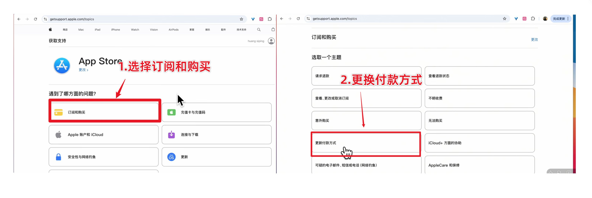
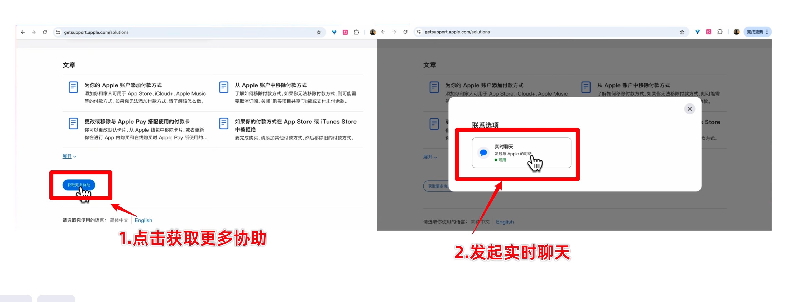

# Apple 购买受限：Codex 带办人工支持

App Store 内购提示「无法完成购买／Purchase Not Completed／Cannot Complete Purchase」，完成余额、账号与购买权限自查后仍失败，或页面明确要求联系 Apple 支持时，按本章请求人工复核。用户希望 Codex 帮忙处理时，直接沿下面的流程带办。

本章处理 Apple 的购买问题。按实际提示分流：Apple 账户无法登录时先完成账户恢复；已扣款但权益未到账时核对订单与 App 权益；提示订阅关联其他 Claude 账号时核对订阅归属；申请退款走[退款章节](04-recovery.md)。记录原始报错，让客服核实具体限制。

## 1. 先确认问题与操作分工

核对当前 App Store 使用的账户、目标 App 与套餐、完整报错、余额是否覆盖价格及税费，以及「屏幕使用时间」中的 App 内购买权限。失败的购买按实际订单状态填写；只有确有订单时才使用对应订单号。已具备这些信息就继续，缺少的只补问必要部分。

**Codex 负责官方入口导航、起草问题说明、提交已获授权的支持请求、读取并回复客服、追问处理安排及记录结果。用户本人负责账户登录、密码和登录验证码、Support PIN 的生成与输入，以及客服要求的本人核验。**

客服沟通围绕用户确认过的购买事实展开。使用下面的第一人称问题说明，具体 App、报错、付款来源和用途按用户实际情况填写。身份核验的问题交给用户本人回答，完成后继续处理购买问题。客服提出电话核验时，确认官方联系安排，由用户本人接听。

保持现有可用环境，先暂停重复购买和追加充值，集中处理当前支持请求。客服要求调整某项设置时，按具体说明操作并记录结果。

## 2. 进入 Apple 官方人工支持

优先用本机已连接的 Chrome，由 Codex Computer Use 操作。打开 [Apple Get Support](https://getsupport.apple.com/)，美区购买问题在页面底部选择 **United States**，语言选择 **English**；其他地区按实际账户与购买地区选择。这里调整的是支持网站地区。

在官网点击 **Sign in**，提醒用户登录发生购买问题的那个 Apple 账户，完成登录验证码。用户回复完成后，Codex 重新读取页面再继续；网页会话已登录时先由用户确认是对应账户。

### 2.1 主路径：App Store 无法购买

**Choose a product（需要时） → App Store → Subscriptions & Purchases → Unable to purchase → Continue → Get more help → Live Chat／Chat。**

进入解决方案页面后，滚动查看底部 **Get more help**。按当前界面选择在线聊天，填写页面实际要求的资料和问题说明，然后点击该表单的 Continue／提交。产品分类阶段的 Continue 与联系表单里的 Continue 分别按当前页面操作。

### 2.2 备用路径：账单与订阅

主路径没有在线聊天或当前问题涉及付款信息时，回到产品／主题选择，按页面可用项进入：

**Billing & Subscriptions → Update Payment Information／Update payment method → Third-Party Subscriptions or Purchases（出现时） → Continue（出现时） → Get more help → Chat。**

已有截图展示了 App Store → Subscriptions & Purchases → 更新付款方式的另一种入口。依据当前报错选择对应主题，进入 **Get more help** 联系人工。

网页名称和顺序随地区与时间变化，按实际可见的对应项导航。**Get started** 通常进入页面推荐的自助方案；本轮需要人工复核时，优先找 **Get more help**。只看到自助文章时继续检查页面底部、账户登录状态、支持地区及当前联系方式。聊天暂不可用时，记录实际显示的服务时间，或协助用户选择官网提供的电话／回拨方式。页面连接失败时按实际错误修复并恢复官方页面。

## 3. 填写问题说明并与客服沟通

按表单填写用户确认的姓名、Apple 账户邮箱、App／项目名称和问题描述。未完成且没有订单的购买，Order number 在允许时留空；表单必填时向客服询问相应填法。资料在用户自己的官方页面填写，进度只记录必要的脱敏结果。

**简短表单说明**（按实际 App 与报错替换）：

> I cannot complete a Claude Pro purchase in the App Store. The message says “Purchase Not Completed.” Please review the purchase attempt and let me know how to proceed.

如果实际报错是 **Cannot Verify Payment Information**，按原文替换报错。表单字数有限时保留 App、报错和复核请求三项。

**接通人工后的问题说明：**

> Hello, I’m trying to purchase a Claude Pro subscription through the Claude iOS app, but I receive “Purchase Not Completed.” Could you please review this purchase attempt, check whether there is a purchase restriction on my Apple Account, and explain what I need to do next?

需要时补充用户已确认的事实，例如余额足够时使用：

> I am paying with my Apple Account balance, which covers the subscription price and tax.

客服问用途时，使用用户自己的用途；例如确实用于日常工作和编程时：

> I use Claude for everyday work, AI conversations, and personal coding projects.

接通后逐条读取客服最新消息，向用户简短说明含义，再回复购买相关问题。等待核查时保持聊天窗口在线；客服询问是否仍在线时及时确认，并说明当前正在完成的实际步骤：

> Thank you. I’m still here and will complete the account verification.

需要账户验证时保留聊天窗口，另开官方账户页面。需要用户输入时，明确指向当前页面和操作位置，完成后 Codex 接着沟通。

## 4. 用户本人完成 Support PIN 验证

Apple 可能要求设备上的账户确认通知，也可能要求临时 **Support PIN**。按客服对本次会话的要求，由用户完成。

Support PIN 的官方步骤见 [Apple 账户确认说明](https://support.apple.com/en-us/102425)：

1. 保留当前客服聊天窗口，另开 [account.apple.com](https://account.apple.com/)，由用户登录同一个账户并完成登录验证。
2. Codex 帮助定位页面底部的 **Support PIN → Generate PIN**；部分界面可在 Sign-In and Security 附近找到，按当前页面定位。
3. 用户本人生成 PIN，并将四位 PIN 输入当前 **Apple 官方客服聊天窗口**。PIN 的有效期和一次性使用要求以生成窗口为准；过期时重新生成。
4. 用户完成输入后，Codex 继续读取客服回复，确认验证已完成，并进入购买尝试的核查。

登录密码和短信／邮箱登录验证码由用户在 Apple 登录页面完成输入；客服聊天使用本次会话要求的 Support PIN 或设备确认。记录只写“待本人验证／验证完成”及下一步，截图选择隐藏验证码和账户资料后的画面。

## 5. 问清处理结果、等待起点与重试时间

客服回复后，确认本次购买尝试处于哪种状态：已处理并可重试、已升级处理且需等待、仍需补充资料，或需转接其他团队。记录实际答复。

等待安排可以一次问清：

> Thank you. Has this purchase attempt been escalated for review? How long should I wait, and when does the waiting period start? Should I pause purchase attempts during that time? Will I receive a notification, or should I retry after the waiting period? If it still fails, how should I follow up using this case number?

新账户充值和订阅前的一到两天使用建议，与本次购买受限后的等待是两回事。已经购买受限时，按本次客服安排处理，不重新套用新号等待。

常见经验是等待 **72 小时**，也有较长等待的情况；本次时长、起点、是否暂停购买、是否通知和到期操作，按当前客服确认的内容填写。客服只说“等 72 小时”时补问起点；给出范围时记录原范围并确认建议何时重试。

将起点和用户实际使用的时区写清楚，换算出具体重试日期和时间，再向用户复述。客服没有确认的安排留作待问项。结束前请用户在本机保存案件号与脱敏聊天凭证，进度只保存其本机路径。

**支持阶段的完成标志：**请求已提交／已接通、账户验证状态明确、处理答复已记录、等待和跟进安排已确认。到期重试并看到付款与对应 Claude 账号权益后，再完成订阅验收。

## 6. 等待后继续与再次跟进

用户下次继续带做时，先读取 `.local/progress.md` 的等待记录。尚未到客服确认的时间，就说明具体可重试时间；到期后先核对同一账户、网络、套餐、余额及现有订单，再按客服安排尝试购买，由用户本人完成付款确认。

购买成功后，在正确 Claude 账号核对权益并发起一次正常请求。仍失败时记录新的完整报错和订单状态，回到官方支持入口，使用用户本机保存的案件号继续跟进：

> I contacted Apple Support about this purchase attempt and completed the advised waiting period. I tried again at the advised time, but I still receive “[current error].” Could you please review the previous case and advise the next step?

等待期间的进度靠用户再次调用项目时恢复；用户希望到期提醒或后续自动跟进时，再按明确要求设置。

## 7. 可直接交给 Codex 的带办提示词

> 请按本项目的 Apple 购买受限人工支持流程，帮我处理这次 App Store 购买问题。先核对我已有的报错、账户和付款信息，再用本机 Chrome 打开 Apple 官方 Get Support，优先走 App Store → Subscriptions & Purchases → Unable to purchase → Continue → Get more help → Live Chat，按当前页面使用对应入口或备用路径。请依据我确认过的事实，用第一人称简洁描述购买问题，与客服逐条沟通，并向我说明客服的回复。Apple 账户登录、登录验证码、Support PIN 的生成和输入、以及本人身份核验由我完成；请在相应页面提示我接手，完成后继续沟通。请确认这次处理状态、等待时长与起点、等待期间的购买安排、通知方式及失败后的跟进方法，换算出具体重试时间，并将脱敏结果和本机凭证路径记入 `.local/progress.md`。付款确认由我完成，成功后再核对订阅权益。
