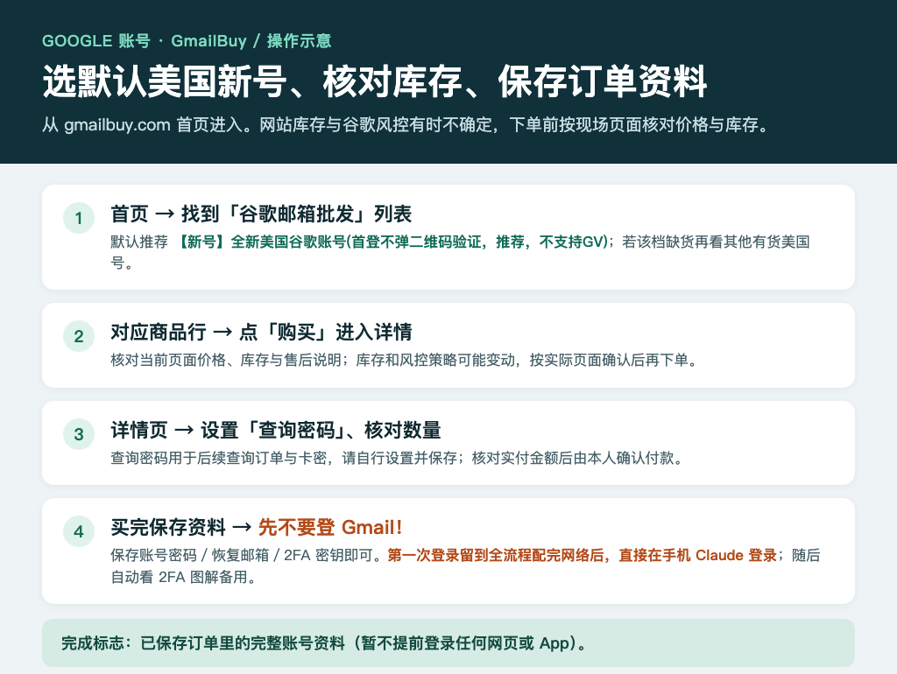
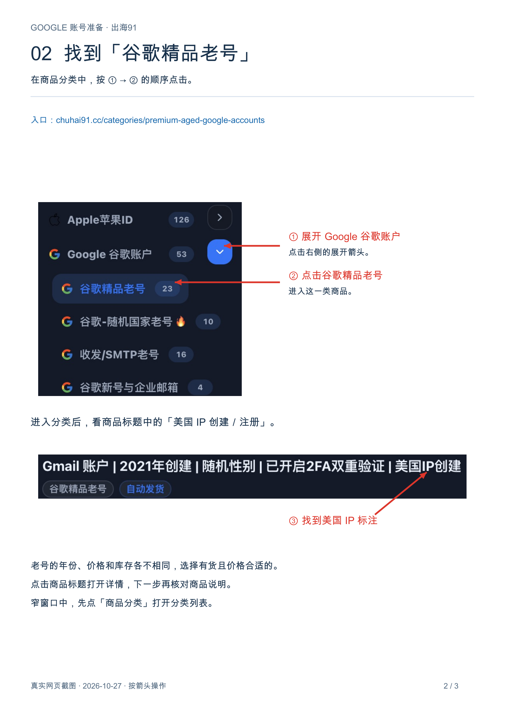
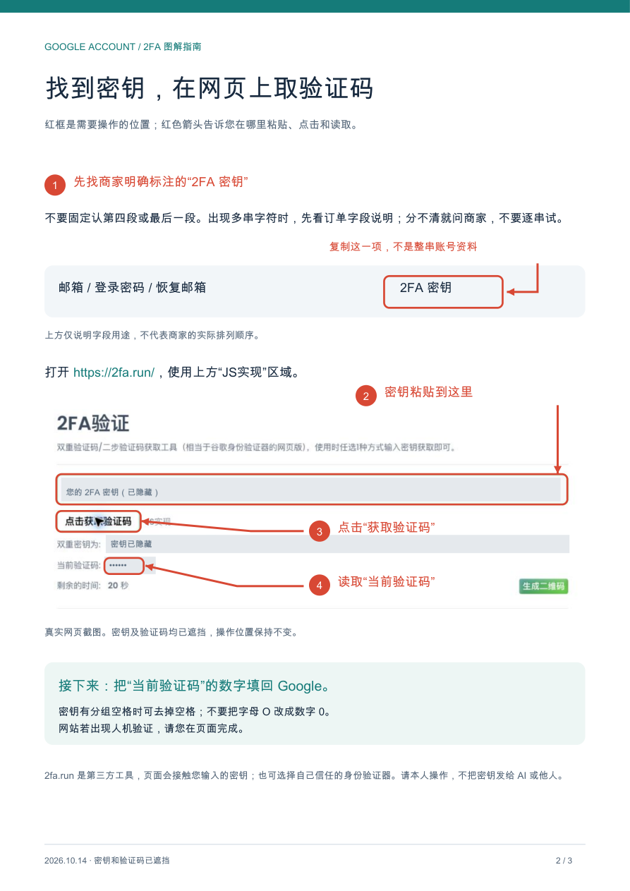

# Google 账号准备与两步验证

**默认配图带做：**收到购买资料时按「账号字段 → 2FA 取码 → Google 回填」一次展示三张原图并给出 `https://2fa.run/`。客户后续说不会或没看懂，运行 `python3 scripts/workflow.py guide --topic google_materials` 或 `--topic google_2fa` 重发整组图。

## 1. 先确认是否有可用 Google 账号

确认设备后单独问一句原话：**「您有一个现在能正常登录的 Google／Gmail 账号吗？」**
- **已有可用账号**（含从未使用过 Claude 的自有 Gmail）：提交 `account_origin=self_used`、`google_account_status=available` 直接复用，进入 VPS（如该号关联的 Claude 曾被封，先确认是否另有可用 Google 账号）。
- **没有可用账号**：按客户原话提交 `google_account_status=unavailable`，同条回复给出首选 GmailBuy、备选出海91及选购图：

> **默认推荐购买 GmailBuy 的全新美国谷歌账号，两个网站都可以选：**
>
> - 首选 [GmailBuy](https://gmailbuy.com/)：推荐 **[【新号】全新美国谷歌账号(首登不弹二维码验证，推荐，不支持GV)](https://gmailbuy.com/home/goods.html?id=18&sid=18)**。
> - 备选 [出海91](https://chuhai91.cc/)：也有谷歌精品老号等套餐可选。
>
> **选购提示：**谷歌账号网站的库存有时候会变动，谷歌账号的风控情况也会不确定，下单前以您现场打开页面的实际价格、库存和售后说明为准。**买完先保存资料，把宝贵的“第一次登录”留给后面 VPS、电脑网络、AdsPower 和手机网络全部配置验收完成后的手机 Claude App**（因为谷歌风控不确定，新号第一次登录往往最顺畅、最容易直接登进去）。

客户选定渠道后记录 `purchase_channel=gmailbuy` 或 `chuhai91` 并沿用。Google 账号用于登录 Claude，美区 Apple 账号用于 App Store 下载与内购；电脑端日后沿用同一个 Google 账号。

## 2. GmailBuy：从商品列表到查订单（首选）

打开 [GmailBuy](https://gmailbuy.com/) 或直达 **[【新号】全新美国谷歌账号(首登不弹二维码验证，推荐，不支持GV)](https://gmailbuy.com/home/goods.html?id=18&sid=18)**（认准 `id=18&sid=18` 本页，区分相邻带 `2FA,` 的档位），点「购买」核对现场价格、库存与售后，自行设置并记好查单用的「查询密码」。客户找不到图时用 `guide --topic gmailbuy` 重发。

## 3. 出海91：三步购买（备选）

客户选定出海91时，首次回复一次给齐下面三张原图和链接（找图用 `guide --topic chuhai_purchase`），按客户当前页实时价格与库存挑选：

1. **注册出海91购物网站账号**：打开[出海91注册页](https://chuhai91.cc/auth/register)，填写自己能收信的常用邮箱（QQ 邮箱也可以）与网站密码，完成邮箱验证登录（已有账号直接登录）。
   
2. **进入分类**：左侧展开 **「Google 谷歌账户」→「谷歌精品老号」**，或直达[谷歌精品老号分类](https://chuhai91.cc/categories/premium-aged-google-accounts)。
   
3. **优先选「美国 IP 创建／注册」的老号**：查看商品详情说明，按当前在售价格与库存选标注清晰、有货的档位完成付款并保存订单资料。
   

## 4. 收到账号资料后：看懂字段与 2FA 取码

客户说买好并收到资料时，提交 `account_origin=purchased` 与 `google_account_status=available`，同条回复完整展示：
- **首登时机原因**：先把邮箱、密码、恢复邮箱、2FA 密钥（如有）保存好，把第一次登录留给后续网络配完后的手机 Claude App。
- **2FA 大白话科普与入口**：2FA 验证码是每 30 秒刷新一次的 6 位动态数字密码，「2FA 密钥」是生成它的种子；推荐使用 **[2FA 取码工具：https://2fa.run/](https://2fa.run/)** 照图取码（手机本机身份验证器导入密钥后面有条件再配即可）。
- **嵌入下方三张原图**（展示后提交 `materials_explained=true` 与 `materials_images_shown` 继续进入 VPS）。

| 字段 | 用途 |
| --- | --- |
| Google 邮箱 / 登录密码 | 登录 Google 时填写的账号与密码 |
| 恢复邮箱／密保邮箱 | Google 要求恢复邮箱核验时使用 |
| 2FA 密钥 | 一长串字母数字，用于生成 6 位动态两步验证码（按商家字段标注识别，字段顺序因商品而异） |

## 5. 手机登录出现两步验证时怎么操作

手机网络验收完成后，在官方 Claude App 点 Google 登录输入账号密码；若弹出身份验证器验证码：
1. 在已配好的电脑 AdsPower 环境打开 [2FA 取码工具：https://2fa.run/](https://2fa.run/)。
2. 在上方 **JS实现** 区域由客户本人粘贴订单标注的 **2FA 密钥**（去掉分组空格，保留完整字母数字）。
3. 点击 **「点击获取验证码」** 读取 **「当前验证码」**，在倒计时结束前填回手机 Google 页面（快过期等下一组）。
4. 若页面要求短信、恢复邮箱或备用码，按页面实际验证方式完成。账号串、密码、密钥与验证码均由客户自己保管与填写，进度仅记录账号准备和验证状态。
