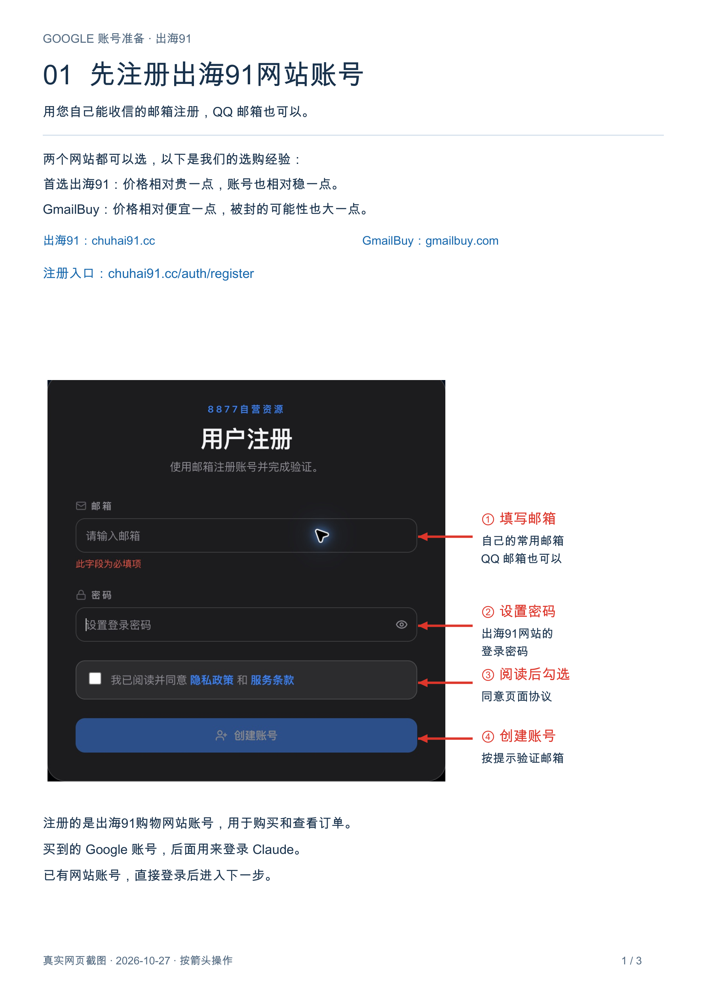
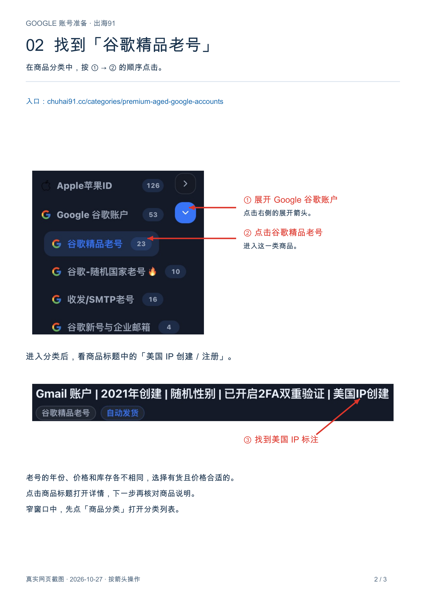
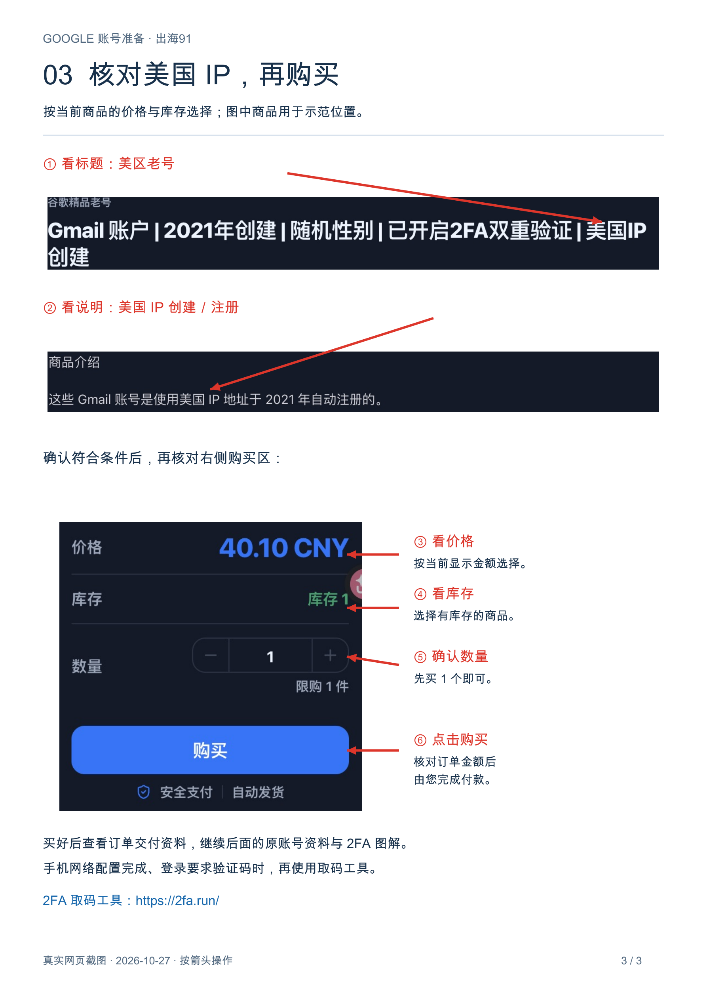
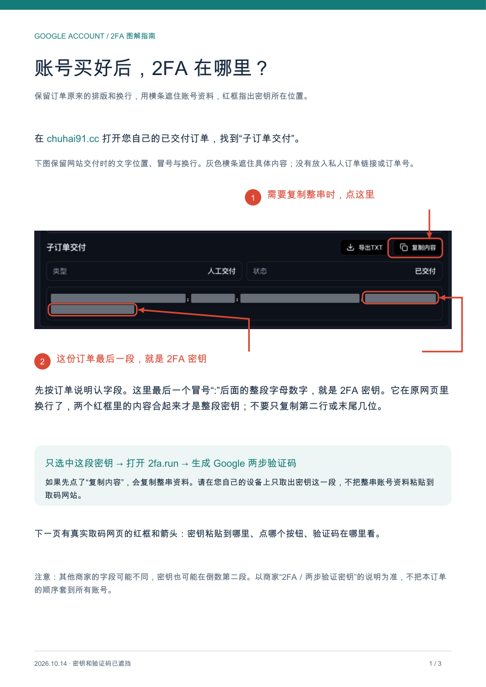
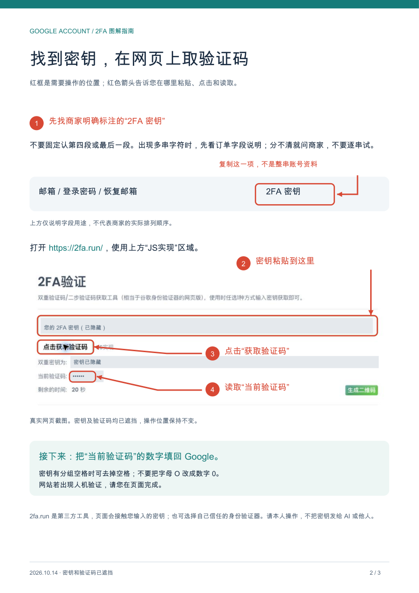
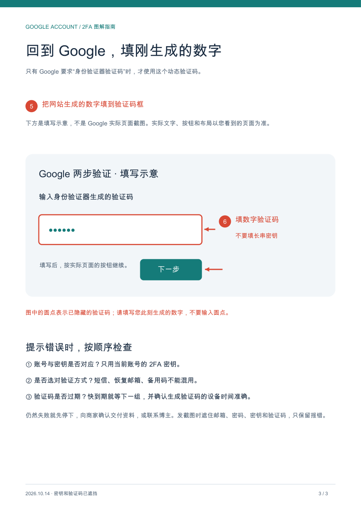

# Google 账号准备与两步验证

## 开始时先确认账号

确认设备与当前进度后，尽早单独问：“您有没有能正常登录 Claude、没有被 Claude 封禁的 Google 账号？有的话直接沿用。”已有能正常登录 Claude 的账号就复用。尚未配置好网络时先确认和准备资料，实际登录留到手机网络验收后。

账号复用以 Claude 的可用状态为准。Google／Gmail 能登录，但对应的 Claude 账号已被封禁时，记录 account_available=false，继续准备其他可用账号；若后来找回的账号也已被 Claude 封禁，同样按此处理。尚未用过 Claude 的 Google 账号先确认既有情况，实际登录仍留到手机网络验收后，不为回答这个问题提前登录。

本流程只走“已有账号复用、没有账号购买”，不引导用户注册 Google 账号。`google` 阶段先单独询问账号；用户回答没有后，再同时展示两家渠道。已有可用账号记录 `account_origin=self_used`、`account_available=true`；购买账号收到资料时记录 `account_origin=purchased`、`account_available=true`，先完成下面的资料图解再继续。

没有可用账号时，先明确告诉客户：

> **优先购买美区 Google 老号，两个网站都可以选：**
>
> - 首选[出海91](https://chuhai91.cc/)：按我们的选购经验，价格相对贵一点，账号也相对稳一点。
> - [GmailBuy](https://gmailbuy.com/)：价格相对便宜一点，按我们的选购经验，被封的可能性也大一点。
>
> 看您个人选择。选出海91的话，我会按下面的图示一步步带您操作。

首次提供购买渠道时，在同一条对话里同时展示两个可点击链接及上述差别，由用户选择。默认推荐出海91；客户选择后记录 `purchase_channel=chuhai91` 或 `gmailbuy`，恢复时沿用该选择。用户选择 GmailBuy 就按其实际商品页继续挑选美区老号。已有可用 Google 账号继续复用。

选购建议按作者交付经验表达，给出选择和下一步即可。商品页的“使用痕迹”等介绍用于理解商品属性，回答仍围绕“美区＋老号”的选择与下一步操作，不延伸成层层风险推测。实际商品信息缺什么就核对什么，先展示上述两家差别；客户继续询问时针对具体问题回答。能直接查看页面时自行检查；需要用户提供信息时，只索取商品名称或当前商品页截图。付款由用户在商家页面完成。

Google 账号用于登录 Claude；美区 Apple 账户用于 App Store 下载、礼品卡充值和订阅付款。后续电脑上的 Claude 桌面端或 CLI 沿用手机登录的同一个 Google 账号。

## 出海91：照着这三步准备账号

图示采集于 2026-10-27，页面当前显示「8877自营资源」，网站入口为 `chuhai91.cc`。图片用于找入口和认商品，价格、库存和商品名称以您当时看到的页面为准。Codex 带做时按当前步骤主动展示对应图片，每次一个小目标。

### 第一步：先注册出海91网站账号

1. 打开[出海91注册页](https://chuhai91.cc/auth/register)。也可以从首页的登录入口选择「还没有账号？立即注册」；窄窗口可从底部「我的」进入。
2. 填写**您自己能正常收信的邮箱，QQ 邮箱也可以**，并设置这个购物网站的登录密码。这里注册的是出海91网站账号，用于购买和查看订单；后面买到的 Google 账号用于登录 Claude。
3. 阅读页面协议后，由您勾选同意并点击「创建账号」，按网页提示完成邮箱验证，再登录网站。已经有出海91账号就直接登录。

### 第二步：找到「谷歌精品老号」

进入商品页面，在左侧展开 **「Google 谷歌账户」**，再点 **「谷歌精品老号」**。窄窗口先点「商品分类」打开分类列表。也可以直接打开[谷歌精品老号分类](https://chuhai91.cc/categories/premium-aged-google-accounts)。

### 第三步：优先选「美国 IP 创建／注册」的老号

先看商品标题，再点进去核对商品说明。**优先选择明确写着“美国 IP 创建”“美国 IP 注册”或同等说明的老号**；例如图中详情写明该账号使用美国 IP 地址创建。

同一分类里年份、价格、库存各不相同。按当前在售商品选择符合上述条件、价格合适且有库存的即可，年份与价格按实际商品比较。图中的年份、金额和库存是截图当时的示例，不作为固定购买要求。标注不清楚就先看详情；仍不明确时问商家或换一个标注清楚的商品。

确认商品、数量和实际付款金额后，由您完成购买。购买后在订单中查看商家交付的账号资料，接着按下面两节辨认字段；**手机网络验收完成后，再用买到的 Google 账号登录 Claude，出现两步验证时使用 2FA 教程。**账号资料准备好后，Codex 在当前 Google 阶段记录购买来源与准备结果，展示下面的资料图解，再按程序返回的下一步继续原流程。

## 对话里直接给出 2FA 取码链接

客户说“买好了，账号资料也收到了”时，提交 `account_origin=purchased` 与 `account_available=true`，控制层会保留在 Google 阶段并返回资料说明和 `customer_images`。将图片转为当前项目的绝对路径嵌入聊天，按下面原图解释资料，同时在本条回复直接写出：[2FA 取码工具：https://2fa.run/](https://2fa.run/)。配一句大白话：“2FA 密钥就是生成登录验证码用的那串字母和数字；手机网络配好、登录时要求验证码，再用这个网站取码。”展示完成后由 Codex 直接提交 `materials_explained=true`，随后按现有流程继续，无需用户额外确认。先前没有账号、后来找回自己的可用账号时，明确记录 `account_origin=self_used`，直接复用。

登录中出现身份验证器验证码时，再次直接展示这个可点击链接，并展示原取码、回填图解。链接、当前操作和对应图片一起给到；PDF 是配套阅读材料，对话本身要能让用户点开并照着做。

## 商家发来的一串文字怎么看

下面保留原来的订单图解，包括灰条脱敏、密钥位置红框和复制操作箭头：

商家通常把邮箱、密码、恢复邮箱和 2FA 信息放在一串文字里，用冒号或其他符号分隔。不同商品的顺序和字段数量可能不同，下面只说明用途，不规定排列位置：

| 字段 | 是什么 | 用在哪里 |
| --- | --- | --- |
| Google 邮箱 | 准备登录的账号 | Google 登录页的账号栏 |
| Google 登录密码 | 该账号的密码 | Google 登录页的密码栏 |
| 恢复邮箱／密保邮箱 | 账号恢复与核验用的邮箱，可能有多项相关信息 | Google 确实要求恢复邮箱核验时使用 |
| 2FA 密钥 | 一长串字母数字，可能带分组空格 | 生成两步验证的动态验证码 |
| 其他附加信息 | 订单提供的其他字段 | 按商家标注的用途使用 |

**不要写死“第四段”或“最后一段”。**2FA 密钥可能在最后，也可能在倒数第二段；有的交付信息多、有的少。先找商家标注为“2FA／两步验证密钥／身份验证器密钥”的那串字符，再用于生成验证码。长字符串的外观只能帮助定位，不能单凭长度认定用途。

出现多串候选内容时，先核对订单的字段说明；仍分不清，就请用户查看商家说明或联系商家确认，不让 AI 按位置猜，也不把每一串都拿去网站试。备用验证码、应用专用密码和 2FA 密钥用途不同。用户不需要把完整账号串、密码、密钥或验证码发给 AI，只需确认对应字段是否找到。

## Google 要求两步验证时怎么操作

按原图里的红框和箭头操作：

手机网络通过检查后，在官方 Claude App 点击页面上的 Google 登录入口，由用户输入自己的 Google 账号和密码。首次登录需要按实际页面完成必要设置；已经登录过的账号直接继续，不另开电脑网页注册流程。

Google 要求身份验证器验证码时：

1. 在电脑已经配置好的 AdsPower 环境打开 [2FA 工具](https://2fa.run/)。
2. 找到上方标有 **JS实现** 的输入区域，由用户本人粘贴订单中明确标注的 **2FA 密钥**；不要粘贴整串账号信息。密钥有分组空格时去掉空格，保留字母数字内容，不把字母 O 和数字 0 相互替换。页面若已有内容，先核对并替换成当前账号对应的密钥。
3. 点击该区域的 **“点击获取验证码”**，读取 **“当前验证码”**。
4. 回到手机 Google 两步验证页面，在倒计时结束前输入当前验证码。快到期就等下一组，不反复提交过期码。
5. 如果页面要求的是短信、恢复邮箱验证或备用码，按实际验证方式处理；有“尝试其他方式”时查看是否提供身份验证器选项，不能把动态验证码填到其他类型的输入框。

密钥是长期凭据，网页生成的数字才是本次验证码。该网站是第三方工具；输入密钥会让该页面接触它，用户本人选择并操作，也可用自己的身份验证器生成。AI 可以导航和解释，不代填密钥，不把密钥拼进网址、进度或截图。验证失败时检查字段、时间和验证方式，无法确认交付内容就联系商家，不连续猜码。

完成后只记录“Google 账号已准备／待处理、两步验证已完成／待完成”，不保存账号串或验证码。
