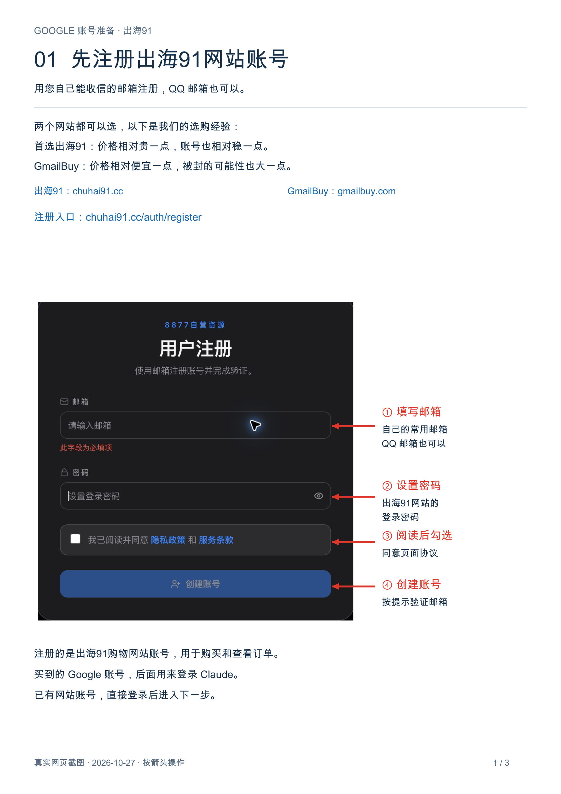
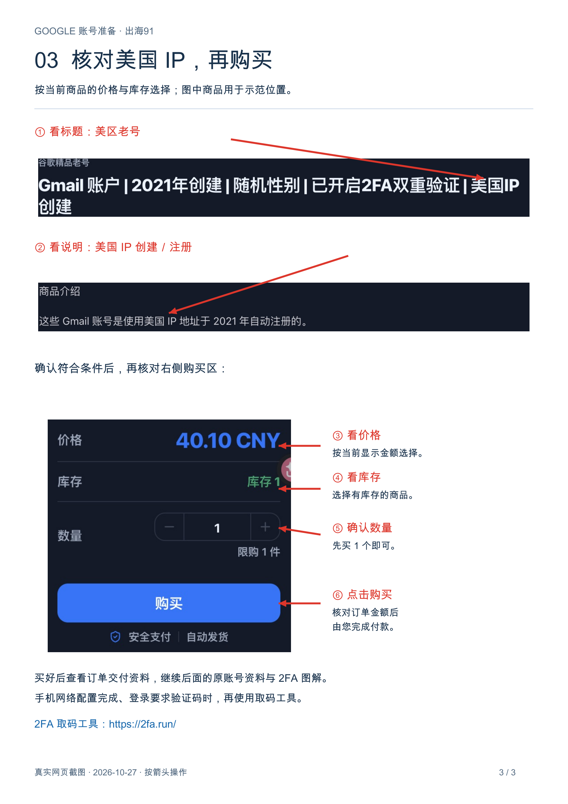
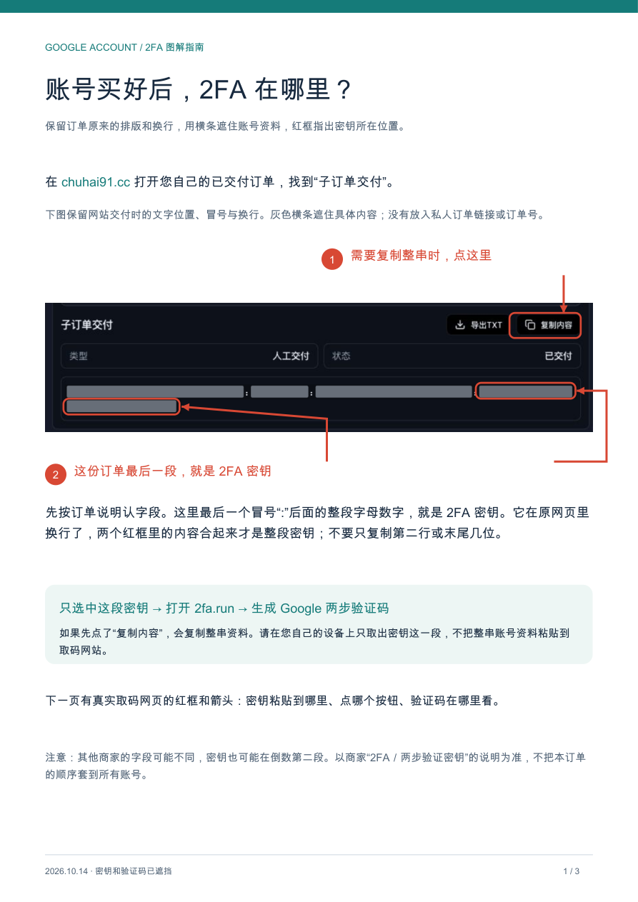
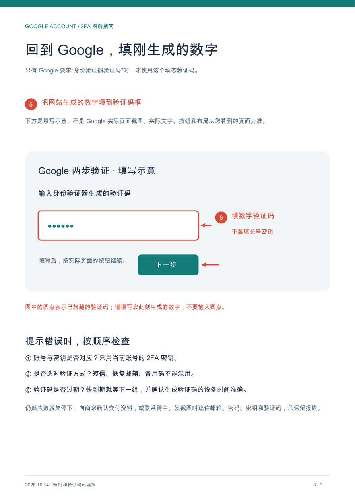

# Google 账号准备与两步验证

**本章默认配图带做。**收到购买资料时按「账号字段 → 2FA 取码 → Google 回填」展示下方三张原图并直接给出 https://2fa.run/。用户之后说不会或看不懂时，运行 `python3 scripts/workflow.py guide --topic google_materials` 或 `--topic google_2fa` 重新展示，不受之前解释标记影响。实际验证码类型以当前页面为准，讲解完成后接回原阶段。

## 开始时先确认账号

确认设备与当前进度后，单独问：“您有一个现在能正常登录的 Google／Gmail 账号吗？”能登录的自有 Gmail 可以复用，包括从未使用过 Claude 的 Gmail。实际登录 Claude 留到手机网络验收后。

如果客户只谈到 Claude 账号，沿用开场原句确认 Google 账号。如果客户已明确说某个 Google 账号关联的 Claude 账号被封禁，先确认有没有另一个可用的 Google 账号。

本流程默认采用“已有账号复用、没有账号购买”。客户明确没有可用的 Google 账号时，按客户原话提交 `google_account_status=unavailable`：程序会自动尝试在默认浏览器打开固定两段式离线图文页 `assets/google-account/guide.html`（上段为 GmailBuy 首推与出海91备选选购指引，下段为买完首登时机与三张 2FA 备用原图），并在返回结果中给出可点击本地路径；需要重新打开时可运行 `python3 scripts/workflow.py run --action open_google_guide`。已有可用账号记录 `account_origin=self_used`、`google_account_status=available`；购买账号收到资料时记录 `account_origin=purchased`、`google_account_status=available`，先完成下面的资料图解再继续。

没有可用账号时，先明确告诉客户：

> **默认推荐购买 GmailBuy 的全新美国谷歌账号，两个网站都可以选：**
>
> - 首选 [GmailBuy](https://gmailbuy.com/)：推荐 **[【新号】全新美国谷歌账号(首登不弹二维码验证，推荐，不支持GV)](https://gmailbuy.com/home/goods.html?id=18&sid=18)**。
> - 备选 [出海91](https://chuhai91.cc/)：也有谷歌精品老号等套餐可选。
>
> **选购提示：**谷歌账号网站的库存有时候会变动，谷歌账号的风控情况也会不确定，下单前以您现场打开页面的实际价格、库存和售后说明为准。下面是 GmailBuy 选购与查单示意图，本地离线图文页 `assets/google-account/guide.html` 也已备妥可随时点击打开。

首次提供购买渠道时，在同一条对话里同时展示两个可点击链接、选购提示与本地图文页路径，由用户选择。默认推荐 GmailBuy 新号（`id=18&sid=18`）；客户选择后记录 `purchase_channel=gmailbuy` 或 `chuhai91`，恢复时沿用该选择。用户选择出海91就按出海91三步图继续。已有可用 Google 账号继续复用。

**买完后的首登时机说明：**买完 Google 账号后先把资料保存好，将新号的“第一次登录”留给后面 VPS、电脑网络、AdsPower 和手机网络全部配置验收完成后的**手机 Claude App**——因为谷歌账号风控不确定，新号第一次登录往往最顺畅、最容易直接登进去。主流程顺序保持不变。

选购建议按作者交付经验表达，给出选择和下一步即可。商品页的“使用痕迹”等介绍用于理解商品属性，回答围绕当前推荐与实际页面选择和下一步操作展开。直接给出入口与本地图文页，以客户现场打开的实时商品页为准；需要用户提供信息时，只索取商品名称或当前商品页截图。付款由用户在商家页面完成。

Google 账号用于登录 Claude；美区 Apple 账户用于 App Store 下载、礼品卡充值和订阅付款。后续电脑上的 Claude 桌面端或 CLI 沿用手机登录的同一个 Google 账号。

## 出海91：照着这三步准备账号

图示采集于 2026-10-27，页面当前显示「8877自营资源」，网站入口为 `chuhai91.cc`。图片用于找入口和认商品，价格、库存和商品名称以您当时看到的页面为准。首次推荐出海91就在同条回复给齐下面三张原图和入口链接，并标明当前操作。客户索要购买步骤或没看到图时，用 `python3 scripts/workflow.py guide --topic chuhai_purchase` 重发整组三张图。已完成注册或登录就接着选购。

### 第一步：先注册出海91网站账号

1. 打开[出海91注册页](https://chuhai91.cc/auth/register)。也可以从首页的登录入口选择「还没有账号？立即注册」；窄窗口可从底部「我的」进入。
2. 填写**您自己能正常收信的邮箱，QQ 邮箱也可以**，并设置这个购物网站的登录密码。这里注册的是出海91网站账号，用于购买和查看订单；后面买到的 Google 账号用于登录 Claude。
3. 阅读页面协议后，由您勾选同意并点击「创建账号」，按网页提示完成邮箱验证，再登录网站。已经有出海91账号就直接登录。

### 第二步：找到「谷歌精品老号」

进入商品页面，在左侧展开 **「Google 谷歌账户」**，再点 **「谷歌精品老号」**。窄窗口先点「商品分类」打开分类列表。也可以直接打开[谷歌精品老号分类](https://chuhai91.cc/categories/premium-aged-google-accounts)。

### 第三步：优先选「美国 IP 创建／注册」的老号

先看商品标题，再点进去核对商品说明。**优先选择明确写着“美国 IP 创建”“美国 IP 注册”或同等说明的老号**；例如图中详情写明该账号使用美国 IP 地址创建。

同一分类里年份、价格、库存各不相同。按当前在售商品选择符合上述条件、价格合适且有库存的即可，年份与价格按实际商品比较。图中的年份、金额和库存是截图当时的示例，不作为固定购买要求。标注不清楚就先看详情；仍不明确时问商家或换一个标注清楚的商品。

确认商品、数量和实际付款金额后，由您完成购买。购买后在订单中查看商家交付的账号资料，接着按下面两节辨认字段；**手机网络验收完成后，再用买到的 Google 账号登录 Claude，出现两步验证时使用 2FA 教程。**账号资料准备好后，Codex 在当前 Google 阶段记录购买来源与准备结果，展示下面的资料图解，再按程序返回的下一步继续原流程。

## GmailBuy：从商品列表到查订单

首选或选择 [GmailBuy](https://gmailbuy.com/) 后，在首页找到「谷歌邮箱批发」商品列表，默认推荐 **[【新号】全新美国谷歌账号(首登不弹二维码验证，推荐，不支持GV)](https://gmailbuy.com/home/goods.html?id=18&sid=18)**（认准 `id=18&sid=18` 本页，区分相邻带 `2FA,` 字样的其他档位）。点对应行的「购买」进入详情，以现场页面的价格、库存和售后为准。详情页的「查询密码」用于查订单，由客户自行设置并保管。客户确认付款并保存订单资料后，把第一次登录留给后续网络配完后的手机 Claude App，并按下方图解辨认账号字段与 2FA 备用方法。页面按钮与字段以当前显示为准。

Codex 在默认推荐或客户选定 GmailBuy 时直接展示这张图、直达链接与本地图文页路径。客户找不到或看不到图时，用 `python3 scripts/workflow.py guide --topic gmailbuy` 重发，或运行 `python3 scripts/workflow.py run --action open_google_guide` 重新打开本地图文页。客户仅想对比另一家图解时可直接取图，继续沿用已选商家。

## 对话里直接给出 2FA 取码链接

客户说“买好了，账号资料也收到了”时，提交 `account_origin=purchased` 与 `google_account_status=available`，控制层会保留在 Google 阶段并返回首登时机说明、2FA 科普和 `customer_images`。将图片转为当前项目的绝对路径嵌入聊天，按下面原图解释资料，同时在回复中直接写出：**[2FA 取码工具：https://2fa.run/](https://2fa.run/)** 是我们教程推荐的验证器使用方式（2FA 验证码即每 30 秒刷新的 6 位动态数字密码，商家订单里的「2FA 密钥」是生成它的种子；手机本机身份验证器导入密钥后面有条件再配即可）。实际展示三张原图后由 Codex 提交 `materials_explained=true` 与 `materials_images_shown`（三张已展示图片的项目相对路径），随后按现有流程继续进入 VPS，无需用户额外确认。先前没有账号、后来找回自己的可用账号时，明确记录 `account_origin=self_used`，直接复用。

登录中出现身份验证器验证码时，再次直接展示这个可点击链接，并展示原取码、回填图解。链接、当前操作和对应图片一起给到；PDF 是配套阅读材料，对话本身要能让用户点开并照着做。

## 商家发来的一串文字怎么看

下面保留原来的订单图解，包括灰条脱敏、密钥位置红框和复制操作箭头：

商家通常把邮箱、密码、恢复邮箱和 2FA 信息放在一串文字里，用冒号或其他符号分隔。不同商品的顺序和字段数量可能不同，下面只说明用途，不规定排列位置：

| 字段 | 是什么 | 用在哪里 |
| --- | --- | --- |
| Google 邮箱 | 准备登录的账号 | Google 登录页的账号栏 |
| Google 登录密码 | 该账号的密码 | Google 登录页的密码栏 |
| 恢复邮箱／密保邮箱 | 账号恢复与核验用的邮箱，可能有多项相关信息 | Google 确实要求恢复邮箱核验时使用 |
| 2FA 密钥 | 一长串字母数字，可能带分组空格 | 生成两步验证的动态验证码 |
| 其他附加信息 | 订单提供的其他字段 | 按商家标注的用途使用 |

**不要写死“第四段”或“最后一段”。**2FA 密钥可能在最后，也可能在倒数第二段；有的交付信息多、有的少。先找商家标注为“2FA／两步验证密钥／身份验证器密钥”的那串字符，再用于生成验证码。长字符串的外观只能帮助定位，不能单凭长度认定用途。

出现多串候选内容时，先核对订单的字段说明；仍分不清，就请用户查看商家说明或联系商家确认，不让 AI 按位置猜，也不把每一串都拿去网站试。备用验证码、应用专用密码和 2FA 密钥用途不同。用户不需要把完整账号串、密码、密钥或验证码发给 AI，只需确认对应字段是否找到。

## Google 要求两步验证时怎么操作

按原图里的红框和箭头操作：

手机网络通过检查后，在官方 Claude App 点击页面上的 Google 登录入口，由用户输入自己的 Google 账号和密码。首次登录需要按实际页面完成必要设置；已经登录过的账号直接继续，不另开电脑网页注册流程。

Google 要求身份验证器验证码时：

1. 在电脑已经配置好的 AdsPower 环境打开 [2FA 工具](https://2fa.run/)。
2. 找到上方标有 **JS实现** 的输入区域，由用户本人粘贴订单中明确标注的 **2FA 密钥**；不要粘贴整串账号信息。密钥有分组空格时去掉空格，保留字母数字内容，不把字母 O 和数字 0 相互替换。页面若已有内容，先核对并替换成当前账号对应的密钥。
3. 点击该区域的 **“点击获取验证码”**，读取 **“当前验证码”**。
4. 回到手机 Google 两步验证页面，在倒计时结束前输入当前验证码。快到期就等下一组，不反复提交过期码。
5. 如果页面要求的是短信、恢复邮箱验证或备用码，按实际验证方式处理；有“尝试其他方式”时查看是否提供身份验证器选项，不能把动态验证码填到其他类型的输入框。

密钥是长期凭据，网页生成的数字才是本次验证码。该网站是第三方工具；输入密钥会让该页面接触它，用户本人选择并操作，也可用自己的身份验证器生成。AI 可以导航和解释，不代填密钥，不把密钥拼进网址、进度或截图。验证失败时检查字段、时间和验证方式，无法确认交付内容就联系商家，不连续猜码。

完成后只记录“Google 账号已准备／待处理、两步验证已完成／待完成”，不保存账号串或验证码。
