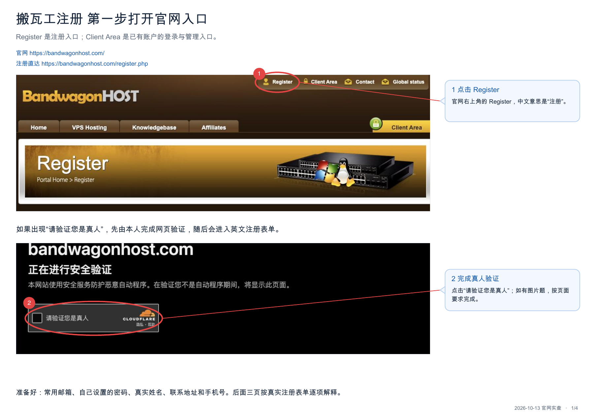
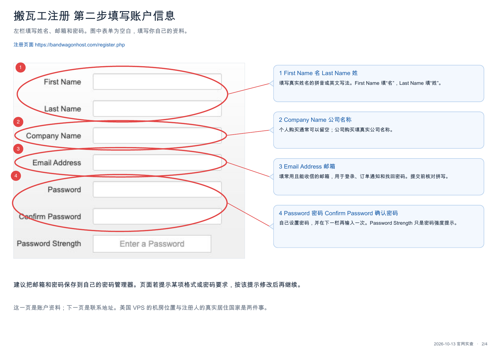
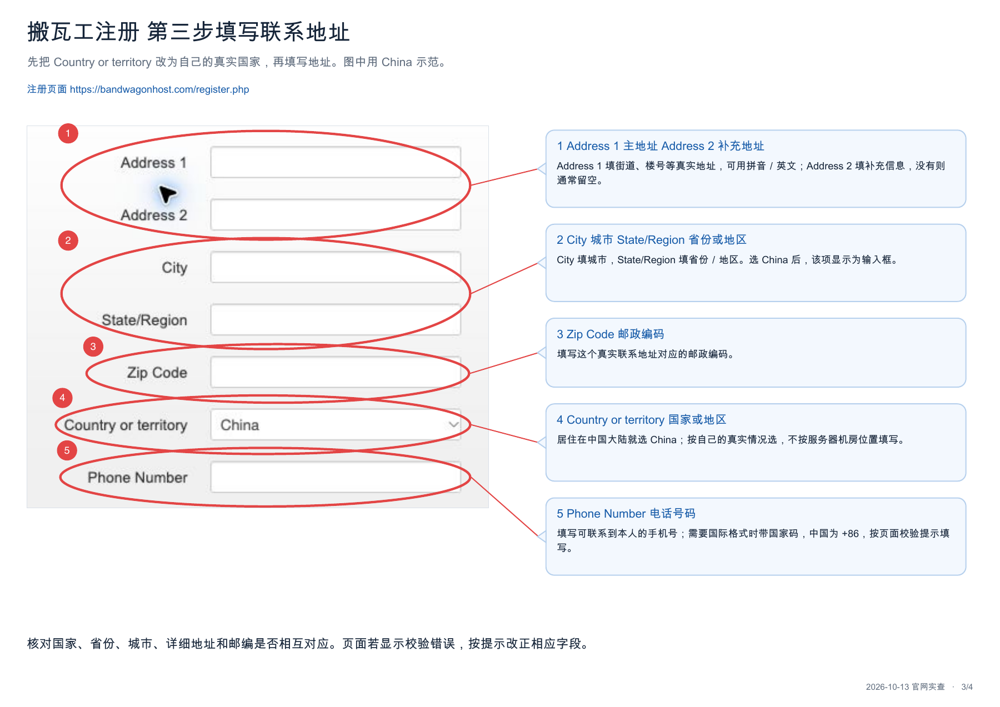
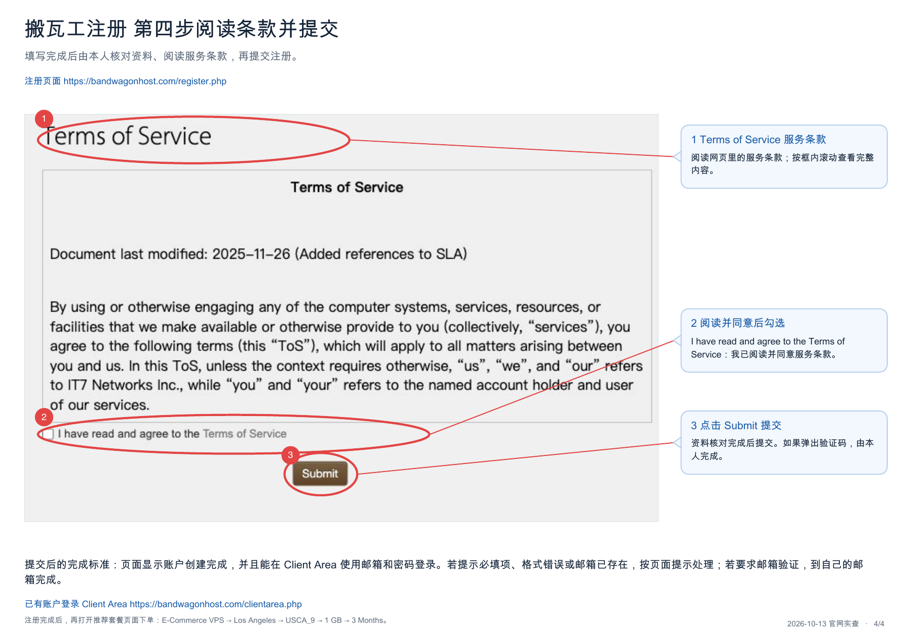
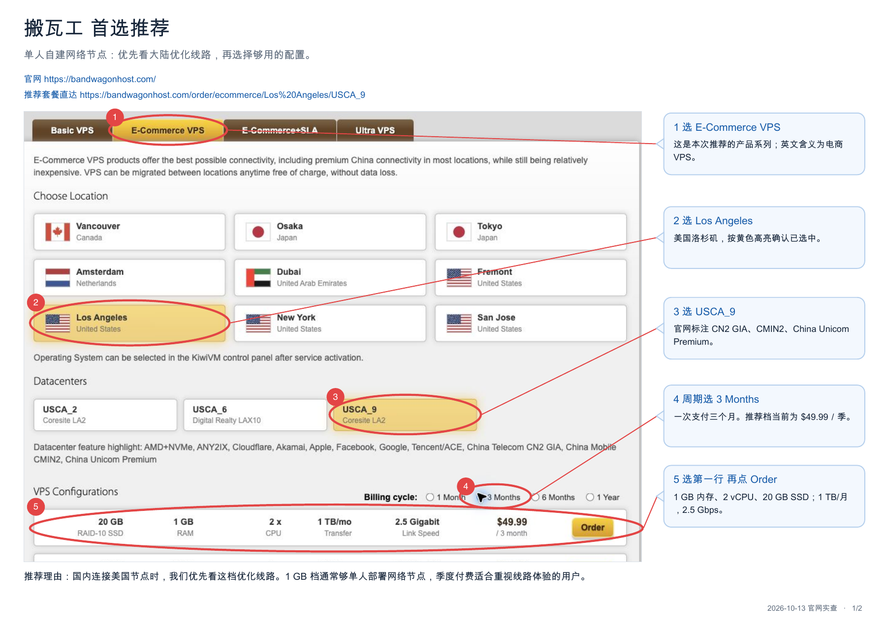

# VPS 注册与购买图解

当前推荐与库存核对规则见[库存核对与缺货分流](18-vps-stock.md)。客户确定购买搬瓦工时，一次向客户展示下方全部五张原图（四张注册图＋一张套餐图）以及两份 PDF：[搬瓦工注册中文图解 PDF](../assets/vps-purchase/bandwagon-registration.pdf) 和 [VPS 购买推荐官网图解 PDF](../assets/vps-purchase/vps-purchase-guide.pdf)，说明“这部分需要您本人填写资料、验证和付款，先把整套中文图解发给您对照操作”，并指出当前起点。账户资料、验证与付款由用户本人完成，期间保持当前可用 VPN 正常在线。

## 搬瓦工购买步骤

### 1. 打开注册入口
打开[搬瓦工官网](https://bandwagonhost.com/)点 Register，或直达[注册页面](https://bandwagonhost.com/register.php)（已有账户直接从 Client Area 登录）。遇到真人验证由用户完成。

### 2. 填写账户信息
First Name 填名，Last Name 填姓，Email Address 填常用邮箱，Password 与 Confirm Password 填自设密码；Company Name 个人购买留空。

### 3. 填写联系地址
Country or territory 选实际居住国家，按实填写地址、城市、省份、邮编与联系电话。

### 4. 阅读条款并提交
核对资料、勾选同意条款后点 Submit，按提示完成邮箱或真人验证，确认能登录 Client Area。

### 5. 选择套餐并付款
打开[搬瓦工 USCA_9 套餐页面](https://bandwagonhost.com/order/ecommerce/Los%20Angeles/USCA_9)，按当前控制层推荐的规格与周期（或客户已确认的套餐）核对配置、库存、本次金额与续费金额后付款（图解价格为历史示例，实际以页面为准）。

## 买好后接回部署

确认账户登录、付款完成、服务器状态变为开通，并在 KiwiVM 控制台确认系统和 SSH 入口后，继续进入部署节点与导出步骤（进度写入 `.local/progress.md`，密码和支付资料留在本机）。
