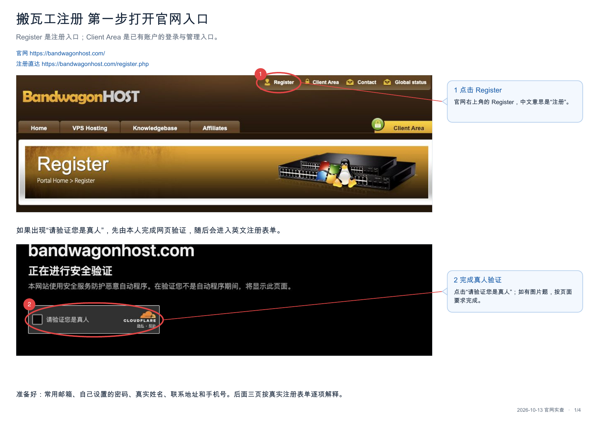
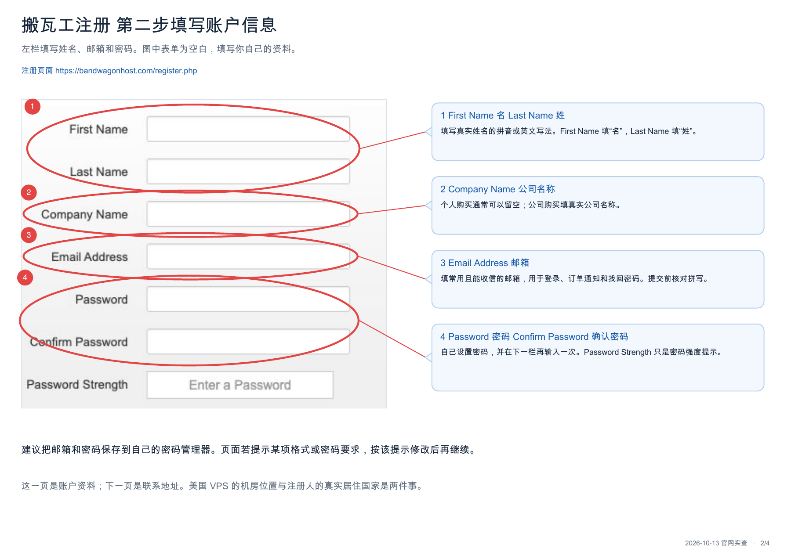
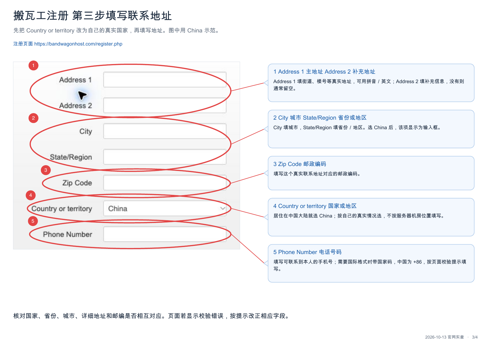
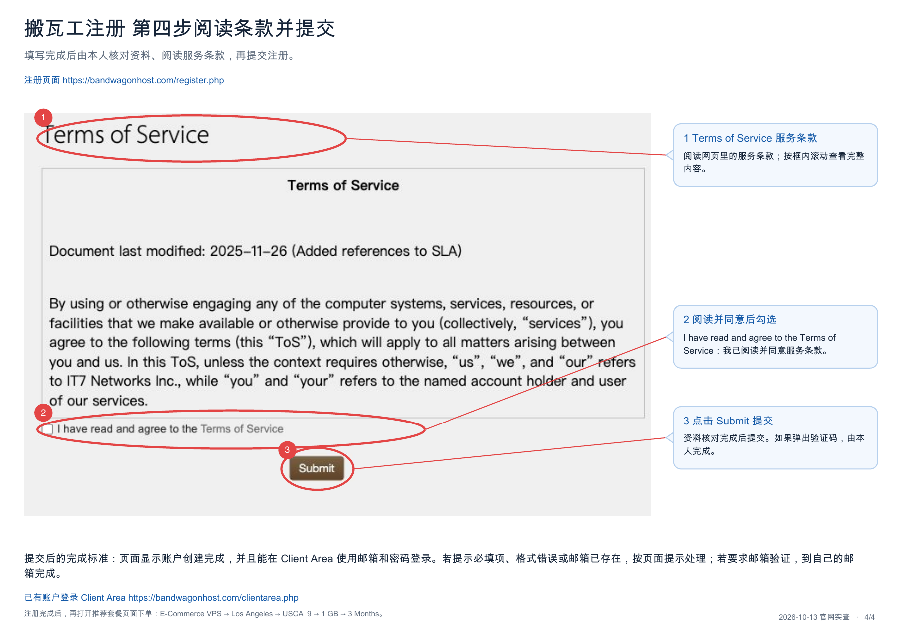
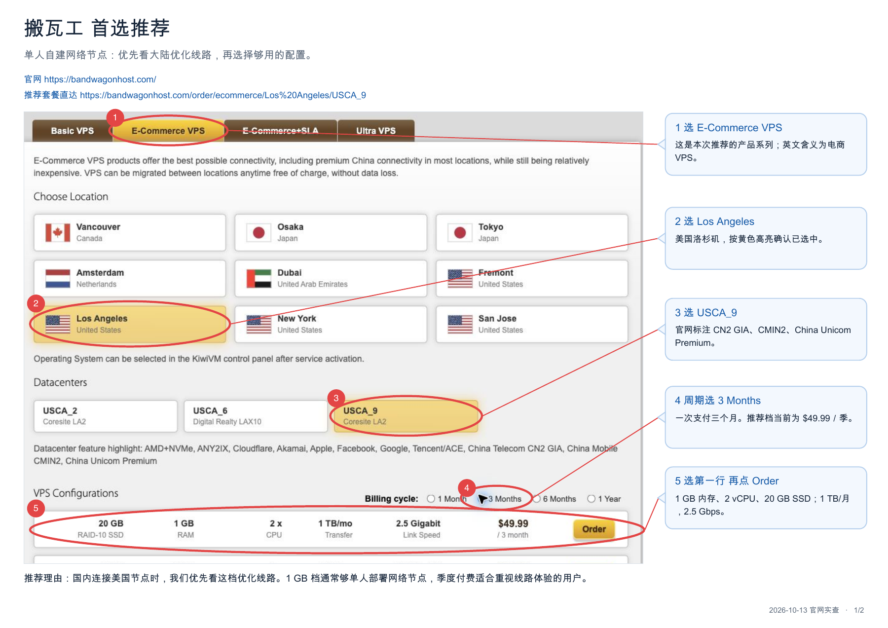
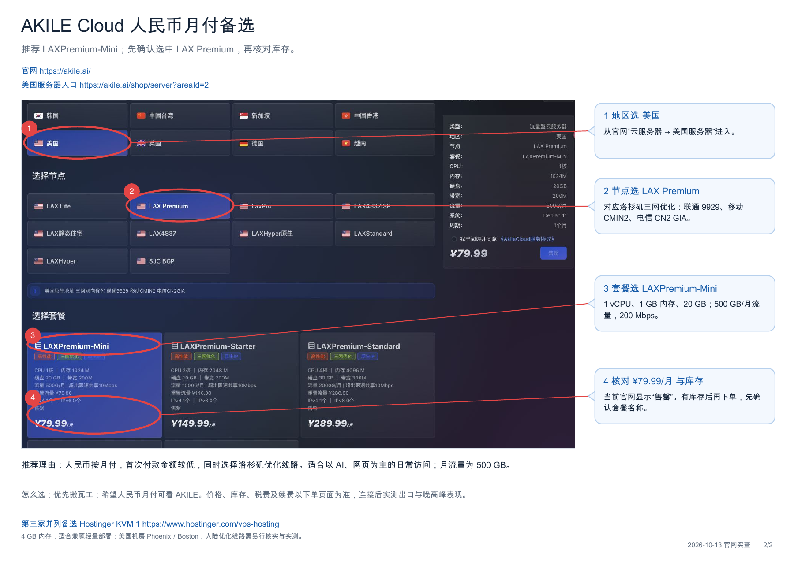

# VPS 注册与购买图解

当前库存与选型先按 [库存核对与缺货分流](18-vps-stock.md)。DMIT 从 `https://www.dmit.io/cart.php` 核对 AS3 Premium TINY（10.90 美元/月参考价），缺货首推已验证有货的搬瓦工。其他 DMIT 套餐需独立核实并说明没有交付实践，由用户选择；原图和后续购买教学保留。

## 给 AI：什么时候展示

用户选定搬瓦工或 AKILE，准备注册或购买时，主动读取本章并展示该商家当前步骤的图片，不等用户索要。先简短说明：“这部分需要您本人填写资料、完成验证和付款，我会按步骤给您图解。”已有账户跳过注册，已有服务器跳过购买；不要让用户重复下单。

按 SKILL.md 的图文带做规则，把下文相对图片路径解析为用户本机的实际绝对路径，在聊天里直接展示当前步骤的一张图，配两三句操作说明。不要一次塞完所有图片，不只在后台看图，也不要只丢 PDF 让用户自己找。进入对应商家时同时提供相关 PDF 的本地文件链接，方便用户保存；环境不能显示图片时提供可打开的图片／PDF 链接并说明情况，不声称已经展示。

这些图片和 PDF 保留 2026-10-13 的官网页面。图中的价格、库存（包括 AKILE 的“售罄”）、系统选项只代表截图当时；付款前以当前官网和用户选定的套餐为准。沿用网络章节的网络用途套餐选择，不让截图覆盖用户已确认的套餐。这里只处理注册与购买，不切换、关闭用户当前用来联网的 VPN。

账户资料、密码、验证码和付款由用户本人在官网完成；AI 解释字段、确认当前步骤和下单内容，不要求用户把凭据或支付资料发到聊天。页面变化时按实际页面带做，不能照旧截图盲点。

## 搬瓦工

首次进入本流程时给用户：[搬瓦工注册中文图解 PDF](../assets/vps-purchase/bandwagon-registration.pdf) 和 [VPS 购买推荐官网图解 PDF](../assets/vps-purchase/vps-purchase-guide.pdf)。

### 1. 打开注册入口

打开[搬瓦工官网](https://bandwagonhost.com/)，点击 Register；也可直接进入[注册页面](https://bandwagonhost.com/register.php)。已有账户从 Client Area 登录。遇到真人验证由用户完成后继续。

### 2. 填写账户信息

First Name 是名，Last Name 是姓；Email Address 填能收信的常用邮箱。Password 和 Confirm Password 填同一个自设密码。个人购买的 Company Name 通常可留空，以页面要求为准。

### 3. 填写联系地址

Country or territory 选实际居住国家，再填写真实地址、城市、省份、邮编和可联系到本人的电话。机房在美国不代表注册资料要填美国。

### 4. 阅读条款并提交

用户核对资料、阅读条款，同意后勾选并点击 Submit。若要求邮箱或真人验证，由用户完成。确认账户创建成功、能登录 Client Area，再进入下单；用户仅说“填好了”不能直接当成注册成功。

### 5. 选择套餐并付款

展示下图，打开[推荐套餐页面](https://bandwagonhost.com/order/ecommerce/Los%20Angeles/USCA_9)。文档推荐路线是 E-Commerce VPS → Los Angeles → USCA_9 → 1 GB → 3 Months。截图价格为 49.99 美元／季；按当前页面核对配置、库存、付款周期、总额与续费，再由用户付款。用户已选其他套餐时，以本次确认的套餐为准。

## AKILE Cloud

进入 AKILE 购买步骤时，展示下图并提供 [VPS 购买推荐官网图解 PDF](../assets/vps-purchase/vps-purchase-guide.pdf)。现有素材是套餐选购图，不是完整注册表单教程。

1. 打开 [AKILE 官网](https://akile.ai/)。需要账户时，按当前官网注册入口指导用户本人注册、验证并登录；根据实际页面解释字段，不套用搬瓦工表单或编造按钮。
2. 按图进入云服务器 → 美国 → LAX Premium → LAXPremium-Mini。默认网络用途对应截图的 1 GB、500 GB／月流量、200 Mbps；用户选定其他配置时按已确认方案核对。
3. 截图价格为 79.99 元／月，图上“售罄”是截图当时状态。查当前库存与费用；确实缺货时回网络章节的备选流程，不自动改买另一条线路。
4. 核对套餐、系统、周期、付款总额和续费后，由用户本人阅读条款、完成下单付款。

## 买好以后接回部署

分别确认账户可登录、订单付款完成、服务器已开通，以及能在控制台找到服务器信息和 SSH 登录方式。支付成功但尚未开通时先等开通，不直接开始部署。

把商家、套餐、已展示图解、注册／付款／开通状态和下一步写入 `.local/progress.md`，不记录账号、密码、完整 IP 或付款凭据。确认服务器可用后，回到 AI 带做指南 3.2“登录服务器，部署并导出节点”。DMIT 按网络章节原有图解带做。默认按 DMIT → 搬瓦工 → AKILE 顺序查看库存，付款周期分别为月付、季付、月付。
